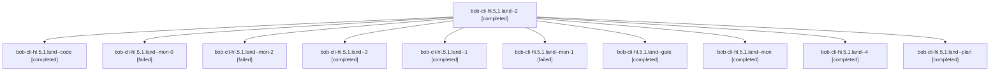

# Session: bob-cli-hl.5.1.land

[Agent Hoods](../README.md) / [bbugyi200](../users/bbugyi200/README.md) / [athena](../users/bbugyi200/machines/athena/README.md) / [bob-cli-hl](../users/bbugyi200/machines/athena/hoods/bob-cli-hl/README.md) / bob-cli-hl.5.1.land

Owner: `bbugyi200.athena` · Hood: `bob-cli-hl` · Members: 11 · Bead: [bob-cli-hl.5.1](https://github.com/bobs-org/bob-cli--beads/blob/main/pages/bob-cli-hl/bob-cli-hl.5.1.md)

## Lineage

The diagram is an optional enhancement; the ordered table below contains the same lineage in accessible text.

| Role | Agent | State | Model / provider | Timing | Commits | Prompt | Chat |
|---|---|---|---|---|---:|---|---|
| 2 | bob-cli-hl.5.1.land--2 | completed | gpt-6-luna / codex | 2026-11-06T13:42:19.938257+00:00 → 2026-11-06T13:48:48.256059+00:00 | 0 | [Prompt](../agents/bbugyi200.athena.bob-cli-hl.5.1.land--2/prompt.md) | [Chat](../agents/bbugyi200.athena.bob-cli-hl.5.1.land--2/chat.md) |
| code | bob-cli-hl.5.1.land--code | completed | gpt-6-luna / codex | 2026-11-06T12:51:05.115638+00:00 → 2026-11-06T13:24:50.504259+00:00 | 0 | — | [Chat](../agents/bbugyi200.athena.bob-cli-hl.5.1.land--code/chat.md) |
| mon-0 | bob-cli-hl.5.1.land--mon-0 | failed | gpt-6-luna / codex | 2026-11-06T13:34:06.032941+00:00 → 2026-11-06T13:40:41.618295+00:00 | 0 | — | [Chat](../agents/bbugyi200.athena.bob-cli-hl.5.1.land--mon-0/chat.md) |
| mon-2 | bob-cli-hl.5.1.land--mon-2 | failed | gpt-6-luna / codex | 2026-11-06T14:01:05.642943+00:00 → 2026-11-06T14:21:59.164881+00:00 | 0 | — | [Chat](../agents/bbugyi200.athena.bob-cli-hl.5.1.land--mon-2/chat.md) |
| 3 | bob-cli-hl.5.1.land--3 | completed | gpt-6-luna / codex | 2026-11-06T13:56:59.104964+00:00 → 2026-11-06T14:02:06.001902+00:00 | 0 | [Prompt](../agents/bbugyi200.athena.bob-cli-hl.5.1.land--3/prompt.md) | [Chat](../agents/bbugyi200.athena.bob-cli-hl.5.1.land--3/chat.md) |
| 1 | bob-cli-hl.5.1.land--1 | completed | gpt-6-luna / codex | 2026-11-06T13:30:56.898387+00:00 → 2026-11-06T13:34:48.691154+00:00 | 0 | [Prompt](../agents/bbugyi200.athena.bob-cli-hl.5.1.land--1/prompt.md) | [Chat](../agents/bbugyi200.athena.bob-cli-hl.5.1.land--1/chat.md) |
| mon-1 | bob-cli-hl.5.1.land--mon-1 | failed | gpt-6-luna / codex | 2026-11-06T13:48:08.823963+00:00 → 2026-11-06T13:56:29.392042+00:00 | 0 | — | [Chat](../agents/bbugyi200.athena.bob-cli-hl.5.1.land--mon-1/chat.md) |
| gate | bob-cli-hl.5.1.land--gate | completed | opus / claude | 2026-11-06T12:49:38.934241+00:00 → 2026-11-06T12:50:48.934277+00:00 | 0 | — | [Chat](../agents/bbugyi200.athena.bob-cli-hl.5.1.land--gate/chat.md) |
| mon | bob-cli-hl.5.1.land--mon | completed | gpt-6-luna / codex | 2026-11-06T13:24:10.926070+00:00 → 2026-11-06T13:29:34.364481+00:00 | 0 | — | [Chat](../agents/bbugyi200.athena.bob-cli-hl.5.1.land--mon/chat.md) |
| 4 | bob-cli-hl.5.1.land--4 | completed | gpt-6-luna / codex | 2026-11-06T14:24:07.874373+00:00 → 2026-11-06T14:32:57.589272+00:00 | 0 | [Prompt](../agents/bbugyi200.athena.bob-cli-hl.5.1.land--4/prompt.md) | [Chat](../agents/bbugyi200.athena.bob-cli-hl.5.1.land--4/chat.md) |
| plan | bob-cli-hl.5.1.land--plan | completed | opus / claude | 2026-11-06T12:27:01.934693+00:00 → 2026-11-06T13:24:50.504259+00:00 | 0 | [Prompt](../agents/bbugyi200.athena.bob-cli-hl.5.1.land--plan/prompt.md) | [Chat](../agents/bbugyi200.athena.bob-cli-hl.5.1.land--plan/chat.md) |

## Neighbors

| Agent | Relation | State |
|---|---|---|
| [bob-cli-hl.5](bbugyi200.athena.bob-cli-hl.5.md) (session · 3) | ancestor | active 1, completed 2 |
| [bob-cli-hl.5.1.1](../agents/bbugyi200.athena.bob-cli-hl.5.1.1/README.md) | bob-cli-hl.5.1 hood | completed |
| [bob-cli-hl.5.1.2](bbugyi200.athena.bob-cli-hl.5.1.2.md) (session · 3) | bob-cli-hl.5.1 hood | completed 2, failed 1 |
| [bob-cli-hl.5.1.3](../agents/bbugyi200.athena.bob-cli-hl.5.1.3/README.md) | bob-cli-hl.5.1 hood | completed |
| [bob-cli-hl.5.1.4](bbugyi200.athena.bob-cli-hl.5.1.4.md) (session · 9) | bob-cli-hl.5.1 hood | completed 5, failed 4 |
| [bob-cli-hl.5.1.5](bbugyi200.athena.bob-cli-hl.5.1.5.md) (session · 5) | bob-cli-hl.5.1 hood | completed 3, failed 2 |
| [bob-cli-hl.5.1.5](../agents/bbugyi200.athena.bob-cli-hl.5.1.5/README.md) | bob-cli-hl.5.1 hood | waiting |
| [bob-cli-hl.1](../agents/bbugyi200.athena.bob-cli-hl.1/README.md) | bob-cli-hl hood | completed |
| [bob-cli-hl.2](bbugyi200.athena.bob-cli-hl.2.md) (session · 3) | bob-cli-hl hood | completed 3 |
| [bob-cli-hl.3](bbugyi200.athena.bob-cli-hl.3.md) (session · 3) | bob-cli-hl hood | active 1, completed 2 |
| [bob-cli-hl.3.1.1](bbugyi200.athena.bob-cli-hl.3.1.1.md) (session · 5) | bob-cli-hl hood | completed 3, failed 2 |
| [bob-cli-hl.3.1.2](../agents/bbugyi200.athena.bob-cli-hl.3.1.2/README.md) | bob-cli-hl hood | completed |
| [bob-cli-hl.3.1.3](bbugyi200.athena.bob-cli-hl.3.1.3.md) (session · 13) | bob-cli-hl hood | completed 9, failed 4 |
| [bob-cli-hl.3.1.4](../agents/bbugyi200.athena.bob-cli-hl.3.1.4/README.md) | bob-cli-hl hood | completed |
| [bob-cli-hl.3.1.5](bbugyi200.athena.bob-cli-hl.3.1.5.md) (session · 5) | bob-cli-hl hood | completed 3, failed 2 |
| [bob-cli-hl.3.1.land](../agents/bbugyi200.athena.bob-cli-hl.3.1.land/README.md) | bob-cli-hl hood | completed |
| [bob-cli-hl.4](../agents/bbugyi200.athena.bob-cli-hl.4/README.md) | bob-cli-hl hood | completed |
| [bob-cli-hl.6](../agents/bbugyi200.athena.bob-cli-hl.6/README.md) | bob-cli-hl hood | completed |
| [bob-cli-hl.land](../agents/bbugyi200.athena.bob-cli-hl.land/README.md) | bob-cli-hl hood | waiting |
