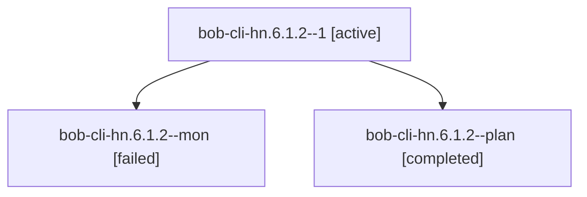

# Session: bob-cli-hn.6.1.2

[Agent Hoods](../README.md) / [bbugyi200](../users/bbugyi200/README.md) / [athena](../users/bbugyi200/machines/athena/README.md) / [bob-cli-hn](../users/bbugyi200/machines/athena/hoods/bob-cli-hn/README.md) / bob-cli-hn.6.1.2

Owner: `bbugyi200.athena` · Hood: `bob-cli-hn` · Members: 3 · Bead: [bob-cli-hn.6.1.2](https://github.com/bobs-org/bob-cli--beads/blob/main/pages/bob-cli-hn/bob-cli-hn.6.1.2.md)

## Lineage

The diagram is an optional enhancement; the ordered table below contains the same lineage in accessible text.

| Role | Agent | State | Model / provider | Timing | Commits | Prompt | Chat |
|---|---|---|---|---|---:|---|---|
| 1 | bob-cli-hn.6.1.2--1 | active | gpt-6-luna / codex | 2026-11-06T02:53:43.643063+00:00 | 0 | [Prompt](../agents/bbugyi200.athena.bob-cli-hn.6.1.2--1/prompt.md) | — |
| mon | bob-cli-hn.6.1.2--mon | failed | gpt-6-luna / codex | 2026-11-06T02:48:17.396696+00:00 → 2026-11-06T02:53:08.112556+00:00 | 0 | — | [Chat](../agents/bbugyi200.athena.bob-cli-hn.6.1.2--mon/chat.md) |
| plan | bob-cli-hn.6.1.2--plan | completed | gpt-6-luna / codex | 2026-11-06T02:25:58.844571+00:00 → 2026-11-06T02:49:09.233630+00:00 | 0 | [Prompt](../agents/bbugyi200.athena.bob-cli-hn.6.1.2--plan/prompt.md) | [Chat](../agents/bbugyi200.athena.bob-cli-hn.6.1.2--plan/chat.md) |

## Neighbors

| Agent | Relation | State |
|---|---|---|
| [bob-cli-hn.6](bbugyi200.athena.bob-cli-hn.6.md) (session · 3) | ancestor | active 1, completed 2 |
| [bob-cli-hn.6.1.1](../agents/bbugyi200.athena.bob-cli-hn.6.1.1/README.md) | bob-cli-hn.6.1 hood | completed |
| [bob-cli-hn.6.1.3](../agents/bbugyi200.athena.bob-cli-hn.6.1.3/README.md) | bob-cli-hn.6.1 hood | waiting |
| [bob-cli-hn.6.1.4](../agents/bbugyi200.athena.bob-cli-hn.6.1.4/README.md) | bob-cli-hn.6.1 hood | waiting |
| [bob-cli-hn.6.1.land](../agents/bbugyi200.athena.bob-cli-hn.6.1.land/README.md) | bob-cli-hn.6.1 hood | waiting |
| [bob-cli-hn.1](../agents/bbugyi200.athena.bob-cli-hn.1/README.md) | bob-cli-hn hood | completed |
| [bob-cli-hn.2](../agents/bbugyi200.athena.bob-cli-hn.2/README.md) | bob-cli-hn hood | completed |
| [bob-cli-hn.3](../agents/bbugyi200.athena.bob-cli-hn.3/README.md) | bob-cli-hn hood | completed |
| [bob-cli-hn.4](../agents/bbugyi200.athena.bob-cli-hn.4/README.md) | bob-cli-hn hood | completed |
| [bob-cli-hn.5](../agents/bbugyi200.athena.bob-cli-hn.5/README.md) | bob-cli-hn hood | completed |
| [bob-cli-hn.7](../agents/bbugyi200.athena.bob-cli-hn.7/README.md) | bob-cli-hn hood | waiting |
| [bob-cli-hn.8](../agents/bbugyi200.athena.bob-cli-hn.8/README.md) | bob-cli-hn hood | waiting |
| [bob-cli-hn.9](../agents/bbugyi200.athena.bob-cli-hn.9/README.md) | bob-cli-hn hood | waiting |
| [bob-cli-hn.land](../agents/bbugyi200.athena.bob-cli-hn.land/README.md) | bob-cli-hn hood | waiting |
