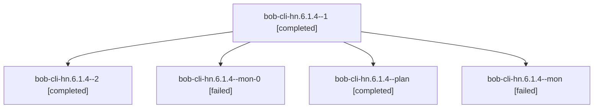

# Session: bob-cli-hn.6.1.4

[Agent Hoods](../README.md) / [bbugyi200](../users/bbugyi200/README.md) / [athena](../users/bbugyi200/machines/athena/README.md) / [bob-cli-hn](../users/bbugyi200/machines/athena/hoods/bob-cli-hn/README.md) / bob-cli-hn.6.1.4

Owner: `bbugyi200.athena` · Hood: `bob-cli-hn` · Members: 5 · Bead: [bob-cli-hn.6.1.4](https://github.com/bobs-org/bob-cli--beads/blob/main/pages/bob-cli-hn/bob-cli-hn.6.1.4.md)

## Lineage

The diagram is an optional enhancement; the ordered table below contains the same lineage in accessible text.

| Role | Agent | State | Model / provider | Timing | Commits | Prompt | Chat |
|---|---|---|---|---|---:|---|---|
| 1 | bob-cli-hn.6.1.4--1 | completed | gpt-6-luna / codex | 2026-11-06T04:52:15.005500+00:00 → 2026-11-06T05:02:53.450126+00:00 | 0 | [Prompt](../agents/bbugyi200.athena.bob-cli-hn.6.1.4--1/prompt.md) | [Chat](../agents/bbugyi200.athena.bob-cli-hn.6.1.4--1/chat.md) |
| 2 | bob-cli-hn.6.1.4--2 | completed | gpt-6-luna / codex | 2026-11-06T05:09:28.647554+00:00 → 2026-11-06T05:31:49.032491+00:00 | 0 | [Prompt](../agents/bbugyi200.athena.bob-cli-hn.6.1.4--2/prompt.md) | [Chat](../agents/bbugyi200.athena.bob-cli-hn.6.1.4--2/chat.md) |
| mon-0 | bob-cli-hn.6.1.4--mon-0 | failed | gpt-6-luna / codex | 2026-11-06T05:02:09.616233+00:00 → 2026-11-06T05:08:15.503695+00:00 | 0 | — | [Chat](../agents/bbugyi200.athena.bob-cli-hn.6.1.4--mon-0/chat.md) |
| plan | bob-cli-hn.6.1.4--plan | completed | gpt-6-luna / codex | 2026-11-06T03:50:51.156491+00:00 → 2026-11-06T04:48:55.445833+00:00 | 0 | [Prompt](../agents/bbugyi200.athena.bob-cli-hn.6.1.4--plan/prompt.md) | [Chat](../agents/bbugyi200.athena.bob-cli-hn.6.1.4--plan/chat.md) |
| mon | bob-cli-hn.6.1.4--mon | failed | gpt-6-luna / codex | 2026-11-06T04:48:12.694273+00:00 → 2026-11-06T04:50:45.724380+00:00 | 0 | — | [Chat](../agents/bbugyi200.athena.bob-cli-hn.6.1.4--mon/chat.md) |

## Neighbors

| Agent | Relation | State |
|---|---|---|
| [bob-cli-hn.6](bbugyi200.athena.bob-cli-hn.6.md) (session · 3) | ancestor | completed 2, dismissed 1 |
| [bob-cli-hn.6.1.1](../agents/bbugyi200.athena.bob-cli-hn.6.1.1/README.md) | bob-cli-hn.6.1 hood | completed |
| [bob-cli-hn.6.1.2](bbugyi200.athena.bob-cli-hn.6.1.2.md) (session · 7) | bob-cli-hn.6.1 hood | completed 4, failed 3 |
| [bob-cli-hn.6.1.3](../agents/bbugyi200.athena.bob-cli-hn.6.1.3/README.md) | bob-cli-hn.6.1 hood | completed |
| [bob-cli-hn.6.1.land](bbugyi200.athena.bob-cli-hn.6.1.land.md) (session · 5) | bob-cli-hn.6.1 hood | completed 4, failed 1 |
| [bob-cli-hn.1](../agents/bbugyi200.athena.bob-cli-hn.1/README.md) | bob-cli-hn hood | completed |
| [bob-cli-hn.2](../agents/bbugyi200.athena.bob-cli-hn.2/README.md) | bob-cli-hn hood | completed |
| [bob-cli-hn.3](../agents/bbugyi200.athena.bob-cli-hn.3/README.md) | bob-cli-hn hood | completed |
| [bob-cli-hn.4](../agents/bbugyi200.athena.bob-cli-hn.4/README.md) | bob-cli-hn hood | completed |
| [bob-cli-hn.5](../agents/bbugyi200.athena.bob-cli-hn.5/README.md) | bob-cli-hn hood | completed |
| [bob-cli-hn.7](../agents/bbugyi200.athena.bob-cli-hn.7/README.md) | bob-cli-hn hood | completed |
| [bob-cli-hn.8](../agents/bbugyi200.athena.bob-cli-hn.8/README.md) | bob-cli-hn hood | completed |
| [bob-cli-hn.9](bbugyi200.athena.bob-cli-hn.9.md) (session · 7) | bob-cli-hn hood | completed 5, failed 2 |
| [bob-cli-hn.land](bbugyi200.athena.bob-cli-hn.land.md) (session · 11) | bob-cli-hn hood | completed 7, failed 4 |
