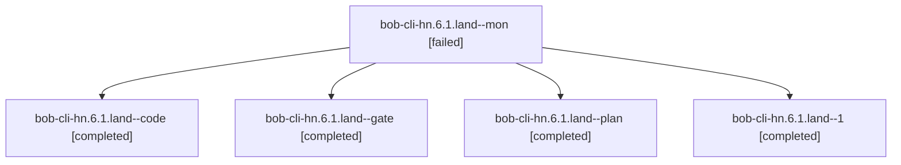

# Session: bob-cli-hn.6.1.land

[Agent Hoods](../README.md) / [bbugyi200](../users/bbugyi200/README.md) / [athena](../users/bbugyi200/machines/athena/README.md) / [bob-cli-hn](../users/bbugyi200/machines/athena/hoods/bob-cli-hn/README.md) / bob-cli-hn.6.1.land

Owner: `bbugyi200.athena` · Hood: `bob-cli-hn` · Members: 5 · Bead: [bob-cli-hn.6.1](https://github.com/bobs-org/bob-cli--beads/blob/main/pages/bob-cli-hn/bob-cli-hn.6.1.md)

## Lineage

The diagram is an optional enhancement; the ordered table below contains the same lineage in accessible text.

| Role | Agent | State | Model / provider | Timing | Commits | Prompt | Chat |
|---|---|---|---|---|---:|---|---|
| mon | bob-cli-hn.6.1.land--mon | failed | gpt-6-luna / codex | 2026-11-06T06:30:54.780038+00:00 → 2026-11-06T06:36:37.294486+00:00 | 0 | — | [Chat](../agents/bbugyi200.athena.bob-cli-hn.6.1.land--mon/chat.md) |
| code | bob-cli-hn.6.1.land--code | completed | gpt-6-luna / codex | 2026-11-06T05:50:29.295418+00:00 → 2026-11-06T06:31:37.056080+00:00 | 0 | — | [Chat](../agents/bbugyi200.athena.bob-cli-hn.6.1.land--code/chat.md) |
| gate | bob-cli-hn.6.1.land--gate | completed | gpt-6-astra / codex | 2026-11-06T05:49:02.749384+00:00 → 2026-11-06T05:49:56.306256+00:00 | 0 | — | [Chat](../agents/bbugyi200.athena.bob-cli-hn.6.1.land--gate/chat.md) |
| plan | bob-cli-hn.6.1.land--plan | completed | gpt-6-astra / codex | 2026-11-06T05:32:40.848256+00:00 → 2026-11-06T06:31:37.056080+00:00 | 0 | [Prompt](../agents/bbugyi200.athena.bob-cli-hn.6.1.land--plan/prompt.md) | [Chat](../agents/bbugyi200.athena.bob-cli-hn.6.1.land--plan/chat.md) |
| 1 | bob-cli-hn.6.1.land--1 | completed | gpt-6-luna / codex | 2026-11-06T06:38:09.540739+00:00 → 2026-11-06T06:47:36.886235+00:00 | [1](../agents/bbugyi200.athena.bob-cli-hn.6.1.land--1/README.md#commits) | [Prompt](../agents/bbugyi200.athena.bob-cli-hn.6.1.land--1/prompt.md) | [Chat](../agents/bbugyi200.athena.bob-cli-hn.6.1.land--1/chat.md) |

## Commits

| Role | Repo | Commit | Subject | Committed |
|---|---|---|---|---|
| 1 | bob-cli | [`5c119a0`](https://github.com/bobs-org/bob-cli/commit/5c119a06983ecdb8489098d4da73ef0d02978899) | fix(task-complete): repair successor verdict contracts and receipts | 2026-11-06 01:46:50 EST |

## Neighbors

| Agent | Relation | State |
|---|---|---|
| [bob-cli-hn.6](bbugyi200.athena.bob-cli-hn.6.md) (session · 3) | ancestor | active 1, completed 2 |
| [bob-cli-hn.6.1.1](../agents/bbugyi200.athena.bob-cli-hn.6.1.1/README.md) | bob-cli-hn.6.1 hood | completed |
| [bob-cli-hn.6.1.2](bbugyi200.athena.bob-cli-hn.6.1.2.md) (session · 7) | bob-cli-hn.6.1 hood | completed 4, failed 3 |
| [bob-cli-hn.6.1.3](../agents/bbugyi200.athena.bob-cli-hn.6.1.3/README.md) | bob-cli-hn.6.1 hood | completed |
| [bob-cli-hn.6.1.4](bbugyi200.athena.bob-cli-hn.6.1.4.md) (session · 5) | bob-cli-hn.6.1 hood | completed 3, failed 2 |
| [bob-cli-hn.1](../agents/bbugyi200.athena.bob-cli-hn.1/README.md) | bob-cli-hn hood | completed |
| [bob-cli-hn.2](../agents/bbugyi200.athena.bob-cli-hn.2/README.md) | bob-cli-hn hood | completed |
| [bob-cli-hn.3](../agents/bbugyi200.athena.bob-cli-hn.3/README.md) | bob-cli-hn hood | completed |
| [bob-cli-hn.4](../agents/bbugyi200.athena.bob-cli-hn.4/README.md) | bob-cli-hn hood | completed |
| [bob-cli-hn.5](../agents/bbugyi200.athena.bob-cli-hn.5/README.md) | bob-cli-hn hood | completed |
| [bob-cli-hn.7](../agents/bbugyi200.athena.bob-cli-hn.7/README.md) | bob-cli-hn hood | completed |
| [bob-cli-hn.8](../agents/bbugyi200.athena.bob-cli-hn.8/README.md) | bob-cli-hn hood | completed |
| [bob-cli-hn.9](bbugyi200.athena.bob-cli-hn.9.md) (session · 7) | bob-cli-hn hood | completed 5, failed 2 |
| [bob-cli-hn.land](bbugyi200.athena.bob-cli-hn.land.md) (session · 11) | bob-cli-hn hood | completed 7, failed 4 |
