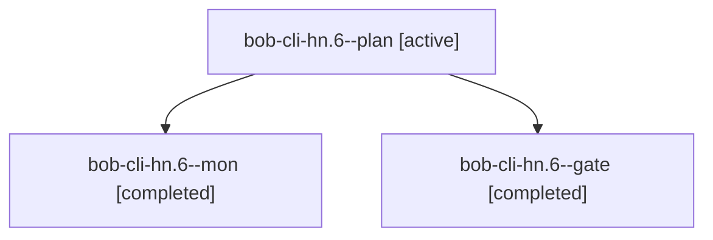

# Session: bob-cli-hn.6

[Agent Hoods](../README.md) / [bbugyi200](../users/bbugyi200/README.md) / [athena](../users/bbugyi200/machines/athena/README.md) / [bob-cli-hn](../users/bbugyi200/machines/athena/hoods/bob-cli-hn/README.md) / bob-cli-hn.6

Owner: `bbugyi200.athena` · Hood: `bob-cli-hn` · Members: 3 · Bead: [bob-cli-hn.6](https://github.com/bobs-org/bob-cli--beads/blob/main/pages/bob-cli-hn/bob-cli-hn.6.md)

## Lineage

The diagram is an optional enhancement; the ordered table below contains the same lineage in accessible text.

| Role | Agent | State | Model / provider | Timing | Commits | Prompt | Chat |
|---|---|---|---|---|---:|---|---|
| plan | bob-cli-hn.6--plan | active | gpt-6-astra / codex | 2026-11-06T01:24:51.351618+00:00 → 2026-11-06T01:37:47.315350+00:00 | 0 | [Prompt](../agents/bbugyi200.athena.bob-cli-hn.6--plan/prompt.md) | [Chat](../agents/bbugyi200.athena.bob-cli-hn.6--plan/chat.md) |
| mon | bob-cli-hn.6--mon | completed | gpt-6-astra / codex | 2026-11-06T01:37:41.650464+00:00 → 2026-11-06T01:40:23.474692+00:00 | 0 | — | [Chat](../agents/bbugyi200.athena.bob-cli-hn.6--mon/chat.md) |
| gate | bob-cli-hn.6--gate | completed | gpt-6-astra / codex | 2026-11-06T01:36:01.150394+00:00 → 2026-11-06T01:37:42.841006+00:00 | 0 | — | [Chat](../agents/bbugyi200.athena.bob-cli-hn.6--gate/chat.md) |

## Neighbors

| Agent | Relation | State |
|---|---|---|
| [bob-cli-hn.6.1.1](../agents/bbugyi200.athena.bob-cli-hn.6.1.1/README.md) | descendant | completed |
| [bob-cli-hn.6.1.2](bbugyi200.athena.bob-cli-hn.6.1.2.md) (session · 7) | descendant | completed 4, failed 3 |
| [bob-cli-hn.6.1.3](../agents/bbugyi200.athena.bob-cli-hn.6.1.3/README.md) | descendant | completed |
| [bob-cli-hn.6.1.4](bbugyi200.athena.bob-cli-hn.6.1.4.md) (session · 5) | descendant | completed 3, failed 2 |
| [bob-cli-hn.6.1.land](bbugyi200.athena.bob-cli-hn.6.1.land.md) (session · 3) | descendant | active 2, completed 1 |
| [bob-cli-hn.1](../agents/bbugyi200.athena.bob-cli-hn.1/README.md) | bob-cli-hn hood | completed |
| [bob-cli-hn.2](../agents/bbugyi200.athena.bob-cli-hn.2/README.md) | bob-cli-hn hood | completed |
| [bob-cli-hn.3](../agents/bbugyi200.athena.bob-cli-hn.3/README.md) | bob-cli-hn hood | completed |
| [bob-cli-hn.4](../agents/bbugyi200.athena.bob-cli-hn.4/README.md) | bob-cli-hn hood | completed |
| [bob-cli-hn.5](../agents/bbugyi200.athena.bob-cli-hn.5/README.md) | bob-cli-hn hood | completed |
| [bob-cli-hn.7](../agents/bbugyi200.athena.bob-cli-hn.7/README.md) | bob-cli-hn hood | waiting |
| [bob-cli-hn.8](../agents/bbugyi200.athena.bob-cli-hn.8/README.md) | bob-cli-hn hood | completed |
| [bob-cli-hn.9](bbugyi200.athena.bob-cli-hn.9.md) (session · 3) | bob-cli-hn hood | completed 3 |
| [bob-cli-hn.land](../agents/bbugyi200.athena.bob-cli-hn.land/README.md) | bob-cli-hn hood | waiting |
