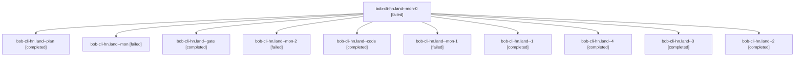

# Session: bob-cli-hn.land

[Agent Hoods](../README.md) / [bbugyi200](../users/bbugyi200/README.md) / [athena](../users/bbugyi200/machines/athena/README.md) / [bob-cli-hn](../users/bbugyi200/machines/athena/hoods/bob-cli-hn/README.md) / bob-cli-hn.land

Owner: `bbugyi200.athena` · Hood: `bob-cli-hn` · Members: 11 · Bead: [bob-cli-hn](https://github.com/bobs-org/bob-cli--beads/blob/main/pages/bob-cli-hn/README.md)

## Lineage

The diagram is an optional enhancement; the ordered table below contains the same lineage in accessible text.

| Role | Agent | State | Model / provider | Timing | Commits | Prompt | Chat |
|---|---|---|---|---|---:|---|---|
| mon-0 | bob-cli-hn.land--mon-0 | failed | gpt-6-luna / codex | 2026-11-06T17:31:48.988561+00:00 → 2026-11-06T17:36:28.570281+00:00 | 0 | — | [Chat](../agents/bbugyi200.athena.bob-cli-hn.land--mon-0/chat.md) |
| plan | bob-cli-hn.land--plan | completed | opus / claude | 2026-11-06T16:22:35.275615+00:00 → 2026-11-06T17:21:41.369220+00:00 | 0 | [Prompt](../agents/bbugyi200.athena.bob-cli-hn.land--plan/prompt.md) | [Chat](../agents/bbugyi200.athena.bob-cli-hn.land--plan/chat.md) |
| mon | bob-cli-hn.land--mon | failed | gpt-6-luna / codex | 2026-11-06T17:20:33.007195+00:00 → 2026-11-06T17:25:12.676978+00:00 | 0 | — | [Chat](../agents/bbugyi200.athena.bob-cli-hn.land--mon/chat.md) |
| gate | bob-cli-hn.land--gate | completed | opus / claude | 2026-11-06T17:01:21.007125+00:00 → 2026-11-06T17:02:40.260693+00:00 | 0 | — | [Chat](../agents/bbugyi200.athena.bob-cli-hn.land--gate/chat.md) |
| mon-2 | bob-cli-hn.land--mon-2 | failed | gpt-6-luna / codex | 2026-11-06T17:53:48.723892+00:00 → 2026-11-06T17:58:01.313890+00:00 | 0 | — | [Chat](../agents/bbugyi200.athena.bob-cli-hn.land--mon-2/chat.md) |
| code | bob-cli-hn.land--code | completed | gpt-6-luna / codex | 2026-11-06T17:03:14.236401+00:00 → 2026-11-06T17:21:41.369220+00:00 | 0 | — | [Chat](../agents/bbugyi200.athena.bob-cli-hn.land--code/chat.md) |
| mon-1 | bob-cli-hn.land--mon-1 | failed | gpt-6-luna / codex | 2026-11-06T17:42:09.960123+00:00 → 2026-11-06T17:46:58.116991+00:00 | 0 | — | [Chat](../agents/bbugyi200.athena.bob-cli-hn.land--mon-1/chat.md) |
| 1 | bob-cli-hn.land--1 | completed | gpt-6-luna / codex | 2026-11-06T17:27:06.422875+00:00 → 2026-11-06T17:32:44.989209+00:00 | 0 | [Prompt](../agents/bbugyi200.athena.bob-cli-hn.land--1/prompt.md) | [Chat](../agents/bbugyi200.athena.bob-cli-hn.land--1/chat.md) |
| 4 | bob-cli-hn.land--4 | completed | gpt-6-luna / codex | 2026-11-06T17:59:27.842404+00:00 → 2026-11-06T18:22:49.429585+00:00 | [1](../agents/bbugyi200.athena.bob-cli-hn.land--4/README.md#commits) | [Prompt](../agents/bbugyi200.athena.bob-cli-hn.land--4/prompt.md) | [Chat](../agents/bbugyi200.athena.bob-cli-hn.land--4/chat.md) |
| 3 | bob-cli-hn.land--3 | completed | gpt-6-luna / codex | 2026-11-06T17:48:16.548938+00:00 → 2026-11-06T17:54:46.776832+00:00 | 0 | [Prompt](../agents/bbugyi200.athena.bob-cli-hn.land--3/prompt.md) | [Chat](../agents/bbugyi200.athena.bob-cli-hn.land--3/chat.md) |
| 2 | bob-cli-hn.land--2 | completed | gpt-6-luna / codex | 2026-11-06T17:37:50.104429+00:00 → 2026-11-06T17:42:56.665175+00:00 | 0 | [Prompt](../agents/bbugyi200.athena.bob-cli-hn.land--2/prompt.md) | [Chat](../agents/bbugyi200.athena.bob-cli-hn.land--2/chat.md) |

## Commits

| Role | Repo | Commit | Subject | Committed |
|---|---|---|---|---|
| 4 | bob-cli | [`86b2501`](https://github.com/bobs-org/bob-cli/commit/86b2501bfcc441028698aa74adc2e66cd6e194b7) | fix(capture): repair successor verdict landing behavior | 2026-11-06 13:21:35 EST |

## Neighbors

| Agent | Relation | State |
|---|---|---|
| [bob-cli-hn.1](../agents/bbugyi200.athena.bob-cli-hn.1/README.md) | bob-cli-hn hood | completed |
| [bob-cli-hn.2](../agents/bbugyi200.athena.bob-cli-hn.2/README.md) | bob-cli-hn hood | completed |
| [bob-cli-hn.3](../agents/bbugyi200.athena.bob-cli-hn.3/README.md) | bob-cli-hn hood | completed |
| [bob-cli-hn.4](../agents/bbugyi200.athena.bob-cli-hn.4/README.md) | bob-cli-hn hood | completed |
| [bob-cli-hn.5](../agents/bbugyi200.athena.bob-cli-hn.5/README.md) | bob-cli-hn hood | completed |
| [bob-cli-hn.6](bbugyi200.athena.bob-cli-hn.6.md) (session · 3) | bob-cli-hn hood | active 1, completed 2 |
| [bob-cli-hn.6.1.1](../agents/bbugyi200.athena.bob-cli-hn.6.1.1/README.md) | bob-cli-hn hood | completed |
| [bob-cli-hn.6.1.2](bbugyi200.athena.bob-cli-hn.6.1.2.md) (session · 7) | bob-cli-hn hood | completed 4, failed 3 |
| [bob-cli-hn.6.1.3](../agents/bbugyi200.athena.bob-cli-hn.6.1.3/README.md) | bob-cli-hn hood | completed |
| [bob-cli-hn.6.1.4](bbugyi200.athena.bob-cli-hn.6.1.4.md) (session · 5) | bob-cli-hn hood | completed 3, failed 2 |
| [bob-cli-hn.6.1.land](bbugyi200.athena.bob-cli-hn.6.1.land.md) (session · 5) | bob-cli-hn hood | completed 4, failed 1 |
| [bob-cli-hn.7](../agents/bbugyi200.athena.bob-cli-hn.7/README.md) | bob-cli-hn hood | completed |
| [bob-cli-hn.8](../agents/bbugyi200.athena.bob-cli-hn.8/README.md) | bob-cli-hn hood | completed |
| [bob-cli-hn.9](bbugyi200.athena.bob-cli-hn.9.md) (session · 7) | bob-cli-hn hood | completed 5, failed 2 |
