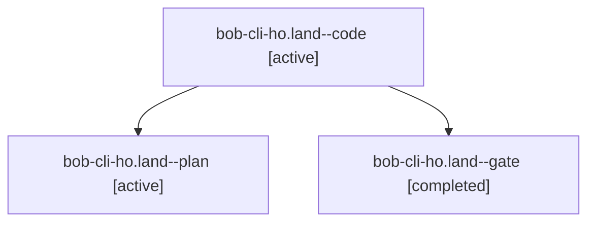

# Session: bob-cli-ho.land

[Agent Hoods](../README.md) / [bbugyi200](../users/bbugyi200/README.md) / [athena](../users/bbugyi200/machines/athena/README.md) / [bob-cli-ho](../users/bbugyi200/machines/athena/hoods/bob-cli-ho/README.md) / bob-cli-ho.land

Owner: `bbugyi200.athena` · Hood: `bob-cli-ho` · Members: 3 · Bead: [bob-cli-ho](https://github.com/bobs-org/bob-cli--beads/blob/main/pages/bob-cli-ho/README.md)

## Lineage

The diagram is an optional enhancement; the ordered table below contains the same lineage in accessible text.

| Role | Agent | State | Model / provider | Timing | Commits | Prompt | Chat |
|---|---|---|---|---|---:|---|---|
| code | bob-cli-ho.land--code | active | gpt-6-luna / codex | 2026-11-06T02:51:58.089485+00:00 | 0 | — | — |
| plan | bob-cli-ho.land--plan | active | opus / claude | 2026-11-06T02:23:08.839617+00:00 | 0 | [Prompt](../agents/bbugyi200.athena.bob-cli-ho.land--plan/prompt.md) | [Chat](../agents/bbugyi200.athena.bob-cli-ho.land--plan/chat.md) |
| gate | bob-cli-ho.land--gate | completed | opus / claude | 2026-11-06T02:49:55.044726+00:00 → 2026-11-06T02:51:28.021694+00:00 | 0 | — | [Chat](../agents/bbugyi200.athena.bob-cli-ho.land--gate/chat.md) |

## Neighbors

| Agent | Relation | State |
|---|---|---|
| [bob-cli-ho.1](../agents/bbugyi200.athena.bob-cli-ho.1/README.md) | bob-cli-ho hood | completed |
| [bob-cli-ho.2](../agents/bbugyi200.athena.bob-cli-ho.2/README.md) | bob-cli-ho hood | completed |
| [bob-cli-ho.3](../agents/bbugyi200.athena.bob-cli-ho.3/README.md) | bob-cli-ho hood | completed |
| [bob-cli-ho.4](../agents/bbugyi200.athena.bob-cli-ho.4/README.md) | bob-cli-ho hood | completed |
| [bob-cli-ho.5](../agents/bbugyi200.athena.bob-cli-ho.5/README.md) | bob-cli-ho hood | completed |
| [bob-cli-ho.6](../agents/bbugyi200.athena.bob-cli-ho.6/README.md) | bob-cli-ho hood | completed |
