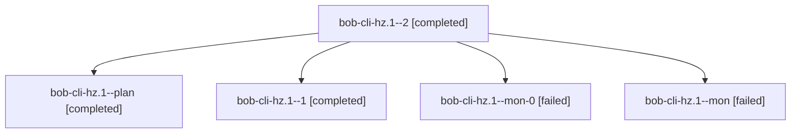

# Session: bob-cli-hz.1

[Agent Hoods](../README.md) / [bbugyi200](../users/bbugyi200/README.md) / [athena](../users/bbugyi200/machines/athena/README.md) / [bob-cli-hz](../users/bbugyi200/machines/athena/hoods/bob-cli-hz/README.md) / bob-cli-hz.1

Owner: `bbugyi200.athena` · Hood: `bob-cli-hz` · Members: 5 · Bead: [bob-cli-hz.1](https://github.com/bobs-org/bob-cli--beads/blob/main/pages/bob-cli-hz/bob-cli-hz.1.md)

## Lineage

The diagram is an optional enhancement; the ordered table below contains the same lineage in accessible text.

| Role | Agent | State | Model / provider | Timing | Commits | Prompt | Chat |
|---|---|---|---|---|---:|---|---|
| 2 | bob-cli-hz.1--2 | completed | grok-4.6 / grok | 2026-11-06T19:42:04.212888+00:00 → 2026-11-06T19:49:39.128566+00:00 | 0 | [Prompt](../agents/bbugyi200.athena.bob-cli-hz.1--2/prompt.md) | [Chat](../agents/bbugyi200.athena.bob-cli-hz.1--2/chat.md) |
| plan | bob-cli-hz.1--plan | completed | grok-4.6 / grok | 2026-11-06T17:54:26.709008+00:00 → 2026-11-06T18:37:22.485109+00:00 | 0 | [Prompt](../agents/bbugyi200.athena.bob-cli-hz.1--plan/prompt.md) | [Chat](../agents/bbugyi200.athena.bob-cli-hz.1--plan/chat.md) |
| 1 | bob-cli-hz.1--1 | completed | grok-4.6 / grok | 2026-11-06T18:57:45.653080+00:00 → 2026-11-06T19:15:54.909737+00:00 | 0 | [Prompt](../agents/bbugyi200.athena.bob-cli-hz.1--1/prompt.md) | [Chat](../agents/bbugyi200.athena.bob-cli-hz.1--1/chat.md) |
| mon-0 | bob-cli-hz.1--mon-0 | failed | grok-4.6 / grok | 2026-11-06T19:14:15.411479+00:00 → 2026-11-06T19:40:15.209871+00:00 | 0 | — | [Chat](../agents/bbugyi200.athena.bob-cli-hz.1--mon-0/chat.md) |
| mon | bob-cli-hz.1--mon | failed | grok-4.6 / grok | 2026-11-06T18:34:30.258632+00:00 → 2026-11-06T18:55:49.633287+00:00 | 0 | — | [Chat](../agents/bbugyi200.athena.bob-cli-hz.1--mon/chat.md) |

## Neighbors

| Agent | Relation | State |
|---|---|---|
| [bob-cli-hz.2](bbugyi200.athena.bob-cli-hz.2.md) (session · 3) | bob-cli-hz hood | completed 3 |
| [bob-cli-hz.3](bbugyi200.athena.bob-cli-hz.3.md) (session · 11) | bob-cli-hz hood | completed 6, failed 5 |
| [bob-cli-hz.4](bbugyi200.athena.bob-cli-hz.4.md) (session · 9) | bob-cli-hz hood | completed 7, failed 2 |
| [bob-cli-hz.5](../agents/bbugyi200.athena.bob-cli-hz.5/README.md) | bob-cli-hz hood | completed |
| [bob-cli-hz.land](../agents/bbugyi200.athena.bob-cli-hz.land/README.md) | bob-cli-hz hood | waiting |
