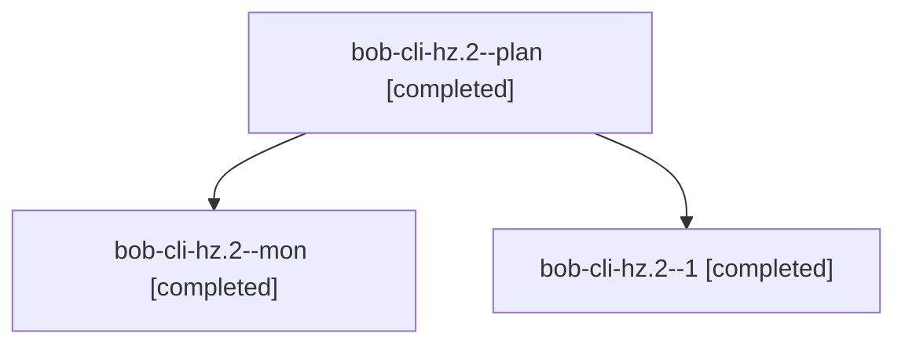

# Session: bob-cli-hz.2

[Agent Hoods](../README.md) / [bbugyi200](../users/bbugyi200/README.md) / [athena](../users/bbugyi200/machines/athena/README.md) / [bob-cli-hz](../users/bbugyi200/machines/athena/hoods/bob-cli-hz/README.md) / bob-cli-hz.2

Owner: `bbugyi200.athena` · Hood: `bob-cli-hz` · Members: 3 · Bead: [bob-cli-hz.2](https://github.com/bobs-org/bob-cli--beads/blob/main/pages/bob-cli-hz/bob-cli-hz.2.md)

## Lineage

The diagram is an optional enhancement; the ordered table below contains the same lineage in accessible text.

| Role | Agent | State | Model / provider | Timing | Commits | Prompt | Chat |
|---|---|---|---|---|---:|---|---|
| plan | bob-cli-hz.2--plan | completed | gpt-6-luna / codex | 2026-11-06T17:54:08.161498+00:00 → 2026-11-06T18:29:22.104366+00:00 | 0 | [Prompt](../agents/bbugyi200.athena.bob-cli-hz.2--plan/prompt.md) | [Chat](../agents/bbugyi200.athena.bob-cli-hz.2--plan/chat.md) |
| mon | bob-cli-hz.2--mon | completed | gpt-6-luna / codex | 2026-11-06T18:27:35.789273+00:00 → 2026-11-06T18:38:57.214879+00:00 | 0 | — | [Chat](../agents/bbugyi200.athena.bob-cli-hz.2--mon/chat.md) |
| 1 | bob-cli-hz.2--1 | completed | gpt-6-luna / codex | 2026-11-06T18:43:20.331420+00:00 → 2026-11-06T19:04:46.287488+00:00 | [1](../agents/bbugyi200.athena.bob-cli-hz.2--1/README.md#commits) | [Prompt](../agents/bbugyi200.athena.bob-cli-hz.2--1/prompt.md) | [Chat](../agents/bbugyi200.athena.bob-cli-hz.2--1/chat.md) |

## Commits

| Role | Repo | Commit | Subject | Committed |
|---|---|---|---|---|
| 1 | bob-cli | [`0869f79`](https://github.com/bobs-org/bob-cli/commit/0869f7921a19b1e9b0e7e3bd6393f279d7d0567e) | feat(capture)!: rewrite relation directions | 2026-11-06 14:04:09 EST |

## Neighbors

| Agent | Relation | State |
|---|---|---|
| [bob-cli-hz.1](bbugyi200.athena.bob-cli-hz.1.md) (session · 5) | bob-cli-hz hood | completed 3, failed 2 |
| [bob-cli-hz.3](bbugyi200.athena.bob-cli-hz.3.md) (session · 11) | bob-cli-hz hood | completed 6, failed 5 |
| [bob-cli-hz.4](bbugyi200.athena.bob-cli-hz.4.md) (session · 9) | bob-cli-hz hood | completed 7, failed 2 |
| [bob-cli-hz.5](../agents/bbugyi200.athena.bob-cli-hz.5/README.md) | bob-cli-hz hood | completed |
| [bob-cli-hz.land](bbugyi200.athena.bob-cli-hz.land.md) (session · 4) | bob-cli-hz hood | active 3, completed 1 |
