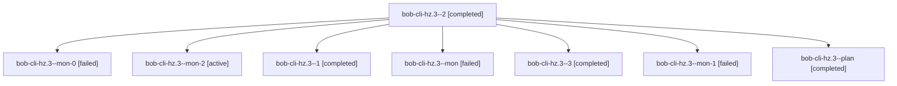

# Session: bob-cli-hz.3

[Agent Hoods](../README.md) / [bbugyi200](../users/bbugyi200/README.md) / [athena](../users/bbugyi200/machines/athena/README.md) / [bob-cli-hz](../users/bbugyi200/machines/athena/hoods/bob-cli-hz/README.md) / bob-cli-hz.3

Owner: `bbugyi200.athena` · Hood: `bob-cli-hz` · Members: 8 · Bead: [bob-cli-hz.3](https://github.com/bobs-org/bob-cli--beads/blob/main/pages/bob-cli-hz/bob-cli-hz.3.md)

## Lineage

The diagram is an optional enhancement; the ordered table below contains the same lineage in accessible text.

| Role | Agent | State | Model / provider | Timing | Commits | Prompt | Chat |
|---|---|---|---|---|---:|---|---|
| 2 | bob-cli-hz.3--2 | completed | gpt-6-luna / codex | 2026-11-06T21:09:41.887184+00:00 → 2026-11-06T21:29:27.570663+00:00 | 0 | [Prompt](../agents/bbugyi200.athena.bob-cli-hz.3--2/prompt.md) | [Chat](../agents/bbugyi200.athena.bob-cli-hz.3--2/chat.md) |
| mon-0 | bob-cli-hz.3--mon-0 | failed | gpt-6-luna / codex | 2026-11-06T20:49:48.406785+00:00 → 2026-11-06T21:07:56.777800+00:00 | 0 | — | [Chat](../agents/bbugyi200.athena.bob-cli-hz.3--mon-0/chat.md) |
| mon-2 | bob-cli-hz.3--mon-2 | active | muse-spark-1.3-contributor / muse | 2026-11-06T22:01:38.476622+00:00 | 0 | — | — |
| 1 | bob-cli-hz.3--1 | completed | gpt-6-luna / codex | 2026-11-06T20:42:17.948044+00:00 → 2026-11-06T20:50:36.589464+00:00 | 0 | [Prompt](../agents/bbugyi200.athena.bob-cli-hz.3--1/prompt.md) | [Chat](../agents/bbugyi200.athena.bob-cli-hz.3--1/chat.md) |
| mon | bob-cli-hz.3--mon | failed | gpt-6-luna / codex | 2026-11-06T20:30:51.456996+00:00 → 2026-11-06T20:40:04.563817+00:00 | 0 | — | [Chat](../agents/bbugyi200.athena.bob-cli-hz.3--mon/chat.md) |
| 3 | bob-cli-hz.3--3 | completed | muse-spark-1.3-contributor / muse | 2026-11-06T21:47:53.522770+00:00 → 2026-11-06T22:04:34.152260+00:00 | 0 | [Prompt](../agents/bbugyi200.athena.bob-cli-hz.3--3/prompt.md) | [Chat](../agents/bbugyi200.athena.bob-cli-hz.3--3/chat.md) |
| mon-1 | bob-cli-hz.3--mon-1 | failed | gpt-6-luna / codex | 2026-11-06T21:28:35.976133+00:00 → 2026-11-06T21:46:06.282872+00:00 | 0 | — | [Chat](../agents/bbugyi200.athena.bob-cli-hz.3--mon-1/chat.md) |
| plan | bob-cli-hz.3--plan | completed | gpt-6-luna / codex | 2026-11-06T19:52:26.354079+00:00 → 2026-11-06T20:32:14.996098+00:00 | 0 | [Prompt](../agents/bbugyi200.athena.bob-cli-hz.3--plan/prompt.md) | [Chat](../agents/bbugyi200.athena.bob-cli-hz.3--plan/chat.md) |

## Neighbors

| Agent | Relation | State |
|---|---|---|
| [bob-cli-hz.1](bbugyi200.athena.bob-cli-hz.1.md) (session · 5) | bob-cli-hz hood | completed 3, failed 2 |
| [bob-cli-hz.2](bbugyi200.athena.bob-cli-hz.2.md) (session · 3) | bob-cli-hz hood | completed 3 |
| [bob-cli-hz.4](../agents/bbugyi200.athena.bob-cli-hz.4/README.md) | bob-cli-hz hood | waiting |
| [bob-cli-hz.5](../agents/bbugyi200.athena.bob-cli-hz.5/README.md) | bob-cli-hz hood | waiting |
| [bob-cli-hz.land](../agents/bbugyi200.athena.bob-cli-hz.land/README.md) | bob-cli-hz hood | waiting |
