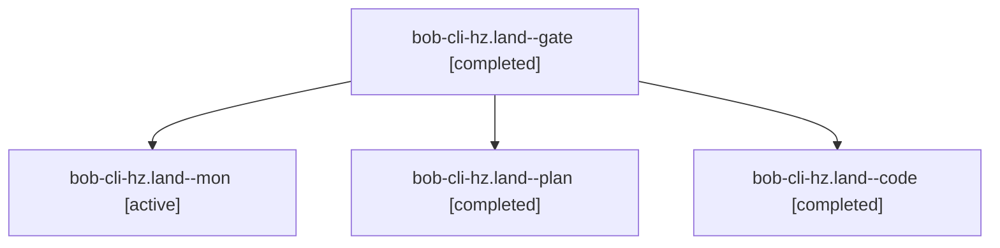

# Session: bob-cli-hz.land

[Agent Hoods](../README.md) / [bbugyi200](../users/bbugyi200/README.md) / [athena](../users/bbugyi200/machines/athena/README.md) / [bob-cli-hz](../users/bbugyi200/machines/athena/hoods/bob-cli-hz/README.md) / bob-cli-hz.land

Owner: `bbugyi200.athena` · Hood: `bob-cli-hz` · Members: 4 · Bead: [bob-cli-hz](https://github.com/bobs-org/bob-cli--beads/blob/main/pages/bob-cli-hz/README.md)

## Lineage

The diagram is an optional enhancement; the ordered table below contains the same lineage in accessible text.

| Role | Agent | State | Model / provider | Timing | Commits | Prompt | Chat |
|---|---|---|---|---|---:|---|---|
| gate | bob-cli-hz.land--gate | completed | opus / claude | 2026-11-07T03:59:47.917814+00:00 → 2026-11-07T04:00:10.738752+00:00 | 0 | — | [Chat](../agents/bbugyi200.athena.bob-cli-hz.land--gate/chat.md) |
| mon | bob-cli-hz.land--mon | active | muse-spark-1.3-contributor / muse | 2026-11-07T04:11:27.213092+00:00 | 0 | — | — |
| plan | bob-cli-hz.land--plan | completed | opus / claude | 2026-11-07T03:41:57.494389+00:00 → 2026-11-07T04:15:10.965787+00:00 | 0 | [Prompt](../agents/bbugyi200.athena.bob-cli-hz.land--plan/prompt.md) | [Chat](../agents/bbugyi200.athena.bob-cli-hz.land--plan/chat.md) |
| code | bob-cli-hz.land--code | completed | muse-spark-1.3-contributor / muse | 2026-11-07T04:00:39.322106+00:00 → 2026-11-07T04:15:10.965787+00:00 | 0 | — | [Chat](../agents/bbugyi200.athena.bob-cli-hz.land--code/chat.md) |

## Neighbors

| Agent | Relation | State |
|---|---|---|
| [bob-cli-hz.1](bbugyi200.athena.bob-cli-hz.1.md) (session · 5) | bob-cli-hz hood | completed 3, failed 2 |
| [bob-cli-hz.2](bbugyi200.athena.bob-cli-hz.2.md) (session · 3) | bob-cli-hz hood | completed 3 |
| [bob-cli-hz.3](bbugyi200.athena.bob-cli-hz.3.md) (session · 11) | bob-cli-hz hood | completed 6, failed 5 |
| [bob-cli-hz.4](bbugyi200.athena.bob-cli-hz.4.md) (session · 9) | bob-cli-hz hood | completed 7, failed 2 |
| [bob-cli-hz.5](../agents/bbugyi200.athena.bob-cli-hz.5/README.md) | bob-cli-hz hood | completed |
