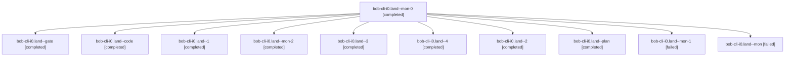

# Session: bob-cli-i0.land

[Agent Hoods](../README.md) / [bbugyi200](../users/bbugyi200/README.md) / [athena](../users/bbugyi200/machines/athena/README.md) / [bob-cli-i0](../users/bbugyi200/machines/athena/hoods/bob-cli-i0/README.md) / bob-cli-i0.land

Owner: `bbugyi200.athena` · Hood: `bob-cli-i0` · Members: 11 · Bead: [bob-cli-i0](https://github.com/bobs-org/bob-cli--beads/blob/main/pages/bob-cli-i0/README.md)

## Lineage



The diagram is an optional enhancement; the ordered table below contains the same lineage in accessible text.

| Role | Agent | State | Model / provider | Timing | Commits | Prompt | Chat |
|---|---|---|---|---|---:|---|---|
| <a id="member-mon-0"></a>mon-0 | bob-cli-i0.land--mon-0 | completed | gpt-6-luna / codex | 2026-11-06T23:54:00.996718+00:00 → 2026-11-06T23:59:25.693247+00:00 | 0 | — | [Chat](../agents/bbugyi200.athena.bob-cli-i0.land--mon-0/chat.md) |
| <a id="member-gate"></a>gate | bob-cli-i0.land--gate | completed | opus / claude | 2026-11-06T23:14:05.072370+00:00 → 2026-11-06T23:15:01.896354+00:00 | 0 | — | [Chat](../agents/bbugyi200.athena.bob-cli-i0.land--gate/chat.md) |
| <a id="member-code"></a>code | bob-cli-i0.land--code | completed | gpt-6-luna / codex | 2026-11-06T23:15:32.695931+00:00 → 2026-11-06T23:46:31.168919+00:00 | 0 | — | [Chat](../agents/bbugyi200.athena.bob-cli-i0.land--code/chat.md) |
| <a id="member-1"></a>1 | bob-cli-i0.land--1 | completed | gpt-6-luna / codex | 2026-11-06T23:51:12.117868+00:00 → 2026-11-06T23:54:30.350123+00:00 | 0 | [Prompt](../agents/bbugyi200.athena.bob-cli-i0.land--1/prompt.md) | [Chat](../agents/bbugyi200.athena.bob-cli-i0.land--1/chat.md) |
| <a id="member-mon-2"></a>mon-2 | bob-cli-i0.land--mon-2 | completed | grok-4.6 / grok | 2026-11-07T00:36:35.406117+00:00 → 2026-11-07T00:45:51.578636+00:00 | 0 | — | [Chat](../agents/bbugyi200.athena.bob-cli-i0.land--mon-2/chat.md) |
| <a id="member-3"></a>3 | bob-cli-i0.land--3 | completed | grok-4.6 / grok | 2026-11-07T00:29:36.077894+00:00 → 2026-11-07T00:38:08.086062+00:00 | [1](../agents/bbugyi200.athena.bob-cli-i0.land--3/README.md#commits) | [Prompt](../agents/bbugyi200.athena.bob-cli-i0.land--3/prompt.md) | [Chat](../agents/bbugyi200.athena.bob-cli-i0.land--3/chat.md) |
| <a id="member-4"></a>4 | bob-cli-i0.land--4 | completed | grok-4.6 / grok | 2026-11-07T00:47:16.323285+00:00 → 2026-11-07T00:49:55.825817+00:00 | 0 | [Prompt](../agents/bbugyi200.athena.bob-cli-i0.land--4/prompt.md) | [Chat](../agents/bbugyi200.athena.bob-cli-i0.land--4/chat.md) |
| <a id="member-2"></a>2 | bob-cli-i0.land--2 | completed | grok-4.6 / grok | 2026-11-07T00:00:47.399120+00:00 → 2026-11-07T00:20:23.490401+00:00 | 0 | [Prompt](../agents/bbugyi200.athena.bob-cli-i0.land--2/prompt.md) | [Chat](../agents/bbugyi200.athena.bob-cli-i0.land--2/chat.md) |
| <a id="member-plan"></a>plan | bob-cli-i0.land--plan | completed | opus / claude | 2026-11-06T22:49:44.665003+00:00 → 2026-11-06T23:46:31.168919+00:00 | 0 | [Prompt](../agents/bbugyi200.athena.bob-cli-i0.land--plan/prompt.md) | [Chat](../agents/bbugyi200.athena.bob-cli-i0.land--plan/chat.md) |
| <a id="member-mon-1"></a>mon-1 | bob-cli-i0.land--mon-1 | failed | grok-4.6 / grok | 2026-11-07T00:19:34.932098+00:00 → 2026-11-07T00:28:15.053067+00:00 | 0 | — | [Chat](../agents/bbugyi200.athena.bob-cli-i0.land--mon-1/chat.md) |
| <a id="member-mon"></a>mon | bob-cli-i0.land--mon | failed | gpt-6-luna / codex | 2026-11-06T23:45:45.728358+00:00 → 2026-11-06T23:49:45.777155+00:00 | 0 | — | [Chat](../agents/bbugyi200.athena.bob-cli-i0.land--mon/chat.md) |

## Commits

| Role | Repo | Commit | Subject | Committed |
|---|---|---|---|---|
| 3 | bob-cli | [`d48e546`](https://github.com/bobs-org/bob-cli/commit/d48e54667d508080e7bd125627879bcde1cba3cf) | fix(install): land live UI phases, indent, and fallbacks | 2026-11-06 19:37:43 EST |

## Variables

| Role | Variable | Value |
|---|---|---|
| 2 | `artifacts` | \[{bead: bob-cli-i0, kind: file, label: bob-cli-i0 real-Cargo just install PTY (cold build), path: /home/bryan/.sase/artifacts/agents/gh\_bobs-org\_\_bob-cli/20261106185825/bob-cli-i0-just-install.pty-17… |

#### artifacts

**Role:** `2`

```yaml
- bead: bob-cli-i0
  kind: file
  label: bob-cli-i0 real-Cargo just install PTY (cold build)
  path: /home/bryan/.sase/artifacts/agents/gh_bobs-org__bob-cli/20261106185825/bob-cli-i0-just-install.pty-176600ede2a2.txt
  ref: file:explicit:6a890c61c8d441a10ef03bd5
  source_path: /tmp/bob-cli-i0-just-install.pty.txt
- bead: bob-cli-i0
  kind: file
  label: bob-cli-i0 sandboxed scripts/install_all PTY
  path: /home/bryan/.sase/artifacts/agents/gh_bobs-org__bob-cli/20261106185825/bob-cli-i0-install-all.pty-7e78e303b4d3.txt
  ref: file:explicit:e490bba9ca8d65a7afe3cd32
  source_path: /tmp/bob-cli-i0-install-all.pty.txt
```

Values are truncated for display; see each member's agent meta.json for the full values.

## Neighbors

| Agent | Relation | State |
|---|---|---|
| [bob-cli-i0.1](../agents/bbugyi200.athena.bob-cli-i0.1/README.md) | bob-cli-i0 hood | completed |
| [bob-cli-i0.2](../agents/bbugyi200.athena.bob-cli-i0.2/README.md) | bob-cli-i0 hood | completed |
| [bob-cli-i0.3](../agents/bbugyi200.athena.bob-cli-i0.3/README.md) | bob-cli-i0 hood | completed |
| [bob-cli-i0.4](../agents/bbugyi200.athena.bob-cli-i0.4/README.md) | bob-cli-i0 hood | completed |
| [bob-cli-i0.5](../agents/bbugyi200.athena.bob-cli-i0.5/README.md) | bob-cli-i0 hood | completed |
| [bob-cli-i0.6](../agents/bbugyi200.athena.bob-cli-i0.6/README.md) | bob-cli-i0 hood | completed |
| [bob-cli-i0.7](../agents/bbugyi200.athena.bob-cli-i0.7/README.md) | bob-cli-i0 hood | completed |
