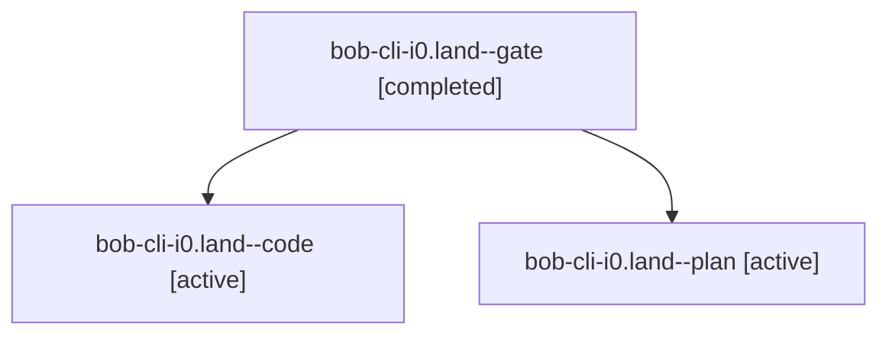

# Session: bob-cli-i0.land

[Agent Hoods](../README.md) / [bbugyi200](../users/bbugyi200/README.md) / [athena](../users/bbugyi200/machines/athena/README.md) / [bob-cli-i0](../users/bbugyi200/machines/athena/hoods/bob-cli-i0/README.md) / bob-cli-i0.land

Owner: `bbugyi200.athena` · Hood: `bob-cli-i0` · Members: 3 · Bead: [bob-cli-i0](https://github.com/bobs-org/bob-cli--beads/blob/main/pages/bob-cli-i0/README.md)

## Lineage

The diagram is an optional enhancement; the ordered table below contains the same lineage in accessible text.

| Role | Agent | State | Model / provider | Timing | Commits | Prompt | Chat |
|---|---|---|---|---|---:|---|---|
| gate | bob-cli-i0.land--gate | completed | opus / claude | 2026-11-06T23:14:05.072370+00:00 → 2026-11-06T23:15:01.896354+00:00 | 0 | — | [Chat](../agents/bbugyi200.athena.bob-cli-i0.land--gate/chat.md) |
| code | bob-cli-i0.land--code | active | gpt-6-luna / codex | 2026-11-06T23:15:32.695931+00:00 | 0 | — | — |
| plan | bob-cli-i0.land--plan | active | opus / claude | 2026-11-06T22:49:44.665003+00:00 | 0 | [Prompt](../agents/bbugyi200.athena.bob-cli-i0.land--plan/prompt.md) | [Chat](../agents/bbugyi200.athena.bob-cli-i0.land--plan/chat.md) |

## Neighbors

| Agent | Relation | State |
|---|---|---|
| [bob-cli-i0.1](../agents/bbugyi200.athena.bob-cli-i0.1/README.md) | bob-cli-i0 hood | completed |
| [bob-cli-i0.2](../agents/bbugyi200.athena.bob-cli-i0.2/README.md) | bob-cli-i0 hood | completed |
| [bob-cli-i0.3](../agents/bbugyi200.athena.bob-cli-i0.3/README.md) | bob-cli-i0 hood | completed |
| [bob-cli-i0.4](../agents/bbugyi200.athena.bob-cli-i0.4/README.md) | bob-cli-i0 hood | completed |
| [bob-cli-i0.5](../agents/bbugyi200.athena.bob-cli-i0.5/README.md) | bob-cli-i0 hood | completed |
| [bob-cli-i0.6](../agents/bbugyi200.athena.bob-cli-i0.6/README.md) | bob-cli-i0 hood | completed |
| [bob-cli-i0.7](../agents/bbugyi200.athena.bob-cli-i0.7/README.md) | bob-cli-i0 hood | completed |
