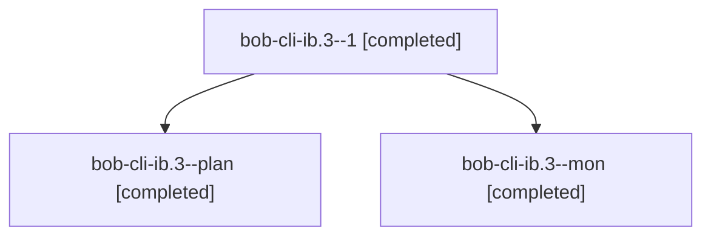

# Session: bob-cli-ib.3

[Agent Hoods](../README.md) / [bbugyi200](../users/bbugyi200/README.md) / [athena](../users/bbugyi200/machines/athena/README.md) / [bob-cli-ib](../users/bbugyi200/machines/athena/hoods/bob-cli-ib/README.md) / bob-cli-ib.3

Owner: `bbugyi200.athena` · Hood: `bob-cli-ib` · Members: 3 · Bead: [bob-cli-ib.3](https://github.com/bobs-org/bob-cli--beads/blob/main/pages/bob-cli-ib/bob-cli-ib.3.md)

## Lineage

The diagram is an optional enhancement; the ordered table below contains the same lineage in accessible text.

| Role | Agent | State | Model / provider | Timing | Commits | Prompt | Chat |
|---|---|---|---|---|---:|---|---|
| 1 | bob-cli-ib.3--1 | completed | opus / claude | 2026-11-07T19:19:44.286834+00:00 → 2026-11-07T19:21:17.421482+00:00 | 0 | [Prompt](../agents/bbugyi200.athena.bob-cli-ib.3--1/prompt.md) | [Chat](../agents/bbugyi200.athena.bob-cli-ib.3--1/chat.md) |
| plan | bob-cli-ib.3--plan | completed | opus / claude | 2026-11-07T18:30:36.556785+00:00 → 2026-11-07T19:02:24.340235+00:00 | 0 | [Prompt](../agents/bbugyi200.athena.bob-cli-ib.3--plan/prompt.md) | [Chat](../agents/bbugyi200.athena.bob-cli-ib.3--plan/chat.md) |
| mon | bob-cli-ib.3--mon | completed | opus / claude | 2026-11-07T19:01:04.798392+00:00 → 2026-11-07T19:03:54.298222+00:00 | 0 | — | [Chat](../agents/bbugyi200.athena.bob-cli-ib.3--mon/chat.md) |

## Neighbors

| Agent | Relation | State |
|---|---|---|
| [bob-cli-ib.1](../agents/bbugyi200.athena.bob-cli-ib.1/README.md) | bob-cli-ib hood | completed |
| [bob-cli-ib.2](../agents/bbugyi200.athena.bob-cli-ib.2/README.md) | bob-cli-ib hood | completed |
| [bob-cli-ib.4](bbugyi200.athena.bob-cli-ib.4.md) (session · 3) | bob-cli-ib hood | completed 3 |
| [bob-cli-ib.5](bbugyi200.athena.bob-cli-ib.5.md) (session · 2) | bob-cli-ib hood | completed 2 |
| [bob-cli-ib.6](bbugyi200.athena.bob-cli-ib.6.md) (session · 3) | bob-cli-ib hood | completed 2, failed 1 |
| [bob-cli-ib.land](bbugyi200.athena.bob-cli-ib.land.md) (session · 4) | bob-cli-ib hood | completed 4 |
