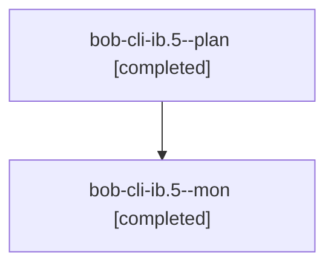

# Session: bob-cli-ib.5

[Agent Hoods](../README.md) / [bbugyi200](../users/bbugyi200/README.md) / [athena](../users/bbugyi200/machines/athena/README.md) / [bob-cli-ib](../users/bbugyi200/machines/athena/hoods/bob-cli-ib/README.md) / bob-cli-ib.5

Owner: `bbugyi200.athena` · Hood: `bob-cli-ib` · Members: 2 · Bead: [bob-cli-ib.5](https://github.com/bobs-org/bob-cli--beads/blob/main/pages/bob-cli-ib/bob-cli-ib.5.md)

## Lineage

The diagram is an optional enhancement; the ordered table below contains the same lineage in accessible text.

| Role | Agent | State | Model / provider | Timing | Commits | Prompt | Chat |
|---|---|---|---|---|---:|---|---|
| plan | bob-cli-ib.5--plan | completed | opus / claude | 2026-11-07T20:17:45.268331+00:00 → 2026-11-07T20:32:23.131616+00:00 | 0 | [Prompt](../agents/bbugyi200.athena.bob-cli-ib.5--plan/prompt.md) | [Chat](../agents/bbugyi200.athena.bob-cli-ib.5--plan/chat.md) |
| mon | bob-cli-ib.5--mon | completed | opus / claude | 2026-11-07T20:31:00.517753+00:00 → 2026-11-07T20:32:30.493341+00:00 | 0 | — | [Chat](../agents/bbugyi200.athena.bob-cli-ib.5--mon/chat.md) |

## Neighbors

| Agent | Relation | State |
|---|---|---|
| [bob-cli-ib.1](../agents/bbugyi200.athena.bob-cli-ib.1/README.md) | bob-cli-ib hood | completed |
| [bob-cli-ib.2](../agents/bbugyi200.athena.bob-cli-ib.2/README.md) | bob-cli-ib hood | completed |
| [bob-cli-ib.3](bbugyi200.athena.bob-cli-ib.3.md) (session · 3) | bob-cli-ib hood | completed 3 |
| [bob-cli-ib.4](bbugyi200.athena.bob-cli-ib.4.md) (session · 3) | bob-cli-ib hood | completed 3 |
| [bob-cli-ib.6](bbugyi200.athena.bob-cli-ib.6.md) (session · 2) | bob-cli-ib hood | active 1, completed 1 |
| [bob-cli-ib.land](../agents/bbugyi200.athena.bob-cli-ib.land/README.md) | bob-cli-ib hood | waiting |
