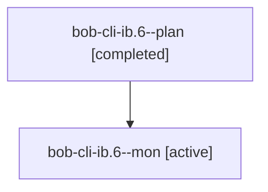

# Session: bob-cli-ib.6

[Agent Hoods](../README.md) / [bbugyi200](../users/bbugyi200/README.md) / [athena](../users/bbugyi200/machines/athena/README.md) / [bob-cli-ib](../users/bbugyi200/machines/athena/hoods/bob-cli-ib/README.md) / bob-cli-ib.6

Owner: `bbugyi200.athena` · Hood: `bob-cli-ib` · Members: 2 · Bead: [bob-cli-ib.6](https://github.com/bobs-org/bob-cli--beads/blob/main/pages/bob-cli-ib/bob-cli-ib.6.md)

## Lineage

The diagram is an optional enhancement; the ordered table below contains the same lineage in accessible text.

| Role | Agent | State | Model / provider | Timing | Commits | Prompt | Chat |
|---|---|---|---|---|---:|---|---|
| plan | bob-cli-ib.6--plan | completed | opus / claude | 2026-11-07T20:36:24.711455+00:00 → 2026-11-07T20:56:04.707542+00:00 | [1](../agents/bbugyi200.athena.bob-cli-ib.6--plan/README.md#commits) | [Prompt](../agents/bbugyi200.athena.bob-cli-ib.6--plan/prompt.md) | [Chat](../agents/bbugyi200.athena.bob-cli-ib.6--plan/chat.md) |
| mon | bob-cli-ib.6--mon | active | opus / claude | 2026-11-07T20:53:49.765496+00:00 | 0 | — | — |

## Commits

| Role | Repo | Commit | Subject | Committed |
|---|---|---|---|---|
| plan | bob-cli | [`591bde8`](https://github.com/bobs-org/bob-cli/commit/591bde8dc82b4aacc08ad511602434b57d29cb0b) | docs(cron): point Mac scheduled maintenance at the chezmoi cron: data | 2026-11-07 15:55:07 EST |

## Neighbors

| Agent | Relation | State |
|---|---|---|
| [bob-cli-ib.1](../agents/bbugyi200.athena.bob-cli-ib.1/README.md) | bob-cli-ib hood | completed |
| [bob-cli-ib.2](../agents/bbugyi200.athena.bob-cli-ib.2/README.md) | bob-cli-ib hood | completed |
| [bob-cli-ib.3](bbugyi200.athena.bob-cli-ib.3.md) (session · 3) | bob-cli-ib hood | completed 3 |
| [bob-cli-ib.4](bbugyi200.athena.bob-cli-ib.4.md) (session · 3) | bob-cli-ib hood | completed 3 |
| [bob-cli-ib.5](bbugyi200.athena.bob-cli-ib.5.md) (session · 2) | bob-cli-ib hood | completed 2 |
| [bob-cli-ib.land](../agents/bbugyi200.athena.bob-cli-ib.land/README.md) | bob-cli-ib hood | waiting |
