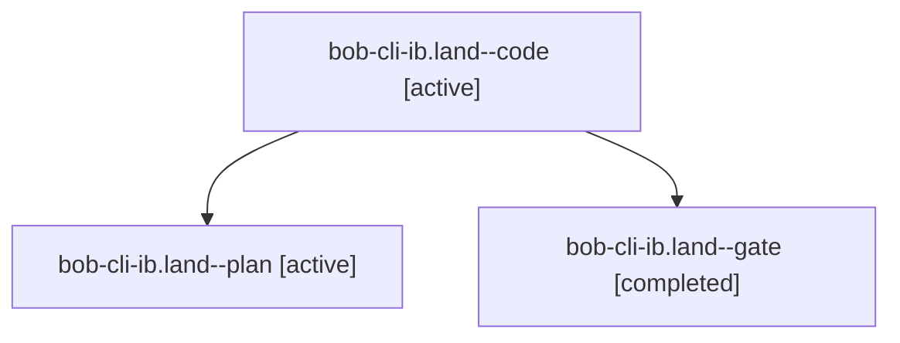

# Session: bob-cli-ib.land

[Agent Hoods](../README.md) / [bbugyi200](../users/bbugyi200/README.md) / [athena](../users/bbugyi200/machines/athena/README.md) / [bob-cli-ib](../users/bbugyi200/machines/athena/hoods/bob-cli-ib/README.md) / bob-cli-ib.land

Owner: `bbugyi200.athena` · Hood: `bob-cli-ib` · Members: 3 · Bead: [bob-cli-ib](https://github.com/bobs-org/bob-cli--beads/blob/main/pages/bob-cli-ib/README.md)

## Lineage

The diagram is an optional enhancement; the ordered table below contains the same lineage in accessible text.

| Role | Agent | State | Model / provider | Timing | Commits | Prompt | Chat |
|---|---|---|---|---|---:|---|---|
| code | bob-cli-ib.land--code | active | opus / claude | 2026-11-07T21:55:57.692321+00:00 | 0 | — | — |
| plan | bob-cli-ib.land--plan | active | opus / claude | 2026-11-07T21:06:56.084635+00:00 | [1](../agents/bbugyi200.athena.bob-cli-ib.land--plan/README.md#commits) | [Prompt](../agents/bbugyi200.athena.bob-cli-ib.land--plan/prompt.md) | [Chat](../agents/bbugyi200.athena.bob-cli-ib.land--plan/chat.md) |
| gate | bob-cli-ib.land--gate | completed | opus / claude | 2026-11-07T21:54:00.182427+00:00 → 2026-11-07T21:55:25.422352+00:00 | 0 | — | [Chat](../agents/bbugyi200.athena.bob-cli-ib.land--gate/chat.md) |

## Commits

| Role | Repo | Commit | Subject | Committed |
|---|---|---|---|---|
| plan | bob-cli | [`b73ac38`](https://github.com/bobs-org/bob-cli/commit/b73ac383c239a1f058742050f84b70c94e6c5732) | docs(cron): note the Mac SSH install caveat and the bob-nightly cron job | 2026-11-07 16:53:26 EST |

## Neighbors

| Agent | Relation | State |
|---|---|---|
| [bob-cli-ib.1](../agents/bbugyi200.athena.bob-cli-ib.1/README.md) | bob-cli-ib hood | completed |
| [bob-cli-ib.2](../agents/bbugyi200.athena.bob-cli-ib.2/README.md) | bob-cli-ib hood | completed |
| [bob-cli-ib.3](bbugyi200.athena.bob-cli-ib.3.md) (session · 3) | bob-cli-ib hood | completed 3 |
| [bob-cli-ib.4](bbugyi200.athena.bob-cli-ib.4.md) (session · 3) | bob-cli-ib hood | completed 3 |
| [bob-cli-ib.5](bbugyi200.athena.bob-cli-ib.5.md) (session · 2) | bob-cli-ib hood | completed 2 |
| [bob-cli-ib.6](bbugyi200.athena.bob-cli-ib.6.md) (session · 3) | bob-cli-ib hood | completed 2, failed 1 |
