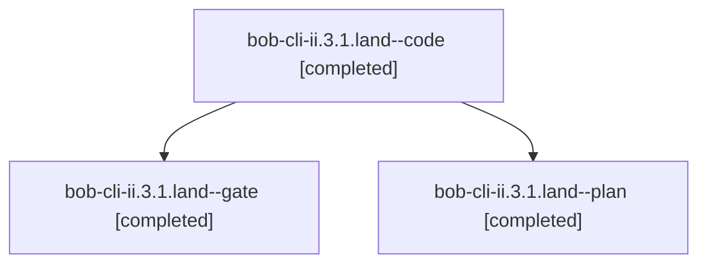

# Session: bob-cli-ii.3.1.land

[Agent Hoods](../README.md) / [bbugyi200](../users/bbugyi200/README.md) / [athena](../users/bbugyi200/machines/athena/README.md) / [bob-cli-ii](../users/bbugyi200/machines/athena/hoods/bob-cli-ii/README.md) / bob-cli-ii.3.1.land

Owner: `bbugyi200.athena` · Hood: `bob-cli-ii` · Members: 3 · Bead: [bob-cli-ii.3.1](https://github.com/bobs-org/bob-cli--beads/blob/main/pages/bob-cli-ii/bob-cli-ii.3.1.md)

## Lineage

The diagram is an optional enhancement; the ordered table below contains the same lineage in accessible text.

| Role | Agent | State | Model / provider | Timing | Commits | Prompt | Chat |
|---|---|---|---|---|---:|---|---|
| code | bob-cli-ii.3.1.land--code | completed | muse-spark-1.3-contributor / muse | 2026-11-08T03:24:15.592475+00:00 → 2026-11-08T04:18:46.711684+00:00 | [1](../agents/bbugyi200.athena.bob-cli-ii.3.1.land--code/README.md#commits) | — | [Chat](../agents/bbugyi200.athena.bob-cli-ii.3.1.land--code/chat.md) |
| gate | bob-cli-ii.3.1.land--gate | completed | gpt-6-astra / codex | 2026-11-08T03:22:25.138755+00:00 → 2026-11-08T03:23:44.070438+00:00 | 0 | — | [Chat](../agents/bbugyi200.athena.bob-cli-ii.3.1.land--gate/chat.md) |
| plan | bob-cli-ii.3.1.land--plan | completed | gpt-6-astra / codex | 2026-11-08T03:09:27.362006+00:00 → 2026-11-08T04:18:46.711684+00:00 | 0 | [Prompt](../agents/bbugyi200.athena.bob-cli-ii.3.1.land--plan/prompt.md) | [Chat](../agents/bbugyi200.athena.bob-cli-ii.3.1.land--plan/chat.md) |

## Commits

| Role | Repo | Commit | Subject | Committed |
|---|---|---|---|---|
| code | bob-cli | [`f904135`](https://github.com/bobs-org/bob-cli/commit/f9041354c191eb8bb781abc000821675f9bb7cdb) | fix(gmail): repair sync landing gaps for filing, coordination, reports, and recovery | 2026-11-07 23:18:09 EST |

## Neighbors

| Agent | Relation | State |
|---|---|---|
| [bob-cli-ii.3](bbugyi200.athena.bob-cli-ii.3.md) (session · 3) | ancestor | active 1, completed 2 |
| [bob-cli-ii.3.1.1](../agents/bbugyi200.athena.bob-cli-ii.3.1.1/README.md) | bob-cli-ii.3.1 hood | completed |
| [bob-cli-ii.3.1.2](bbugyi200.athena.bob-cli-ii.3.1.2.md) (session · 3) | bob-cli-ii.3.1 hood | completed 3 |
| [bob-cli-ii.3.1.3](../agents/bbugyi200.athena.bob-cli-ii.3.1.3/README.md) | bob-cli-ii.3.1 hood | completed |
| [bob-cli-ii.3.1.4](../agents/bbugyi200.athena.bob-cli-ii.3.1.4/README.md) | bob-cli-ii.3.1 hood | completed |
| [bob-cli-ii.1](../agents/bbugyi200.athena.bob-cli-ii.1/README.md) | bob-cli-ii hood | completed |
| [bob-cli-ii.2](../agents/bbugyi200.athena.bob-cli-ii.2/README.md) | bob-cli-ii hood | completed |
| [bob-cli-ii.4](bbugyi200.athena.bob-cli-ii.4.md) (session · 3) | bob-cli-ii hood | active 1, completed 2 |
| [bob-cli-ii.4.1.1](../agents/bbugyi200.athena.bob-cli-ii.4.1.1/README.md) | bob-cli-ii hood | completed |
| [bob-cli-ii.4.1.2](../agents/bbugyi200.athena.bob-cli-ii.4.1.2/README.md) | bob-cli-ii hood | active |
| [bob-cli-ii.4.1.3](../agents/bbugyi200.athena.bob-cli-ii.4.1.3/README.md) | bob-cli-ii hood | waiting |
| [bob-cli-ii.4.1.4](../agents/bbugyi200.athena.bob-cli-ii.4.1.4/README.md) | bob-cli-ii hood | waiting |
| [bob-cli-ii.4.1.5](../agents/bbugyi200.athena.bob-cli-ii.4.1.5/README.md) | bob-cli-ii hood | waiting |
| [bob-cli-ii.4.1.6](../agents/bbugyi200.athena.bob-cli-ii.4.1.6/README.md) | bob-cli-ii hood | waiting |
| [bob-cli-ii.4.1.land](../agents/bbugyi200.athena.bob-cli-ii.4.1.land/README.md) | bob-cli-ii hood | waiting |
| [bob-cli-ii.5](../agents/bbugyi200.athena.bob-cli-ii.5/README.md) | bob-cli-ii hood | waiting |
| [bob-cli-ii.6](../agents/bbugyi200.athena.bob-cli-ii.6/README.md) | bob-cli-ii hood | completed |
| [bob-cli-ii.7](../agents/bbugyi200.athena.bob-cli-ii.7/README.md) | bob-cli-ii hood | completed |
| [bob-cli-ii.8](../agents/bbugyi200.athena.bob-cli-ii.8/README.md) | bob-cli-ii hood | waiting |
| [bob-cli-ii.land](../agents/bbugyi200.athena.bob-cli-ii.land/README.md) | bob-cli-ii hood | waiting |
