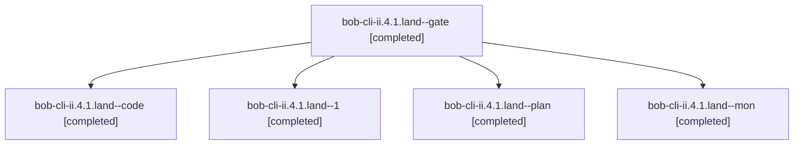

# Session: bob-cli-ii.4.1.land

[Agent Hoods](../README.md) / [bbugyi200](../users/bbugyi200/README.md) / [athena](../users/bbugyi200/machines/athena/README.md) / [bob-cli-ii](../users/bbugyi200/machines/athena/hoods/bob-cli-ii/README.md) / bob-cli-ii.4.1.land

Owner: `bbugyi200.athena` · Hood: `bob-cli-ii` · Members: 5 · Bead: [bob-cli-ii.4.1](https://github.com/bobs-org/bob-cli--beads/blob/main/pages/bob-cli-ii/bob-cli-ii.4.1.md)

## Lineage

The diagram is an optional enhancement; the ordered table below contains the same lineage in accessible text.

| Role | Agent | State | Model / provider | Timing | Commits | Prompt | Chat |
|---|---|---|---|---|---:|---|---|
| gate | bob-cli-ii.4.1.land--gate | completed | opus / claude | 2026-11-08T21:46:06.551369+00:00 → 2026-11-08T21:46:38.829685+00:00 | 0 | — | [Chat](../agents/bbugyi200.athena.bob-cli-ii.4.1.land--gate/chat.md) |
| code | bob-cli-ii.4.1.land--code | completed | gpt-6-luna / codex | 2026-11-08T21:47:10.965640+00:00 → 2026-11-08T22:33:52.442487+00:00 | 0 | — | [Chat](../agents/bbugyi200.athena.bob-cli-ii.4.1.land--code/chat.md) |
| 1 | bob-cli-ii.4.1.land--1 | completed | gpt-6-luna / codex | 2026-11-08T22:39:32.899229+00:00 → 2026-11-08T22:44:53.129896+00:00 | [1](../agents/bbugyi200.athena.bob-cli-ii.4.1.land--1/README.md#commits) | [Prompt](../agents/bbugyi200.athena.bob-cli-ii.4.1.land--1/prompt.md) | [Chat](../agents/bbugyi200.athena.bob-cli-ii.4.1.land--1/chat.md) |
| plan | bob-cli-ii.4.1.land--plan | completed | opus / claude | 2026-11-08T21:02:26.587162+00:00 → 2026-11-08T22:33:52.442487+00:00 | [1](../agents/bbugyi200.athena.bob-cli-ii.4.1.land--plan/README.md#commits) | [Prompt](../agents/bbugyi200.athena.bob-cli-ii.4.1.land--plan/prompt.md) | [Chat](../agents/bbugyi200.athena.bob-cli-ii.4.1.land--plan/chat.md) |
| mon | bob-cli-ii.4.1.land--mon | completed | gpt-6-luna / codex | 2026-11-08T22:33:10.041004+00:00 → 2026-11-08T22:38:33.911153+00:00 | 0 | — | [Chat](../agents/bbugyi200.athena.bob-cli-ii.4.1.land--mon/chat.md) |

## Commits

| Role | Repo | Commit | Subject | Committed |
|---|---|---|---|---|
| plan | bob-cli | [`25c0223`](https://github.com/bobs-org/bob-cli/commit/25c02232a5820c6625c8cf99f2e2eabeace421eb) | fix(gmail): clear reply-watch lint and stale dead-code allowances | 2026-11-08 16:45:30 EST |
| 1 | bob-cli | [`5ef6612`](https://github.com/bobs-org/bob-cli/commit/5ef66125d29191aaaef087bde986528967202740) | fix(gmail): preserve watched targets across shifted lines | 2026-11-08 17:43:54 EST |

## Neighbors

| Agent | Relation | State |
|---|---|---|
| [bob-cli-ii.4](bbugyi200.athena.bob-cli-ii.4.md) (session · 3) | ancestor | active 1, completed 2 |
| [bob-cli-ii.4.1.1](../agents/bbugyi200.athena.bob-cli-ii.4.1.1/README.md) | bob-cli-ii.4.1 hood | completed |
| [bob-cli-ii.4.1.2](../agents/bbugyi200.athena.bob-cli-ii.4.1.2/README.md) | bob-cli-ii.4.1 hood | completed |
| [bob-cli-ii.4.1.3](../agents/bbugyi200.athena.bob-cli-ii.4.1.3/README.md) | bob-cli-ii.4.1 hood | completed |
| [bob-cli-ii.4.1.4](../agents/bbugyi200.athena.bob-cli-ii.4.1.4/README.md) | bob-cli-ii.4.1 hood | completed |
| [bob-cli-ii.4.1.5](../agents/bbugyi200.athena.bob-cli-ii.4.1.5/README.md) | bob-cli-ii.4.1 hood | completed |
| [bob-cli-ii.4.1.6](../agents/bbugyi200.athena.bob-cli-ii.4.1.6/README.md) | bob-cli-ii.4.1 hood | completed |
| [bob-cli-ii.1](../agents/bbugyi200.athena.bob-cli-ii.1/README.md) | bob-cli-ii hood | completed |
| [bob-cli-ii.2](../agents/bbugyi200.athena.bob-cli-ii.2/README.md) | bob-cli-ii hood | completed |
| [bob-cli-ii.3](bbugyi200.athena.bob-cli-ii.3.md) (session · 3) | bob-cli-ii hood | active 1, completed 2 |
| [bob-cli-ii.3.1.1](../agents/bbugyi200.athena.bob-cli-ii.3.1.1/README.md) | bob-cli-ii hood | completed |
| [bob-cli-ii.3.1.2](bbugyi200.athena.bob-cli-ii.3.1.2.md) (session · 3) | bob-cli-ii hood | completed 3 |
| [bob-cli-ii.3.1.3](../agents/bbugyi200.athena.bob-cli-ii.3.1.3/README.md) | bob-cli-ii hood | completed |
| [bob-cli-ii.3.1.4](../agents/bbugyi200.athena.bob-cli-ii.3.1.4/README.md) | bob-cli-ii hood | completed |
| [bob-cli-ii.3.1.land](bbugyi200.athena.bob-cli-ii.3.1.land.md) (session · 3) | bob-cli-ii hood | completed 3 |
| [bob-cli-ii.5](../agents/bbugyi200.athena.bob-cli-ii.5/README.md) | bob-cli-ii hood | waiting |
| [bob-cli-ii.6](../agents/bbugyi200.athena.bob-cli-ii.6/README.md) | bob-cli-ii hood | completed |
| [bob-cli-ii.7](../agents/bbugyi200.athena.bob-cli-ii.7/README.md) | bob-cli-ii hood | completed |
| [bob-cli-ii.8](../agents/bbugyi200.athena.bob-cli-ii.8/README.md) | bob-cli-ii hood | waiting |
| [bob-cli-ii.land](../agents/bbugyi200.athena.bob-cli-ii.land/README.md) | bob-cli-ii hood | waiting |
