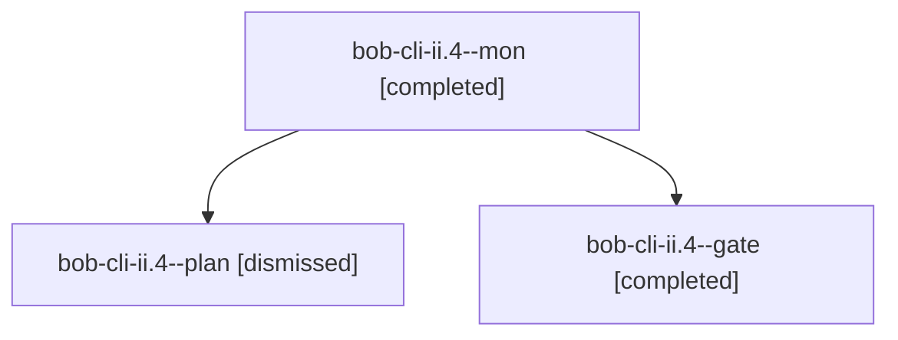

# Session: bob-cli-ii.4

[Agent Hoods](../README.md) / [bbugyi200](../users/bbugyi200/README.md) / [athena](../users/bbugyi200/machines/athena/README.md) / [bob-cli-ii](../users/bbugyi200/machines/athena/hoods/bob-cli-ii/README.md) / bob-cli-ii.4

Owner: `bbugyi200.athena` · Hood: `bob-cli-ii` · Members: 3 · Bead: [bob-cli-ii.4](https://github.com/bobs-org/bob-cli--beads/blob/main/pages/bob-cli-ii/bob-cli-ii.4.md)

## Lineage

The diagram is an optional enhancement; the ordered table below contains the same lineage in accessible text.

| Role | Agent | State | Model / provider | Timing | Commits | Prompt | Chat |
|---|---|---|---|---|---:|---|---|
| mon | bob-cli-ii.4--mon | completed | gpt-6-astra / codex | 2026-11-08T17:01:24.380019+00:00 → 2026-11-08T17:04:05.048663+00:00 | 0 | — | [Chat](../agents/bbugyi200.athena.bob-cli-ii.4--mon/chat.md) |
| plan | bob-cli-ii.4--plan | dismissed | gpt-6-astra / codex | 2026-11-08T11:52:13.152664 → 2026-11-08T12:01:31.102913 | 0 | [Prompt](../agents/bbugyi200.athena.bob-cli-ii.4--plan/prompt.md) | [Chat](../agents/bbugyi200.athena.bob-cli-ii.4--plan/chat.md) |
| gate | bob-cli-ii.4--gate | completed | gpt-6-astra / codex | 2026-11-08T17:00:49.048535+00:00 → 2026-11-08T17:01:25.746016+00:00 | 0 | — | [Chat](../agents/bbugyi200.athena.bob-cli-ii.4--gate/chat.md) |

## Neighbors

| Agent | Relation | State |
|---|---|---|
| [bob-cli-ii.4.1.1](../agents/bbugyi200.athena.bob-cli-ii.4.1.1/README.md) | descendant | completed |
| [bob-cli-ii.4.1.2](../agents/bbugyi200.athena.bob-cli-ii.4.1.2/README.md) | descendant | completed |
| [bob-cli-ii.4.1.3](../agents/bbugyi200.athena.bob-cli-ii.4.1.3/README.md) | descendant | completed |
| [bob-cli-ii.4.1.4](../agents/bbugyi200.athena.bob-cli-ii.4.1.4/README.md) | descendant | completed |
| [bob-cli-ii.4.1.5](../agents/bbugyi200.athena.bob-cli-ii.4.1.5/README.md) | descendant | completed |
| [bob-cli-ii.4.1.6](../agents/bbugyi200.athena.bob-cli-ii.4.1.6/README.md) | descendant | completed |
| [bob-cli-ii.4.1.land](bbugyi200.athena.bob-cli-ii.4.1.land.md) (session · 5) | descendant | completed 5 |
| [bob-cli-ii.1](../agents/bbugyi200.athena.bob-cli-ii.1/README.md) | bob-cli-ii hood | completed |
| [bob-cli-ii.2](../agents/bbugyi200.athena.bob-cli-ii.2/README.md) | bob-cli-ii hood | completed |
| [bob-cli-ii.3](bbugyi200.athena.bob-cli-ii.3.md) (session · 3) | bob-cli-ii hood | completed 2, dismissed 1 |
| [bob-cli-ii.3.1.1](../agents/bbugyi200.athena.bob-cli-ii.3.1.1/README.md) | bob-cli-ii hood | completed |
| [bob-cli-ii.3.1.2](bbugyi200.athena.bob-cli-ii.3.1.2.md) (session · 3) | bob-cli-ii hood | completed 3 |
| [bob-cli-ii.3.1.3](../agents/bbugyi200.athena.bob-cli-ii.3.1.3/README.md) | bob-cli-ii hood | completed |
| [bob-cli-ii.3.1.4](../agents/bbugyi200.athena.bob-cli-ii.3.1.4/README.md) | bob-cli-ii hood | completed |
| [bob-cli-ii.3.1.land](bbugyi200.athena.bob-cli-ii.3.1.land.md) (session · 3) | bob-cli-ii hood | completed 3 |
| [bob-cli-ii.5](bbugyi200.athena.bob-cli-ii.5.md) (session · 3) | bob-cli-ii hood | completed 3 |
| [bob-cli-ii.6](../agents/bbugyi200.athena.bob-cli-ii.6/README.md) | bob-cli-ii hood | completed |
| [bob-cli-ii.7](../agents/bbugyi200.athena.bob-cli-ii.7/README.md) | bob-cli-ii hood | completed |
| [bob-cli-ii.8](bbugyi200.athena.bob-cli-ii.8.md) (session · 3) | bob-cli-ii hood | completed 2, failed 1 |
| [bob-cli-ii.land](bbugyi200.athena.bob-cli-ii.land.md) (session · 3) | bob-cli-ii hood | completed 3 |
