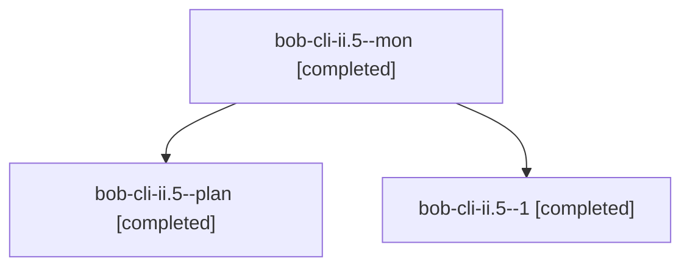

# Session: bob-cli-ii.5

[Agent Hoods](../README.md) / [bbugyi200](../users/bbugyi200/README.md) / [athena](../users/bbugyi200/machines/athena/README.md) / [bob-cli-ii](../users/bbugyi200/machines/athena/hoods/bob-cli-ii/README.md) / bob-cli-ii.5

Owner: `bbugyi200.athena` · Hood: `bob-cli-ii` · Members: 3 · Bead: [bob-cli-ii.5](https://github.com/bobs-org/bob-cli--beads/blob/main/pages/bob-cli-ii/bob-cli-ii.5.md)

## Lineage

The diagram is an optional enhancement; the ordered table below contains the same lineage in accessible text.

| Role | Agent | State | Model / provider | Timing | Commits | Prompt | Chat |
|---|---|---|---|---|---:|---|---|
| mon | bob-cli-ii.5--mon | completed | grok-4.6 / grok | 2026-11-08T23:27:31.633962+00:00 → 2026-11-08T23:34:50.931062+00:00 | 0 | — | [Chat](../agents/bbugyi200.athena.bob-cli-ii.5--mon/chat.md) |
| plan | bob-cli-ii.5--plan | completed | grok-4.6 / grok | 2026-11-08T22:43:48.242834+00:00 → 2026-11-08T23:28:36.479544+00:00 | 0 | [Prompt](../agents/bbugyi200.athena.bob-cli-ii.5--plan/prompt.md) | [Chat](../agents/bbugyi200.athena.bob-cli-ii.5--plan/chat.md) |
| 1 | bob-cli-ii.5--1 | completed | grok-4.6 / grok | 2026-11-08T23:35:52.455915+00:00 → 2026-11-08T23:47:52.026089+00:00 | [1](../agents/bbugyi200.athena.bob-cli-ii.5--1/README.md#commits) | [Prompt](../agents/bbugyi200.athena.bob-cli-ii.5--1/prompt.md) | [Chat](../agents/bbugyi200.athena.bob-cli-ii.5--1/chat.md) |

## Commits

| Role | Repo | Commit | Subject | Committed |
|---|---|---|---|---|
| 1 | bob-cli | [`8427bd9`](https://github.com/bobs-org/bob-cli/commit/8427bd96dbab8470c2e4228d8f199265b690ab50) | feat(gmail): refile resolved inbox routes and alarm stale skips | 2026-11-08 18:47:14 EST |

## Neighbors

| Agent | Relation | State |
|---|---|---|
| [bob-cli-ii.1](../agents/bbugyi200.athena.bob-cli-ii.1/README.md) | bob-cli-ii hood | completed |
| [bob-cli-ii.2](../agents/bbugyi200.athena.bob-cli-ii.2/README.md) | bob-cli-ii hood | completed |
| [bob-cli-ii.3](bbugyi200.athena.bob-cli-ii.3.md) (session · 3) | bob-cli-ii hood | active 1, completed 2 |
| [bob-cli-ii.3.1.1](../agents/bbugyi200.athena.bob-cli-ii.3.1.1/README.md) | bob-cli-ii hood | completed |
| [bob-cli-ii.3.1.2](bbugyi200.athena.bob-cli-ii.3.1.2.md) (session · 3) | bob-cli-ii hood | completed 3 |
| [bob-cli-ii.3.1.3](../agents/bbugyi200.athena.bob-cli-ii.3.1.3/README.md) | bob-cli-ii hood | completed |
| [bob-cli-ii.3.1.4](../agents/bbugyi200.athena.bob-cli-ii.3.1.4/README.md) | bob-cli-ii hood | completed |
| [bob-cli-ii.3.1.land](bbugyi200.athena.bob-cli-ii.3.1.land.md) (session · 3) | bob-cli-ii hood | completed 3 |
| [bob-cli-ii.4](bbugyi200.athena.bob-cli-ii.4.md) (session · 3) | bob-cli-ii hood | active 1, completed 2 |
| [bob-cli-ii.4.1.1](../agents/bbugyi200.athena.bob-cli-ii.4.1.1/README.md) | bob-cli-ii hood | completed |
| [bob-cli-ii.4.1.2](../agents/bbugyi200.athena.bob-cli-ii.4.1.2/README.md) | bob-cli-ii hood | completed |
| [bob-cli-ii.4.1.3](../agents/bbugyi200.athena.bob-cli-ii.4.1.3/README.md) | bob-cli-ii hood | completed |
| [bob-cli-ii.4.1.4](../agents/bbugyi200.athena.bob-cli-ii.4.1.4/README.md) | bob-cli-ii hood | completed |
| [bob-cli-ii.4.1.5](../agents/bbugyi200.athena.bob-cli-ii.4.1.5/README.md) | bob-cli-ii hood | completed |
| [bob-cli-ii.4.1.6](../agents/bbugyi200.athena.bob-cli-ii.4.1.6/README.md) | bob-cli-ii hood | completed |
| [bob-cli-ii.4.1.land](bbugyi200.athena.bob-cli-ii.4.1.land.md) (session · 5) | bob-cli-ii hood | completed 5 |
| [bob-cli-ii.6](../agents/bbugyi200.athena.bob-cli-ii.6/README.md) | bob-cli-ii hood | completed |
| [bob-cli-ii.7](../agents/bbugyi200.athena.bob-cli-ii.7/README.md) | bob-cli-ii hood | completed |
| [bob-cli-ii.8](bbugyi200.athena.bob-cli-ii.8.md) (session · 3) | bob-cli-ii hood | completed 2, failed 1 |
| [bob-cli-ii.land](../agents/bbugyi200.athena.bob-cli-ii.land/README.md) | bob-cli-ii hood | waiting |
