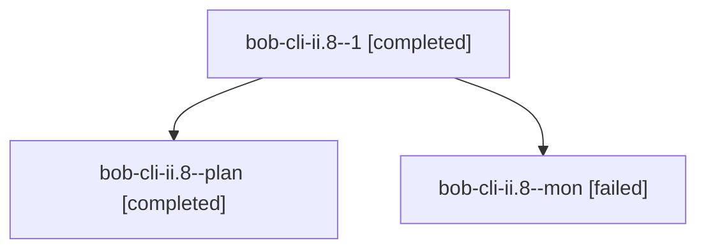

# Session: bob-cli-ii.8

[Agent Hoods](../README.md) / [bbugyi200](../users/bbugyi200/README.md) / [athena](../users/bbugyi200/machines/athena/README.md) / [bob-cli-ii](../users/bbugyi200/machines/athena/hoods/bob-cli-ii/README.md) / bob-cli-ii.8

Owner: `bbugyi200.athena` · Hood: `bob-cli-ii` · Members: 3 · Bead: [bob-cli-ii.8](https://github.com/bobs-org/bob-cli--beads/blob/main/pages/bob-cli-ii/bob-cli-ii.8.md)

## Lineage

The diagram is an optional enhancement; the ordered table below contains the same lineage in accessible text.

| Role | Agent | State | Model / provider | Timing | Commits | Prompt | Chat |
|---|---|---|---|---|---:|---|---|
| 1 | bob-cli-ii.8--1 | completed | muse-spark-1.3-contributor / muse | 2026-11-08T23:58:03.235048+00:00 → 2026-11-09T00:00:16.176152+00:00 | [1](../agents/bbugyi200.athena.bob-cli-ii.8--1/README.md#commits) | [Prompt](../agents/bbugyi200.athena.bob-cli-ii.8--1/prompt.md) | [Chat](../agents/bbugyi200.athena.bob-cli-ii.8--1/chat.md) |
| plan | bob-cli-ii.8--plan | completed | muse-spark-1.3-contributor / muse | 2026-11-08T23:49:55.455507+00:00 → 2026-11-08T23:55:01.224555+00:00 | 0 | [Prompt](../agents/bbugyi200.athena.bob-cli-ii.8--plan/prompt.md) | [Chat](../agents/bbugyi200.athena.bob-cli-ii.8--plan/chat.md) |
| mon | bob-cli-ii.8--mon | failed | muse-spark-1.3-contributor / muse | 2026-11-08T23:53:55.620957+00:00 → 2026-11-08T23:56:55.041110+00:00 | 0 | — | [Chat](../agents/bbugyi200.athena.bob-cli-ii.8--mon/chat.md) |

## Commits

| Role | Repo | Commit | Subject | Committed |
|---|---|---|---|---|
| 1 | bob-cli | [`ad2298d`](https://github.com/bobs-org/bob-cli/commit/ad2298d44d9810beb721db6085a1a92dfa361795) | docs(vault-sync): document mac bob-gmail-sync maintenance slot | 2026-11-08 18:59:07 EST |

## Neighbors

| Agent | Relation | State |
|---|---|---|
| [bob-cli-ii.1](../agents/bbugyi200.athena.bob-cli-ii.1/README.md) | bob-cli-ii hood | completed |
| [bob-cli-ii.2](../agents/bbugyi200.athena.bob-cli-ii.2/README.md) | bob-cli-ii hood | completed |
| [bob-cli-ii.3](bbugyi200.athena.bob-cli-ii.3.md) (session · 3) | bob-cli-ii hood | active 1, completed 2 |
| [bob-cli-ii.3.1.1](../agents/bbugyi200.athena.bob-cli-ii.3.1.1/README.md) | bob-cli-ii hood | completed |
| [bob-cli-ii.3.1.2](bbugyi200.athena.bob-cli-ii.3.1.2.md) (session · 3) | bob-cli-ii hood | completed 3 |
| [bob-cli-ii.3.1.3](../agents/bbugyi200.athena.bob-cli-ii.3.1.3/README.md) | bob-cli-ii hood | completed |
| [bob-cli-ii.3.1.4](../agents/bbugyi200.athena.bob-cli-ii.3.1.4/README.md) | bob-cli-ii hood | completed |
| [bob-cli-ii.3.1.land](bbugyi200.athena.bob-cli-ii.3.1.land.md) (session · 3) | bob-cli-ii hood | completed 3 |
| [bob-cli-ii.4](bbugyi200.athena.bob-cli-ii.4.md) (session · 3) | bob-cli-ii hood | active 1, completed 2 |
| [bob-cli-ii.4.1.1](../agents/bbugyi200.athena.bob-cli-ii.4.1.1/README.md) | bob-cli-ii hood | completed |
| [bob-cli-ii.4.1.2](../agents/bbugyi200.athena.bob-cli-ii.4.1.2/README.md) | bob-cli-ii hood | completed |
| [bob-cli-ii.4.1.3](../agents/bbugyi200.athena.bob-cli-ii.4.1.3/README.md) | bob-cli-ii hood | completed |
| [bob-cli-ii.4.1.4](../agents/bbugyi200.athena.bob-cli-ii.4.1.4/README.md) | bob-cli-ii hood | completed |
| [bob-cli-ii.4.1.5](../agents/bbugyi200.athena.bob-cli-ii.4.1.5/README.md) | bob-cli-ii hood | completed |
| [bob-cli-ii.4.1.6](../agents/bbugyi200.athena.bob-cli-ii.4.1.6/README.md) | bob-cli-ii hood | completed |
| [bob-cli-ii.4.1.land](bbugyi200.athena.bob-cli-ii.4.1.land.md) (session · 5) | bob-cli-ii hood | completed 5 |
| [bob-cli-ii.5](bbugyi200.athena.bob-cli-ii.5.md) (session · 3) | bob-cli-ii hood | completed 3 |
| [bob-cli-ii.6](../agents/bbugyi200.athena.bob-cli-ii.6/README.md) | bob-cli-ii hood | completed |
| [bob-cli-ii.7](../agents/bbugyi200.athena.bob-cli-ii.7/README.md) | bob-cli-ii hood | completed |
| [bob-cli-ii.land](bbugyi200.athena.bob-cli-ii.land.md) (session · 3) | bob-cli-ii hood | completed 3 |
