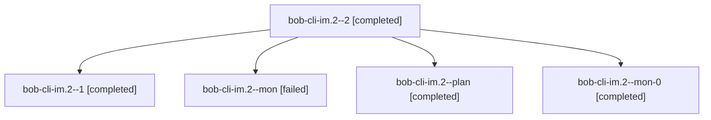

# Session: bob-cli-im.2

[Agent Hoods](../README.md) / [bbugyi200](../users/bbugyi200/README.md) / [athena](../users/bbugyi200/machines/athena/README.md) / [bob-cli-im](../users/bbugyi200/machines/athena/hoods/bob-cli-im/README.md) / bob-cli-im.2

Owner: `bbugyi200.athena` · Hood: `bob-cli-im` · Members: 5 · Bead: [bob-cli-im.2](https://github.com/bobs-org/bob-cli--beads/blob/main/pages/bob-cli-im/bob-cli-im.2.md)

## Lineage

The diagram is an optional enhancement; the ordered table below contains the same lineage in accessible text.

| Role | Agent | State | Model / provider | Timing | Commits | Prompt | Chat |
|---|---|---|---|---|---:|---|---|
| 2 | bob-cli-im.2--2 | completed | grok-4.6 / grok | 2026-11-08T13:12:11.039641+00:00 → 2026-11-08T13:28:34.857122+00:00 | [1](../agents/bbugyi200.athena.bob-cli-im.2--2/README.md#commits) | [Prompt](../agents/bbugyi200.athena.bob-cli-im.2--2/prompt.md) | [Chat](../agents/bbugyi200.athena.bob-cli-im.2--2/chat.md) |
| 1 | bob-cli-im.2--1 | completed | grok-4.6 / grok | 2026-11-08T12:50:08.297478+00:00 → 2026-11-08T13:03:32.215314+00:00 | 0 | [Prompt](../agents/bbugyi200.athena.bob-cli-im.2--1/prompt.md) | [Chat](../agents/bbugyi200.athena.bob-cli-im.2--1/chat.md) |
| mon | bob-cli-im.2--mon | failed | grok-4.6 / grok | 2026-11-08T12:42:35.049545+00:00 → 2026-11-08T12:49:17.844696+00:00 | 0 | — | [Chat](../agents/bbugyi200.athena.bob-cli-im.2--mon/chat.md) |
| plan | bob-cli-im.2--plan | completed | grok-4.6 / grok | 2026-11-08T11:57:31.590718+00:00 → 2026-11-08T12:43:39.817119+00:00 | 0 | [Prompt](../agents/bbugyi200.athena.bob-cli-im.2--plan/prompt.md) | [Chat](../agents/bbugyi200.athena.bob-cli-im.2--plan/chat.md) |
| mon-0 | bob-cli-im.2--mon-0 | completed | grok-4.6 / grok | 2026-11-08T13:02:15.321279+00:00 → 2026-11-08T13:10:21.599074+00:00 | 0 | — | [Chat](../agents/bbugyi200.athena.bob-cli-im.2--mon-0/chat.md) |

## Commits

| Role | Repo | Commit | Subject | Committed |
|---|---|---|---|---|
| 2 | bob-cli | [`b416354`](https://github.com/bobs-org/bob-cli/commit/b4163548b5025573256ad2a9ec5fdedbb526cd53) | feat(capture): treat trailing plus after a bare start name as later timing | 2026-11-08 08:27:48 EST |

## Neighbors

| Agent | Relation | State |
|---|---|---|
| [bob-cli-im.1](../agents/bbugyi200.athena.bob-cli-im.1/README.md) | bob-cli-im hood | completed |
| [bob-cli-im.3](../agents/bbugyi200.athena.bob-cli-im.3/README.md) | bob-cli-im hood | waiting |
| [bob-cli-im.4](../agents/bbugyi200.athena.bob-cli-im.4/README.md) | bob-cli-im hood | completed |
| [bob-cli-im.land](../agents/bbugyi200.athena.bob-cli-im.land/README.md) | bob-cli-im hood | waiting |
