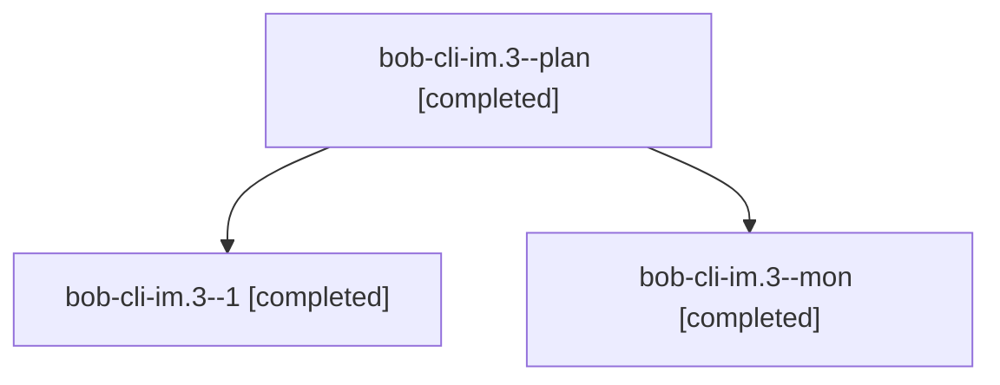

# Session: bob-cli-im.3

[Agent Hoods](../README.md) / [bbugyi200](../users/bbugyi200/README.md) / [athena](../users/bbugyi200/machines/athena/README.md) / [bob-cli-im](../users/bbugyi200/machines/athena/hoods/bob-cli-im/README.md) / bob-cli-im.3

Owner: `bbugyi200.athena` · Hood: `bob-cli-im` · Members: 3 · Bead: [bob-cli-im.3](https://github.com/bobs-org/bob-cli--beads/blob/main/pages/bob-cli-im/bob-cli-im.3.md)

## Lineage

The diagram is an optional enhancement; the ordered table below contains the same lineage in accessible text.

| Role | Agent | State | Model / provider | Timing | Commits | Prompt | Chat |
|---|---|---|---|---|---:|---|---|
| plan | bob-cli-im.3--plan | completed | gpt-6-luna / codex | 2026-11-08T13:30:22.484339+00:00 → 2026-11-08T14:18:40.649292+00:00 | 0 | [Prompt](../agents/bbugyi200.athena.bob-cli-im.3--plan/prompt.md) | [Chat](../agents/bbugyi200.athena.bob-cli-im.3--plan/chat.md) |
| 1 | bob-cli-im.3--1 | completed | gpt-6-luna / codex | 2026-11-08T14:28:21.102437+00:00 → 2026-11-08T14:43:32.064583+00:00 | [1](../agents/bbugyi200.athena.bob-cli-im.3--1/README.md#commits) | [Prompt](../agents/bbugyi200.athena.bob-cli-im.3--1/prompt.md) | [Chat](../agents/bbugyi200.athena.bob-cli-im.3--1/chat.md) |
| mon | bob-cli-im.3--mon | completed | gpt-6-luna / codex | 2026-11-08T14:17:14.718027+00:00 → 2026-11-08T14:26:32.975876+00:00 | 0 | — | [Chat](../agents/bbugyi200.athena.bob-cli-im.3--mon/chat.md) |

## Commits

| Role | Repo | Commit | Subject | Committed |
|---|---|---|---|---|
| 1 | bob-cli | [`572ce97`](https://github.com/bobs-org/bob-cli/commit/572ce974c9d933e8bb0547418fd421d22e2957b3) | feat(capture): refuse operator-only link-start bodies | 2026-11-08 09:42:54 EST |

## Neighbors

| Agent | Relation | State |
|---|---|---|
| [bob-cli-im.1](../agents/bbugyi200.athena.bob-cli-im.1/README.md) | bob-cli-im hood | completed |
| [bob-cli-im.2](bbugyi200.athena.bob-cli-im.2.md) (session · 5) | bob-cli-im hood | completed 4, failed 1 |
| [bob-cli-im.4](../agents/bbugyi200.athena.bob-cli-im.4/README.md) | bob-cli-im hood | completed |
| [bob-cli-im.land](../agents/bbugyi200.athena.bob-cli-im.land/README.md) | bob-cli-im hood | waiting |
