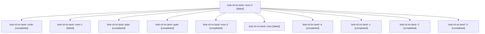

# Session: bob-cli-im.land

[Agent Hoods](../README.md) / [bbugyi200](../users/bbugyi200/README.md) / [athena](../users/bbugyi200/machines/athena/README.md) / [bob-cli-im](../users/bbugyi200/machines/athena/hoods/bob-cli-im/README.md) / bob-cli-im.land

Owner: `bbugyi200.athena` · Hood: `bob-cli-im` · Members: 11 · Bead: [bob-cli-im](https://github.com/bobs-org/bob-cli--beads/blob/main/pages/bob-cli-im/README.md)

## Lineage

The diagram is an optional enhancement; the ordered table below contains the same lineage in accessible text.

| Role | Agent | State | Model / provider | Timing | Commits | Prompt | Chat |
|---|---|---|---|---|---:|---|---|
| mon-0 | bob-cli-im.land--mon-0 | failed | gpt-6-luna / codex | 2026-11-08T16:07:10.560502+00:00 → 2026-11-08T16:13:02.104789+00:00 | 0 | — | [Chat](../agents/bbugyi200.athena.bob-cli-im.land--mon-0/chat.md) |
| code | bob-cli-im.land--code | completed | gpt-6-luna / codex | 2026-11-08T15:01:37.670860+00:00 → 2026-11-08T16:01:57.555867+00:00 | 0 | — | [Chat](../agents/bbugyi200.athena.bob-cli-im.land--code/chat.md) |
| mon-1 | bob-cli-im.land--mon-1 | failed | gpt-6-luna / codex | 2026-11-08T16:17:34.617312+00:00 → 2026-11-08T16:27:51.619365+00:00 | 0 | — | [Chat](../agents/bbugyi200.athena.bob-cli-im.land--mon-1/chat.md) |
| plan | bob-cli-im.land--plan | completed | gpt-6-astra / codex | 2026-11-08T14:46:36.082037+00:00 → 2026-11-08T16:01:57.555867+00:00 | 0 | [Prompt](../agents/bbugyi200.athena.bob-cli-im.land--plan/prompt.md) | [Chat](../agents/bbugyi200.athena.bob-cli-im.land--plan/chat.md) |
| gate | bob-cli-im.land--gate | completed | gpt-6-astra / codex | 2026-11-08T15:00:44.846308+00:00 → 2026-11-08T15:01:08.932163+00:00 | 0 | — | [Chat](../agents/bbugyi200.athena.bob-cli-im.land--gate/chat.md) |
| mon-2 | bob-cli-im.land--mon-2 | completed | gpt-6-luna / codex | 2026-11-08T16:38:42.451092+00:00 → 2026-11-08T16:46:39.550331+00:00 | 0 | — | [Chat](../agents/bbugyi200.athena.bob-cli-im.land--mon-2/chat.md) |
| mon | bob-cli-im.land--mon | failed | gpt-6-luna / codex | 2026-11-08T16:00:33.860496+00:00 → 2026-11-08T16:03:35.508831+00:00 | 0 | — | [Chat](../agents/bbugyi200.athena.bob-cli-im.land--mon/chat.md) |
| 4 | bob-cli-im.land--4 | completed | gpt-6-luna / codex | 2026-11-08T16:47:42.726707+00:00 → 2026-11-08T17:02:01.187035+00:00 | [1](../agents/bbugyi200.athena.bob-cli-im.land--4/README.md#commits) | [Prompt](../agents/bbugyi200.athena.bob-cli-im.land--4/prompt.md) | [Chat](../agents/bbugyi200.athena.bob-cli-im.land--4/chat.md) |
| 1 | bob-cli-im.land--1 | completed | gpt-6-luna / codex | 2026-11-08T16:04:40.425985+00:00 → 2026-11-08T16:08:05.449829+00:00 | 0 | [Prompt](../agents/bbugyi200.athena.bob-cli-im.land--1/prompt.md) | [Chat](../agents/bbugyi200.athena.bob-cli-im.land--1/chat.md) |
| 2 | bob-cli-im.land--2 | completed | gpt-6-luna / codex | 2026-11-08T16:14:30.117274+00:00 → 2026-11-08T16:18:21.202793+00:00 | 0 | [Prompt](../agents/bbugyi200.athena.bob-cli-im.land--2/prompt.md) | [Chat](../agents/bbugyi200.athena.bob-cli-im.land--2/chat.md) |
| 3 | bob-cli-im.land--3 | completed | gpt-6-luna / codex | 2026-11-08T16:29:13.551494+00:00 → 2026-11-08T16:39:45.693907+00:00 | 0 | [Prompt](../agents/bbugyi200.athena.bob-cli-im.land--3/prompt.md) | [Chat](../agents/bbugyi200.athena.bob-cli-im.land--3/chat.md) |

## Commits

| Role | Repo | Commit | Subject | Committed |
|---|---|---|---|---|
| 4 | bob-cli | [`984f819`](https://github.com/bobs-org/bob-cli/commit/984f8196a816c43100757190c6a9361fe653e797) | fix(capture)!: finish signed-start diagnostics and landing | 2026-11-08 12:01:13 EST |

## Neighbors

| Agent | Relation | State |
|---|---|---|
| [bob-cli-im.1](../agents/bbugyi200.athena.bob-cli-im.1/README.md) | bob-cli-im hood | completed |
| [bob-cli-im.2](bbugyi200.athena.bob-cli-im.2.md) (session · 5) | bob-cli-im hood | completed 4, failed 1 |
| [bob-cli-im.3](bbugyi200.athena.bob-cli-im.3.md) (session · 3) | bob-cli-im hood | completed 3 |
| [bob-cli-im.4](../agents/bbugyi200.athena.bob-cli-im.4/README.md) | bob-cli-im hood | completed |
