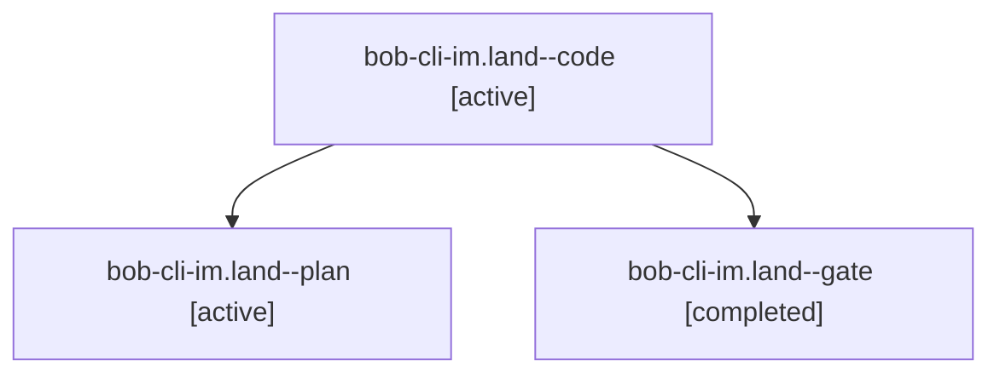

# Session: bob-cli-im.land

[Agent Hoods](../README.md) / [bbugyi200](../users/bbugyi200/README.md) / [athena](../users/bbugyi200/machines/athena/README.md) / [bob-cli-im](../users/bbugyi200/machines/athena/hoods/bob-cli-im/README.md) / bob-cli-im.land

Owner: `bbugyi200.athena` · Hood: `bob-cli-im` · Members: 3 · Bead: [bob-cli-im](https://github.com/bobs-org/bob-cli--beads/blob/main/pages/bob-cli-im/README.md)

## Lineage

The diagram is an optional enhancement; the ordered table below contains the same lineage in accessible text.

| Role | Agent | State | Model / provider | Timing | Commits | Prompt | Chat |
|---|---|---|---|---|---:|---|---|
| code | bob-cli-im.land--code | active | gpt-6-luna / codex | 2026-11-08T15:01:37.670860+00:00 | 0 | — | — |
| plan | bob-cli-im.land--plan | active | gpt-6-astra / codex | 2026-11-08T14:46:36.082037+00:00 | 0 | [Prompt](../agents/bbugyi200.athena.bob-cli-im.land--plan/prompt.md) | [Chat](../agents/bbugyi200.athena.bob-cli-im.land--plan/chat.md) |
| gate | bob-cli-im.land--gate | completed | gpt-6-astra / codex | 2026-11-08T15:00:44.846308+00:00 → 2026-11-08T15:01:08.932163+00:00 | 0 | — | [Chat](../agents/bbugyi200.athena.bob-cli-im.land--gate/chat.md) |

## Neighbors

| Agent | Relation | State |
|---|---|---|
| [bob-cli-im.1](../agents/bbugyi200.athena.bob-cli-im.1/README.md) | bob-cli-im hood | completed |
| [bob-cli-im.2](bbugyi200.athena.bob-cli-im.2.md) (session · 5) | bob-cli-im hood | completed 4, failed 1 |
| [bob-cli-im.3](bbugyi200.athena.bob-cli-im.3.md) (session · 3) | bob-cli-im hood | completed 3 |
| [bob-cli-im.4](../agents/bbugyi200.athena.bob-cli-im.4/README.md) | bob-cli-im hood | completed |
