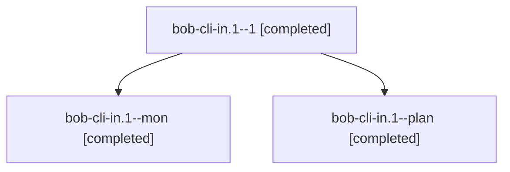

# Session: bob-cli-in.1

[Agent Hoods](../README.md) / [bbugyi200](../users/bbugyi200/README.md) / [athena](../users/bbugyi200/machines/athena/README.md) / [bob-cli-in](../users/bbugyi200/machines/athena/hoods/bob-cli-in/README.md) / bob-cli-in.1

Owner: `bbugyi200.athena` · Hood: `bob-cli-in` · Members: 3 · Bead: [bob-cli-in.1](https://github.com/bobs-org/bob-cli--beads/blob/main/pages/bob-cli-in/bob-cli-in.1.md)

## Lineage

The diagram is an optional enhancement; the ordered table below contains the same lineage in accessible text.

| Role | Agent | State | Model / provider | Timing | Commits | Prompt | Chat |
|---|---|---|---|---|---:|---|---|
| 1 | bob-cli-in.1--1 | completed | grok-4.6 / grok | 2026-11-08T12:25:15.504194+00:00 → 2026-11-08T12:39:06.758501+00:00 | [1](../agents/bbugyi200.athena.bob-cli-in.1--1/README.md#commits) | [Prompt](../agents/bbugyi200.athena.bob-cli-in.1--1/prompt.md) | [Chat](../agents/bbugyi200.athena.bob-cli-in.1--1/chat.md) |
| mon | bob-cli-in.1--mon | completed | grok-4.6 / grok | 2026-11-08T12:17:17.221747+00:00 → 2026-11-08T12:23:46.084001+00:00 | 0 | — | [Chat](../agents/bbugyi200.athena.bob-cli-in.1--mon/chat.md) |
| plan | bob-cli-in.1--plan | completed | grok-4.6 / grok | 2026-11-08T11:38:16.078262+00:00 → 2026-11-08T12:18:40.035054+00:00 | 0 | [Prompt](../agents/bbugyi200.athena.bob-cli-in.1--plan/prompt.md) | [Chat](../agents/bbugyi200.athena.bob-cli-in.1--plan/chat.md) |

## Commits

| Role | Repo | Commit | Subject | Committed |
|---|---|---|---|---|
| 1 | bob-cli | [`3ff3c4f`](https://github.com/bobs-org/bob-cli/commit/3ff3c4fe6c3a45ca52f267702e4e51d5f4e1b2df) | feat(gmail): coordinate every sync Gmail read through one retry layer | 2026-11-08 07:38:41 EST |

## Neighbors

| Agent | Relation | State |
|---|---|---|
| [bob-cli-in.2](../agents/bbugyi200.athena.bob-cli-in.2/README.md) | bob-cli-in hood | completed |
| [bob-cli-in.3](../agents/bbugyi200.athena.bob-cli-in.3/README.md) | bob-cli-in hood | completed |
| [bob-cli-in.4](../agents/bbugyi200.athena.bob-cli-in.4/README.md) | bob-cli-in hood | completed |
| [bob-cli-in.land](bbugyi200.athena.bob-cli-in.land.md) (session · 5) | bob-cli-in hood | completed 4, failed 1 |
