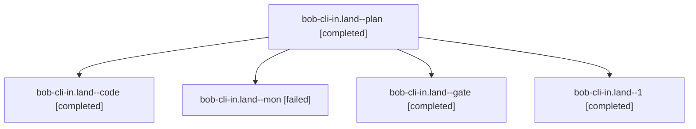

# Session: bob-cli-in.land

[Agent Hoods](../README.md) / [bbugyi200](../users/bbugyi200/README.md) / [athena](../users/bbugyi200/machines/athena/README.md) / [bob-cli-in](../users/bbugyi200/machines/athena/hoods/bob-cli-in/README.md) / bob-cli-in.land

Owner: `bbugyi200.athena` · Hood: `bob-cli-in` · Members: 5 · Bead: [bob-cli-in](https://github.com/bobs-org/bob-cli--beads/blob/main/pages/bob-cli-in/README.md)

## Lineage

The diagram is an optional enhancement; the ordered table below contains the same lineage in accessible text.

| Role | Agent | State | Model / provider | Timing | Commits | Prompt | Chat |
|---|---|---|---|---|---:|---|---|
| plan | bob-cli-in.land--plan | completed | gpt-6-astra / codex | 2026-11-08T15:33:25.649793+00:00 → 2026-11-08T16:24:14.204498+00:00 | 0 | [Prompt](../agents/bbugyi200.athena.bob-cli-in.land--plan/prompt.md) | [Chat](../agents/bbugyi200.athena.bob-cli-in.land--plan/chat.md) |
| code | bob-cli-in.land--code | completed | grok-4.6 / grok | 2026-11-08T15:47:22.472410+00:00 → 2026-11-08T16:24:14.204498+00:00 | [1](../agents/bbugyi200.athena.bob-cli-in.land--code/README.md#commits) | — | [Chat](../agents/bbugyi200.athena.bob-cli-in.land--code/chat.md) |
| mon | bob-cli-in.land--mon | failed | grok-4.6 / grok | 2026-11-08T16:21:39.956773+00:00 → 2026-11-08T16:26:10.532770+00:00 | 0 | — | [Chat](../agents/bbugyi200.athena.bob-cli-in.land--mon/chat.md) |
| gate | bob-cli-in.land--gate | completed | gpt-6-astra / codex | 2026-11-08T15:45:58.437051+00:00 → 2026-11-08T15:46:25.242851+00:00 | 0 | — | [Chat](../agents/bbugyi200.athena.bob-cli-in.land--gate/chat.md) |
| 1 | bob-cli-in.land--1 | completed | grok-4.6 / grok | 2026-11-08T16:27:36.070578+00:00 → 2026-11-08T16:52:19.424347+00:00 | [1](../agents/bbugyi200.athena.bob-cli-in.land--1/README.md#commits) | [Prompt](../agents/bbugyi200.athena.bob-cli-in.land--1/prompt.md) | [Chat](../agents/bbugyi200.athena.bob-cli-in.land--1/chat.md) |

## Commits

| Role | Repo | Commit | Subject | Committed |
|---|---|---|---|---|
| code | bob-cli | [`1cf8d96`](https://github.com/bobs-org/bob-cli/commit/1cf8d96b37fa250521d77990e5da19f40b79f233) | fix(gmail): land remaining sync retry, recovery, and watch-membership defects | 2026-11-08 11:23:11 EST |
| 1 | bob-cli | [`32c241a`](https://github.com/bobs-org/bob-cli/commit/32c241af95e2818ebd7635295ee96ca2ab38bc26) | fix(gmail): land remaining sync retry, recovery, and watch-membership lint | 2026-11-08 11:51:36 EST |

## Neighbors

| Agent | Relation | State |
|---|---|---|
| [bob-cli-in.1](bbugyi200.athena.bob-cli-in.1.md) (session · 3) | bob-cli-in hood | completed 3 |
| [bob-cli-in.2](../agents/bbugyi200.athena.bob-cli-in.2/README.md) | bob-cli-in hood | completed |
| [bob-cli-in.3](../agents/bbugyi200.athena.bob-cli-in.3/README.md) | bob-cli-in hood | completed |
| [bob-cli-in.4](../agents/bbugyi200.athena.bob-cli-in.4/README.md) | bob-cli-in hood | completed |
