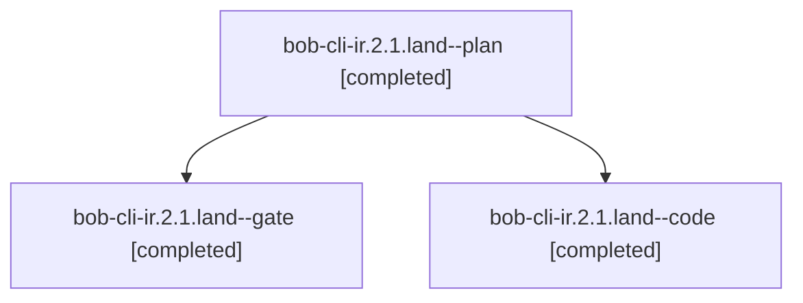

# Session: bob-cli-ir.2.1.land

[Agent Hoods](../README.md) / [bbugyi200](../users/bbugyi200/README.md) / [athena](../users/bbugyi200/machines/athena/README.md) / [bob-cli-ir](../users/bbugyi200/machines/athena/hoods/bob-cli-ir/README.md) / bob-cli-ir.2.1.land

Owner: `bbugyi200.athena` · Hood: `bob-cli-ir` · Members: 3 · Bead: [bob-cli-ir.2.1](https://github.com/bobs-org/bob-cli--beads/blob/main/pages/bob-cli-ir/bob-cli-ir.2.1.md)

## Lineage



The diagram is an optional enhancement; the ordered table below contains the same lineage in accessible text.

| Role | Agent | State | Model / provider | Timing | Commits | Prompt | Chat |
|---|---|---|---|---|---:|---|---|
| <a id="member-plan"></a>plan | bob-cli-ir.2.1.land--plan | completed | gpt-6-astra / codex | 2026-11-08T18:24:25.249367+00:00 → 2026-11-08T19:26:18.670730+00:00 | 0 | [Prompt](../agents/bbugyi200.athena.bob-cli-ir.2.1.land--plan/prompt.md) | [Chat](../agents/bbugyi200.athena.bob-cli-ir.2.1.land--plan/chat.md) |
| <a id="member-gate"></a>gate | bob-cli-ir.2.1.land--gate | completed | gpt-6-astra / codex | 2026-11-08T18:40:37.275514+00:00 → 2026-11-08T18:41:38.634381+00:00 | 0 | — | [Chat](../agents/bbugyi200.athena.bob-cli-ir.2.1.land--gate/chat.md) |
| <a id="member-code"></a>code | bob-cli-ir.2.1.land--code | completed | gpt-6-luna / codex | 2026-11-08T18:42:09.922379+00:00 → 2026-11-08T19:26:18.670730+00:00 | [1](../agents/bbugyi200.athena.bob-cli-ir.2.1.land--code/README.md#commits) | — | [Chat](../agents/bbugyi200.athena.bob-cli-ir.2.1.land--code/chat.md) |

## Commits

| Role | Repo | Commit | Subject | Committed |
|---|---|---|---|---|
| code | bob-cli | [`8ff0d8e`](https://github.com/bobs-org/bob-cli/commit/8ff0d8ed5a43b34977a6acaf4473159fe977e600) | feat(records): harden planning and byte-preserving updates | 2026-11-08 14:25:40 EST |
| — | bob-cli | [`361974f`](https://github.com/bobs-org/bob-cli/commit/361974f48eef7e2ba1fdc8ad97a1916835a6d20b) | fix(records): map stemless titles to record\_title and document engine allowances | 2026-11-08 18:15:09 EST |

## Variables

| Role | Variable | Value |
|---|---|---|
| plan | `artifacts` | \[{bead: bob-cli-ir.2.1, kind: file, label: Records-engine landing source probes at 86af3d5e, path: /home/bryan/.sase/artifacts/agents/gh\_bobs-org\_\_bob-cli/20261108111939/records-engine-landing-probe-… |

#### artifacts

**Role:** `plan`

```yaml
- bead: bob-cli-ir.2.1
  kind: file
  label: Records-engine landing source probes at 86af3d5e
  path: /home/bryan/.sase/artifacts/agents/gh_bobs-org__bob-cli/20261108111939/records-engine-landing-probe-89b0a6afad35.txt
  ref: file:explicit:0463132eb6eafca3abae823e
  source_path: /home/bryan/.local/state/sase/workspaces/bobs-org/bob-cli/bob-cli_10/target/records-engine-landing-probe.txt
```

Values are truncated for display; see each member's agent meta.json for the full values.

## Neighbors

| Agent | Relation | State |
|---|---|---|
| [bob-cli-ir.2](bbugyi200.athena.bob-cli-ir.2.md) (session · 3) | ancestor | active 1, completed 2 |
| [bob-cli-ir.2.1.1](../agents/bbugyi200.athena.bob-cli-ir.2.1.1/README.md) | bob-cli-ir.2.1 hood | completed |
| [bob-cli-ir.2.1.2](../agents/bbugyi200.athena.bob-cli-ir.2.1.2/README.md) | bob-cli-ir.2.1 hood | completed |
| [bob-cli-ir.2.1.3](../agents/bbugyi200.athena.bob-cli-ir.2.1.3/README.md) | bob-cli-ir.2.1 hood | completed |
| [bob-cli-ir.2.1.4](../agents/bbugyi200.athena.bob-cli-ir.2.1.4/README.md) | bob-cli-ir.2.1 hood | completed |
| [bob-cli-ir.1](../agents/bbugyi200.athena.bob-cli-ir.1/README.md) | bob-cli-ir hood | completed |
| [bob-cli-ir.10](bbugyi200.athena.bob-cli-ir.10.md) (session · 3) | bob-cli-ir hood | active 1, completed 2 |
| [bob-cli-ir.10.1.1](../agents/bbugyi200.athena.bob-cli-ir.10.1.1/README.md) | bob-cli-ir hood | completed |
| [bob-cli-ir.10.1.2](../agents/bbugyi200.athena.bob-cli-ir.10.1.2/README.md) | bob-cli-ir hood | completed |
| [bob-cli-ir.10.1.3](../agents/bbugyi200.athena.bob-cli-ir.10.1.3/README.md) | bob-cli-ir hood | completed |
| [bob-cli-ir.10.1.4](bbugyi200.athena.bob-cli-ir.10.1.4.md) (session · 5) | bob-cli-ir hood | completed 4, failed 1 |
| [bob-cli-ir.10.1.land](bbugyi200.athena.bob-cli-ir.10.1.land.md) (session · 7) | bob-cli-ir hood | completed 6, failed 1 |
| [bob-cli-ir.11](bbugyi200.athena.bob-cli-ir.11.md) (session · 5) | bob-cli-ir hood | completed 5 |
| [bob-cli-ir.12](../agents/bbugyi200.athena.bob-cli-ir.12/README.md) | bob-cli-ir hood | completed |
| [bob-cli-ir.13](../agents/bbugyi200.athena.bob-cli-ir.13/README.md) | bob-cli-ir hood | completed |
| [bob-cli-ir.3](../agents/bbugyi200.athena.bob-cli-ir.3/README.md) | bob-cli-ir hood | completed |
| [bob-cli-ir.4](../agents/bbugyi200.athena.bob-cli-ir.4/README.md) | bob-cli-ir hood | completed |
| [bob-cli-ir.5](bbugyi200.athena.bob-cli-ir.5.md) (session · 3) | bob-cli-ir hood | active 1, completed 2 |
| [bob-cli-ir.5.1.1](../agents/bbugyi200.athena.bob-cli-ir.5.1.1/README.md) | bob-cli-ir hood | completed |
| [bob-cli-ir.5.1.2](../agents/bbugyi200.athena.bob-cli-ir.5.1.2/README.md) | bob-cli-ir hood | completed |
| [bob-cli-ir.5.1.3](../agents/bbugyi200.athena.bob-cli-ir.5.1.3/README.md) | bob-cli-ir hood | completed |
| [bob-cli-ir.5.1.4](bbugyi200.athena.bob-cli-ir.5.1.4.md) (session · 5) | bob-cli-ir hood | completed 4, failed 1 |
| [bob-cli-ir.5.1.land](bbugyi200.athena.bob-cli-ir.5.1.land.md) (session · 3) | bob-cli-ir hood | completed 3 |
| [bob-cli-ir.6](bbugyi200.athena.bob-cli-ir.6.md) (session · 7) | bob-cli-ir hood | completed 6, failed 1 |
| [bob-cli-ir.7](bbugyi200.athena.bob-cli-ir.7.md) (session · 3) | bob-cli-ir hood | active 1, completed 2 |
| [bob-cli-ir.7.1.1](../agents/bbugyi200.athena.bob-cli-ir.7.1.1/README.md) | bob-cli-ir hood | completed |
| [bob-cli-ir.7.1.2](../agents/bbugyi200.athena.bob-cli-ir.7.1.2/README.md) | bob-cli-ir hood | completed |
| [bob-cli-ir.7.1.3](../agents/bbugyi200.athena.bob-cli-ir.7.1.3/README.md) | bob-cli-ir hood | completed |
| [bob-cli-ir.7.1.4](../agents/bbugyi200.athena.bob-cli-ir.7.1.4/README.md) | bob-cli-ir hood | completed |
| [bob-cli-ir.7.1.5](../agents/bbugyi200.athena.bob-cli-ir.7.1.5/README.md) | bob-cli-ir hood | completed |
| [bob-cli-ir.7.1.land](bbugyi200.athena.bob-cli-ir.7.1.land.md) (session · 3) | bob-cli-ir hood | completed 3 |
| [bob-cli-ir.8](../agents/bbugyi200.athena.bob-cli-ir.8/README.md) | bob-cli-ir hood | completed |
| [bob-cli-ir.9](bbugyi200.athena.bob-cli-ir.9.md) (session · 5) | bob-cli-ir hood | completed 4, failed 1 |
| [bob-cli-ir.land](bbugyi200.athena.bob-cli-ir.land.md) (session · 3) | bob-cli-ir hood | active 2, completed 1 |
