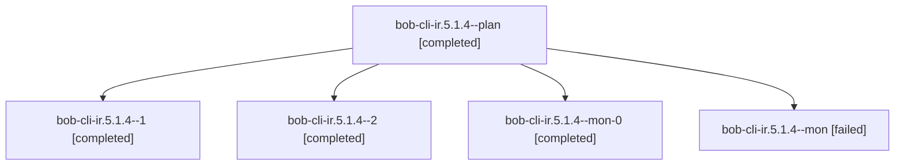

# Session: bob-cli-ir.5.1.4

[Agent Hoods](../README.md) / [bbugyi200](../users/bbugyi200/README.md) / [athena](../users/bbugyi200/machines/athena/README.md) / [bob-cli-ir](../users/bbugyi200/machines/athena/hoods/bob-cli-ir/README.md) / bob-cli-ir.5.1.4

Owner: `bbugyi200.athena` · Hood: `bob-cli-ir` · Members: 5 · Bead: [bob-cli-ir.5.1.4](https://github.com/bobs-org/bob-cli--beads/blob/main/pages/bob-cli-ir/bob-cli-ir.5.1.4.md)

## Lineage

The diagram is an optional enhancement; the ordered table below contains the same lineage in accessible text.

| Role | Agent | State | Model / provider | Timing | Commits | Prompt | Chat |
|---|---|---|---|---|---:|---|---|
| plan | bob-cli-ir.5.1.4--plan | completed | grok-4.6 / grok | 2026-11-09T02:50:18.092414+00:00 → 2026-11-09T03:18:57.829205+00:00 | 0 | [Prompt](../agents/bbugyi200.athena.bob-cli-ir.5.1.4--plan/prompt.md) | [Chat](../agents/bbugyi200.athena.bob-cli-ir.5.1.4--plan/chat.md) |
| 1 | bob-cli-ir.5.1.4--1 | completed | grok-4.6 / grok | 2026-11-09T03:28:39.894488+00:00 → 2026-11-09T03:39:43.079246+00:00 | 0 | [Prompt](../agents/bbugyi200.athena.bob-cli-ir.5.1.4--1/prompt.md) | [Chat](../agents/bbugyi200.athena.bob-cli-ir.5.1.4--1/chat.md) |
| 2 | bob-cli-ir.5.1.4--2 | completed | grok-4.6 / grok | 2026-11-09T03:47:25.670246+00:00 → 2026-11-09T03:59:39.841556+00:00 | [1](../agents/bbugyi200.athena.bob-cli-ir.5.1.4--2/README.md#commits) | [Prompt](../agents/bbugyi200.athena.bob-cli-ir.5.1.4--2/prompt.md) | [Chat](../agents/bbugyi200.athena.bob-cli-ir.5.1.4--2/chat.md) |
| mon-0 | bob-cli-ir.5.1.4--mon-0 | completed | grok-4.6 / grok | 2026-11-09T03:38:27.406401+00:00 → 2026-11-09T03:46:18.768355+00:00 | 0 | — | [Chat](../agents/bbugyi200.athena.bob-cli-ir.5.1.4--mon-0/chat.md) |
| mon | bob-cli-ir.5.1.4--mon | failed | grok-4.6 / grok | 2026-11-09T03:17:51.071486+00:00 → 2026-11-09T03:27:34.725127+00:00 | 0 | — | [Chat](../agents/bbugyi200.athena.bob-cli-ir.5.1.4--mon/chat.md) |

## Commits

| Role | Repo | Commit | Subject | Committed |
|---|---|---|---|---|
| 2 | bob-cli | [`e081e72`](https://github.com/bobs-org/bob-cli/commit/e081e729c5d30152df19e2a9173d067be6dacd8d) | docs(capture): publish the record note capture contract | 2026-11-08 22:59:07 EST |

## Neighbors

| Agent | Relation | State |
|---|---|---|
| [bob-cli-ir.5](bbugyi200.athena.bob-cli-ir.5.md) (session · 3) | ancestor | active 1, completed 2 |
| [bob-cli-ir.5.1.1](../agents/bbugyi200.athena.bob-cli-ir.5.1.1/README.md) | bob-cli-ir.5.1 hood | completed |
| [bob-cli-ir.5.1.2](../agents/bbugyi200.athena.bob-cli-ir.5.1.2/README.md) | bob-cli-ir.5.1 hood | completed |
| [bob-cli-ir.5.1.3](../agents/bbugyi200.athena.bob-cli-ir.5.1.3/README.md) | bob-cli-ir.5.1 hood | completed |
| [bob-cli-ir.5.1.land](bbugyi200.athena.bob-cli-ir.5.1.land.md) (session · 3) | bob-cli-ir.5.1 hood | completed 3 |
| [bob-cli-ir.1](../agents/bbugyi200.athena.bob-cli-ir.1/README.md) | bob-cli-ir hood | completed |
| [bob-cli-ir.10](bbugyi200.athena.bob-cli-ir.10.md) (session · 3) | bob-cli-ir hood | active 1, completed 2 |
| [bob-cli-ir.10.1.1](../agents/bbugyi200.athena.bob-cli-ir.10.1.1/README.md) | bob-cli-ir hood | completed |
| [bob-cli-ir.10.1.2](../agents/bbugyi200.athena.bob-cli-ir.10.1.2/README.md) | bob-cli-ir hood | completed |
| [bob-cli-ir.10.1.3](../agents/bbugyi200.athena.bob-cli-ir.10.1.3/README.md) | bob-cli-ir hood | completed |
| [bob-cli-ir.10.1.4](../agents/bbugyi200.athena.bob-cli-ir.10.1.4/README.md) | bob-cli-ir hood | waiting |
| [bob-cli-ir.10.1.land](../agents/bbugyi200.athena.bob-cli-ir.10.1.land/README.md) | bob-cli-ir hood | waiting |
| [bob-cli-ir.11](../agents/bbugyi200.athena.bob-cli-ir.11/README.md) | bob-cli-ir hood | waiting |
| [bob-cli-ir.12](../agents/bbugyi200.athena.bob-cli-ir.12/README.md) | bob-cli-ir hood | waiting |
| [bob-cli-ir.13](../agents/bbugyi200.athena.bob-cli-ir.13/README.md) | bob-cli-ir hood | waiting |
| [bob-cli-ir.2](bbugyi200.athena.bob-cli-ir.2.md) (session · 3) | bob-cli-ir hood | active 1, completed 2 |
| [bob-cli-ir.2.1.1](../agents/bbugyi200.athena.bob-cli-ir.2.1.1/README.md) | bob-cli-ir hood | completed |
| [bob-cli-ir.2.1.2](../agents/bbugyi200.athena.bob-cli-ir.2.1.2/README.md) | bob-cli-ir hood | completed |
| [bob-cli-ir.2.1.3](../agents/bbugyi200.athena.bob-cli-ir.2.1.3/README.md) | bob-cli-ir hood | completed |
| [bob-cli-ir.2.1.4](../agents/bbugyi200.athena.bob-cli-ir.2.1.4/README.md) | bob-cli-ir hood | completed |
| [bob-cli-ir.2.1.land](bbugyi200.athena.bob-cli-ir.2.1.land.md) (session · 3) | bob-cli-ir hood | completed 3 |
| [bob-cli-ir.2.1.land](../agents/bbugyi200.athena.bob-cli-ir.2.1.land/README.md) | bob-cli-ir hood | completed |
| [bob-cli-ir.3](../agents/bbugyi200.athena.bob-cli-ir.3/README.md) | bob-cli-ir hood | completed |
| [bob-cli-ir.4](../agents/bbugyi200.athena.bob-cli-ir.4/README.md) | bob-cli-ir hood | completed |
| [bob-cli-ir.6](bbugyi200.athena.bob-cli-ir.6.md) (session · 7) | bob-cli-ir hood | completed 6, failed 1 |
| [bob-cli-ir.7](bbugyi200.athena.bob-cli-ir.7.md) (session · 3) | bob-cli-ir hood | active 1, completed 2 |
| [bob-cli-ir.7.1.1](../agents/bbugyi200.athena.bob-cli-ir.7.1.1/README.md) | bob-cli-ir hood | completed |
| [bob-cli-ir.7.1.2](../agents/bbugyi200.athena.bob-cli-ir.7.1.2/README.md) | bob-cli-ir hood | completed |
| [bob-cli-ir.7.1.3](../agents/bbugyi200.athena.bob-cli-ir.7.1.3/README.md) | bob-cli-ir hood | completed |
| [bob-cli-ir.7.1.4](../agents/bbugyi200.athena.bob-cli-ir.7.1.4/README.md) | bob-cli-ir hood | completed |
| [bob-cli-ir.7.1.5](../agents/bbugyi200.athena.bob-cli-ir.7.1.5/README.md) | bob-cli-ir hood | completed |
| [bob-cli-ir.7.1.land](../agents/bbugyi200.athena.bob-cli-ir.7.1.land/README.md) | bob-cli-ir hood | waiting |
| [bob-cli-ir.8](../agents/bbugyi200.athena.bob-cli-ir.8/README.md) | bob-cli-ir hood | waiting |
| [bob-cli-ir.9](../agents/bbugyi200.athena.bob-cli-ir.9/README.md) | bob-cli-ir hood | waiting |
| [bob-cli-ir.land](../agents/bbugyi200.athena.bob-cli-ir.land/README.md) | bob-cli-ir hood | waiting |
