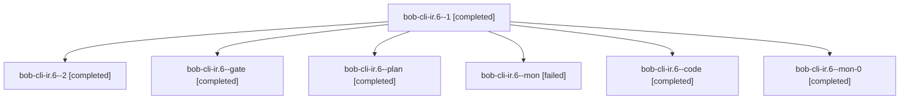

# Session: bob-cli-ir.6

[Agent Hoods](../README.md) / [bbugyi200](../users/bbugyi200/README.md) / [athena](../users/bbugyi200/machines/athena/README.md) / [bob-cli-ir](../users/bbugyi200/machines/athena/hoods/bob-cli-ir/README.md) / bob-cli-ir.6

Owner: `bbugyi200.athena` · Hood: `bob-cli-ir` · Members: 7 · Bead: [bob-cli-ir.6](https://github.com/bobs-org/bob-cli--beads/blob/main/pages/bob-cli-ir/bob-cli-ir.6.md)

## Lineage

The diagram is an optional enhancement; the ordered table below contains the same lineage in accessible text.

| Role | Agent | State | Model / provider | Timing | Commits | Prompt | Chat |
|---|---|---|---|---|---:|---|---|
| 1 | bob-cli-ir.6--1 | completed | grok-4.6 / grok | 2026-11-09T06:59:04.219790+00:00 → 2026-11-09T07:08:27.937072+00:00 | 0 | [Prompt](../agents/bbugyi200.athena.bob-cli-ir.6--1/prompt.md) | [Chat](../agents/bbugyi200.athena.bob-cli-ir.6--1/chat.md) |
| 2 | bob-cli-ir.6--2 | completed | grok-4.6 / grok | 2026-11-09T07:17:39.323212+00:00 → 2026-11-09T07:35:08.112108+00:00 | [1](../agents/bbugyi200.athena.bob-cli-ir.6--2/README.md#commits) | [Prompt](../agents/bbugyi200.athena.bob-cli-ir.6--2/prompt.md) | [Chat](../agents/bbugyi200.athena.bob-cli-ir.6--2/chat.md) |
| gate | bob-cli-ir.6--gate | completed | gpt-6-astra / codex | 2026-11-09T05:37:31.176654+00:00 → 2026-11-09T05:37:59.451204+00:00 | 0 | — | [Chat](../agents/bbugyi200.athena.bob-cli-ir.6--gate/chat.md) |
| plan | bob-cli-ir.6--plan | completed | gpt-6-astra / codex | 2026-11-09T05:30:25.393256+00:00 → 2026-11-09T06:54:21.488851+00:00 | 0 | [Prompt](../agents/bbugyi200.athena.bob-cli-ir.6--plan/prompt.md) | [Chat](../agents/bbugyi200.athena.bob-cli-ir.6--plan/chat.md) |
| mon | bob-cli-ir.6--mon | failed | grok-4.6 / grok | 2026-11-09T06:53:03.409473+00:00 → 2026-11-09T06:58:05.353930+00:00 | 0 | — | [Chat](../agents/bbugyi200.athena.bob-cli-ir.6--mon/chat.md) |
| code | bob-cli-ir.6--code | completed | grok-4.6 / grok | 2026-11-09T05:39:25.611752+00:00 → 2026-11-09T06:54:21.488851+00:00 | 0 | — | [Chat](../agents/bbugyi200.athena.bob-cli-ir.6--code/chat.md) |
| mon-0 | bob-cli-ir.6--mon-0 | completed | grok-4.6 / grok | 2026-11-09T07:07:16.904872+00:00 → 2026-11-09T07:16:40.863744+00:00 | 0 | — | [Chat](../agents/bbugyi200.athena.bob-cli-ir.6--mon-0/chat.md) |

## Commits

| Role | Repo | Commit | Subject | Committed |
|---|---|---|---|---|
| 2 | bob-cli | [`07ff3bf`](https://github.com/bobs-org/bob-cli/commit/07ff3bf01fd4dad8d8ebf287035877bfd43df90b) | feat(capture): add guided record field completion | 2026-11-09 02:34:23 EST |

## Neighbors

| Agent | Relation | State |
|---|---|---|
| [bob-cli-ir.1](../agents/bbugyi200.athena.bob-cli-ir.1/README.md) | bob-cli-ir hood | completed |
| [bob-cli-ir.10](bbugyi200.athena.bob-cli-ir.10.md) (session · 3) | bob-cli-ir hood | active 1, completed 2 |
| [bob-cli-ir.10.1.1](../agents/bbugyi200.athena.bob-cli-ir.10.1.1/README.md) | bob-cli-ir hood | completed |
| [bob-cli-ir.10.1.2](../agents/bbugyi200.athena.bob-cli-ir.10.1.2/README.md) | bob-cli-ir hood | completed |
| [bob-cli-ir.10.1.3](../agents/bbugyi200.athena.bob-cli-ir.10.1.3/README.md) | bob-cli-ir hood | completed |
| [bob-cli-ir.10.1.4](../agents/bbugyi200.athena.bob-cli-ir.10.1.4/README.md) | bob-cli-ir hood | waiting |
| [bob-cli-ir.10.1.land](../agents/bbugyi200.athena.bob-cli-ir.10.1.land/README.md) | bob-cli-ir hood | waiting |
| [bob-cli-ir.11](../agents/bbugyi200.athena.bob-cli-ir.11/README.md) | bob-cli-ir hood | waiting |
| [bob-cli-ir.12](../agents/bbugyi200.athena.bob-cli-ir.12/README.md) | bob-cli-ir hood | waiting |
| [bob-cli-ir.13](../agents/bbugyi200.athena.bob-cli-ir.13/README.md) | bob-cli-ir hood | waiting |
| [bob-cli-ir.2](bbugyi200.athena.bob-cli-ir.2.md) (session · 3) | bob-cli-ir hood | active 1, completed 2 |
| [bob-cli-ir.2.1.1](../agents/bbugyi200.athena.bob-cli-ir.2.1.1/README.md) | bob-cli-ir hood | completed |
| [bob-cli-ir.2.1.2](../agents/bbugyi200.athena.bob-cli-ir.2.1.2/README.md) | bob-cli-ir hood | completed |
| [bob-cli-ir.2.1.3](../agents/bbugyi200.athena.bob-cli-ir.2.1.3/README.md) | bob-cli-ir hood | completed |
| [bob-cli-ir.2.1.4](../agents/bbugyi200.athena.bob-cli-ir.2.1.4/README.md) | bob-cli-ir hood | completed |
| [bob-cli-ir.2.1.land](bbugyi200.athena.bob-cli-ir.2.1.land.md) (session · 3) | bob-cli-ir hood | completed 3 |
| [bob-cli-ir.2.1.land](../agents/bbugyi200.athena.bob-cli-ir.2.1.land/README.md) | bob-cli-ir hood | completed |
| [bob-cli-ir.3](../agents/bbugyi200.athena.bob-cli-ir.3/README.md) | bob-cli-ir hood | completed |
| [bob-cli-ir.4](../agents/bbugyi200.athena.bob-cli-ir.4/README.md) | bob-cli-ir hood | completed |
| [bob-cli-ir.5](bbugyi200.athena.bob-cli-ir.5.md) (session · 3) | bob-cli-ir hood | active 1, completed 2 |
| [bob-cli-ir.5.1.1](../agents/bbugyi200.athena.bob-cli-ir.5.1.1/README.md) | bob-cli-ir hood | completed |
| [bob-cli-ir.5.1.2](../agents/bbugyi200.athena.bob-cli-ir.5.1.2/README.md) | bob-cli-ir hood | completed |
| [bob-cli-ir.5.1.3](../agents/bbugyi200.athena.bob-cli-ir.5.1.3/README.md) | bob-cli-ir hood | completed |
| [bob-cli-ir.5.1.4](bbugyi200.athena.bob-cli-ir.5.1.4.md) (session · 5) | bob-cli-ir hood | completed 4, failed 1 |
| [bob-cli-ir.5.1.land](bbugyi200.athena.bob-cli-ir.5.1.land.md) (session · 3) | bob-cli-ir hood | completed 3 |
| [bob-cli-ir.7](bbugyi200.athena.bob-cli-ir.7.md) (session · 3) | bob-cli-ir hood | active 1, completed 2 |
| [bob-cli-ir.7.1.1](../agents/bbugyi200.athena.bob-cli-ir.7.1.1/README.md) | bob-cli-ir hood | completed |
| [bob-cli-ir.7.1.2](../agents/bbugyi200.athena.bob-cli-ir.7.1.2/README.md) | bob-cli-ir hood | completed |
| [bob-cli-ir.7.1.3](../agents/bbugyi200.athena.bob-cli-ir.7.1.3/README.md) | bob-cli-ir hood | completed |
| [bob-cli-ir.7.1.4](../agents/bbugyi200.athena.bob-cli-ir.7.1.4/README.md) | bob-cli-ir hood | waiting |
| [bob-cli-ir.7.1.5](../agents/bbugyi200.athena.bob-cli-ir.7.1.5/README.md) | bob-cli-ir hood | waiting |
| [bob-cli-ir.7.1.land](../agents/bbugyi200.athena.bob-cli-ir.7.1.land/README.md) | bob-cli-ir hood | waiting |
| [bob-cli-ir.8](../agents/bbugyi200.athena.bob-cli-ir.8/README.md) | bob-cli-ir hood | waiting |
| [bob-cli-ir.9](../agents/bbugyi200.athena.bob-cli-ir.9/README.md) | bob-cli-ir hood | waiting |
| [bob-cli-ir.land](../agents/bbugyi200.athena.bob-cli-ir.land/README.md) | bob-cli-ir hood | waiting |
