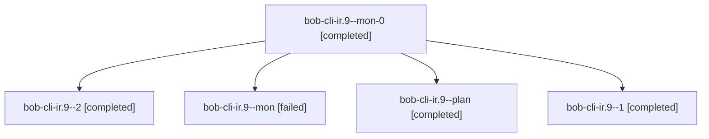

# Session: bob-cli-ir.9

[Agent Hoods](../README.md) / [bbugyi200](../users/bbugyi200/README.md) / [athena](../users/bbugyi200/machines/athena/README.md) / [bob-cli-ir](../users/bbugyi200/machines/athena/hoods/bob-cli-ir/README.md) / bob-cli-ir.9

Owner: `bbugyi200.athena` · Hood: `bob-cli-ir` · Members: 5 · Bead: [bob-cli-ir.9](https://github.com/bobs-org/bob-cli--beads/blob/main/pages/bob-cli-ir/bob-cli-ir.9.md)

## Lineage

The diagram is an optional enhancement; the ordered table below contains the same lineage in accessible text.

| Role | Agent | State | Model / provider | Timing | Commits | Prompt | Chat |
|---|---|---|---|---|---:|---|---|
| mon-0 | bob-cli-ir.9--mon-0 | completed | grok-4.6 / grok | 2026-11-09T12:59:34.671120+00:00 → 2026-11-09T13:09:35.639158+00:00 | 0 | — | [Chat](../agents/bbugyi200.athena.bob-cli-ir.9--mon-0/chat.md) |
| 2 | bob-cli-ir.9--2 | completed | grok-4.6 / grok | 2026-11-09T13:10:38.632677+00:00 → 2026-11-09T13:26:47.921433+00:00 | [1](../agents/bbugyi200.athena.bob-cli-ir.9--2/README.md#commits) | [Prompt](../agents/bbugyi200.athena.bob-cli-ir.9--2/prompt.md) | [Chat](../agents/bbugyi200.athena.bob-cli-ir.9--2/chat.md) |
| mon | bob-cli-ir.9--mon | failed | grok-4.6 / grok | 2026-11-09T12:41:43.309664+00:00 → 2026-11-09T12:49:05.861142+00:00 | 0 | — | [Chat](../agents/bbugyi200.athena.bob-cli-ir.9--mon/chat.md) |
| plan | bob-cli-ir.9--plan | completed | grok-4.6 / grok | 2026-11-09T12:07:32.932830+00:00 → 2026-11-09T12:42:59.053434+00:00 | 0 | [Prompt](../agents/bbugyi200.athena.bob-cli-ir.9--plan/prompt.md) | [Chat](../agents/bbugyi200.athena.bob-cli-ir.9--plan/chat.md) |
| 1 | bob-cli-ir.9--1 | completed | grok-4.6 / grok | 2026-11-09T12:50:01.363047+00:00 → 2026-11-09T13:00:38.924009+00:00 | 0 | [Prompt](../agents/bbugyi200.athena.bob-cli-ir.9--1/prompt.md) | [Chat](../agents/bbugyi200.athena.bob-cli-ir.9--1/chat.md) |

## Commits

| Role | Repo | Commit | Subject | Committed |
|---|---|---|---|---|
| 2 | bob-cli | [`262f3cf`](https://github.com/bobs-org/bob-cli/commit/262f3cfcbf594449a247bb5925e10ba7ca89fb34) | feat(records): add records init CLI to scaffold type notes and Bases | 2026-11-09 08:25:16 EST |

## Neighbors

| Agent | Relation | State |
|---|---|---|
| [bob-cli-ir.1](../agents/bbugyi200.athena.bob-cli-ir.1/README.md) | bob-cli-ir hood | completed |
| [bob-cli-ir.10](bbugyi200.athena.bob-cli-ir.10.md) (session · 3) | bob-cli-ir hood | active 1, completed 2 |
| [bob-cli-ir.10.1.1](../agents/bbugyi200.athena.bob-cli-ir.10.1.1/README.md) | bob-cli-ir hood | completed |
| [bob-cli-ir.10.1.2](../agents/bbugyi200.athena.bob-cli-ir.10.1.2/README.md) | bob-cli-ir hood | completed |
| [bob-cli-ir.10.1.3](../agents/bbugyi200.athena.bob-cli-ir.10.1.3/README.md) | bob-cli-ir hood | completed |
| [bob-cli-ir.10.1.4](bbugyi200.athena.bob-cli-ir.10.1.4.md) (session · 5) | bob-cli-ir hood | completed 4, failed 1 |
| [bob-cli-ir.10.1.land](bbugyi200.athena.bob-cli-ir.10.1.land.md) (session · 7) | bob-cli-ir hood | completed 6, failed 1 |
| [bob-cli-ir.11](../agents/bbugyi200.athena.bob-cli-ir.11/README.md) | bob-cli-ir hood | waiting |
| [bob-cli-ir.12](../agents/bbugyi200.athena.bob-cli-ir.12/README.md) | bob-cli-ir hood | waiting |
| [bob-cli-ir.13](../agents/bbugyi200.athena.bob-cli-ir.13/README.md) | bob-cli-ir hood | waiting |
| [bob-cli-ir.2](bbugyi200.athena.bob-cli-ir.2.md) (session · 3) | bob-cli-ir hood | active 1, completed 2 |
| [bob-cli-ir.2.1.1](../agents/bbugyi200.athena.bob-cli-ir.2.1.1/README.md) | bob-cli-ir hood | completed |
| [bob-cli-ir.2.1.2](../agents/bbugyi200.athena.bob-cli-ir.2.1.2/README.md) | bob-cli-ir hood | completed |
| [bob-cli-ir.2.1.3](../agents/bbugyi200.athena.bob-cli-ir.2.1.3/README.md) | bob-cli-ir hood | completed |
| [bob-cli-ir.2.1.4](../agents/bbugyi200.athena.bob-cli-ir.2.1.4/README.md) | bob-cli-ir hood | completed |
| [bob-cli-ir.2.1.land](bbugyi200.athena.bob-cli-ir.2.1.land.md) (session · 3) | bob-cli-ir hood | completed 3 |
| [bob-cli-ir.2.1.land](../agents/bbugyi200.athena.bob-cli-ir.2.1.land/README.md) | bob-cli-ir hood | completed |
| [bob-cli-ir.3](../agents/bbugyi200.athena.bob-cli-ir.3/README.md) | bob-cli-ir hood | completed |
| [bob-cli-ir.4](../agents/bbugyi200.athena.bob-cli-ir.4/README.md) | bob-cli-ir hood | completed |
| [bob-cli-ir.5](bbugyi200.athena.bob-cli-ir.5.md) (session · 3) | bob-cli-ir hood | active 1, completed 2 |
| [bob-cli-ir.5.1.1](../agents/bbugyi200.athena.bob-cli-ir.5.1.1/README.md) | bob-cli-ir hood | completed |
| [bob-cli-ir.5.1.2](../agents/bbugyi200.athena.bob-cli-ir.5.1.2/README.md) | bob-cli-ir hood | completed |
| [bob-cli-ir.5.1.3](../agents/bbugyi200.athena.bob-cli-ir.5.1.3/README.md) | bob-cli-ir hood | completed |
| [bob-cli-ir.5.1.4](bbugyi200.athena.bob-cli-ir.5.1.4.md) (session · 5) | bob-cli-ir hood | completed 4, failed 1 |
| [bob-cli-ir.5.1.land](bbugyi200.athena.bob-cli-ir.5.1.land.md) (session · 3) | bob-cli-ir hood | completed 3 |
| [bob-cli-ir.6](bbugyi200.athena.bob-cli-ir.6.md) (session · 7) | bob-cli-ir hood | completed 6, failed 1 |
| [bob-cli-ir.7](bbugyi200.athena.bob-cli-ir.7.md) (session · 3) | bob-cli-ir hood | active 1, completed 2 |
| [bob-cli-ir.7.1.1](../agents/bbugyi200.athena.bob-cli-ir.7.1.1/README.md) | bob-cli-ir hood | completed |
| [bob-cli-ir.7.1.2](../agents/bbugyi200.athena.bob-cli-ir.7.1.2/README.md) | bob-cli-ir hood | completed |
| [bob-cli-ir.7.1.3](../agents/bbugyi200.athena.bob-cli-ir.7.1.3/README.md) | bob-cli-ir hood | completed |
| [bob-cli-ir.7.1.4](../agents/bbugyi200.athena.bob-cli-ir.7.1.4/README.md) | bob-cli-ir hood | completed |
| [bob-cli-ir.7.1.5](../agents/bbugyi200.athena.bob-cli-ir.7.1.5/README.md) | bob-cli-ir hood | completed |
| [bob-cli-ir.7.1.land](bbugyi200.athena.bob-cli-ir.7.1.land.md) (session · 3) | bob-cli-ir hood | completed 3 |
| [bob-cli-ir.8](../agents/bbugyi200.athena.bob-cli-ir.8/README.md) | bob-cli-ir hood | completed |
| [bob-cli-ir.land](../agents/bbugyi200.athena.bob-cli-ir.land/README.md) | bob-cli-ir hood | waiting |
