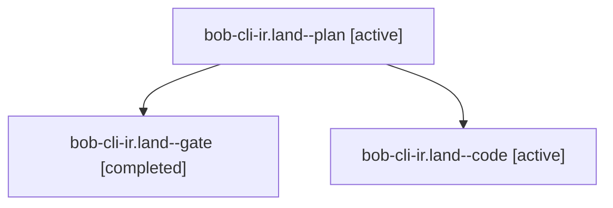

# Session: bob-cli-ir.land

[Agent Hoods](../README.md) / [bbugyi200](../users/bbugyi200/README.md) / [athena](../users/bbugyi200/machines/athena/README.md) / [bob-cli-ir](../users/bbugyi200/machines/athena/hoods/bob-cli-ir/README.md) / bob-cli-ir.land

Owner: `bbugyi200.athena` · Hood: `bob-cli-ir` · Members: 3 · Bead: [bob-cli-ir](https://github.com/bobs-org/bob-cli--beads/blob/main/pages/bob-cli-ir/README.md)

## Lineage

The diagram is an optional enhancement; the ordered table below contains the same lineage in accessible text.

| Role | Agent | State | Model / provider | Timing | Commits | Prompt | Chat |
|---|---|---|---|---|---:|---|---|
| plan | bob-cli-ir.land--plan | active | opus / claude | 2026-11-09T18:38:17.226778+00:00 | 0 | [Prompt](../agents/bbugyi200.athena.bob-cli-ir.land--plan/prompt.md) | [Chat](../agents/bbugyi200.athena.bob-cli-ir.land--plan/chat.md) |
| gate | bob-cli-ir.land--gate | completed | opus / claude | 2026-11-09T19:13:09.211886+00:00 → 2026-11-09T19:13:55.588332+00:00 | 0 | — | [Chat](../agents/bbugyi200.athena.bob-cli-ir.land--gate/chat.md) |
| code | bob-cli-ir.land--code | active | grok-4.6 / grok | 2026-11-09T19:14:30.187702+00:00 | 0 | — | — |

## Neighbors

| Agent | Relation | State |
|---|---|---|
| [bob-cli-ir.1](../agents/bbugyi200.athena.bob-cli-ir.1/README.md) | bob-cli-ir hood | completed |
| [bob-cli-ir.10](bbugyi200.athena.bob-cli-ir.10.md) (session · 3) | bob-cli-ir hood | active 1, completed 2 |
| [bob-cli-ir.10.1.1](../agents/bbugyi200.athena.bob-cli-ir.10.1.1/README.md) | bob-cli-ir hood | completed |
| [bob-cli-ir.10.1.2](../agents/bbugyi200.athena.bob-cli-ir.10.1.2/README.md) | bob-cli-ir hood | completed |
| [bob-cli-ir.10.1.3](../agents/bbugyi200.athena.bob-cli-ir.10.1.3/README.md) | bob-cli-ir hood | completed |
| [bob-cli-ir.10.1.4](bbugyi200.athena.bob-cli-ir.10.1.4.md) (session · 5) | bob-cli-ir hood | completed 4, failed 1 |
| [bob-cli-ir.10.1.land](bbugyi200.athena.bob-cli-ir.10.1.land.md) (session · 7) | bob-cli-ir hood | completed 6, failed 1 |
| [bob-cli-ir.11](bbugyi200.athena.bob-cli-ir.11.md) (session · 5) | bob-cli-ir hood | completed 5 |
| [bob-cli-ir.12](../agents/bbugyi200.athena.bob-cli-ir.12/README.md) | bob-cli-ir hood | completed |
| [bob-cli-ir.13](../agents/bbugyi200.athena.bob-cli-ir.13/README.md) | bob-cli-ir hood | completed |
| [bob-cli-ir.2](bbugyi200.athena.bob-cli-ir.2.md) (session · 3) | bob-cli-ir hood | active 1, completed 2 |
| [bob-cli-ir.2.1.1](../agents/bbugyi200.athena.bob-cli-ir.2.1.1/README.md) | bob-cli-ir hood | completed |
| [bob-cli-ir.2.1.2](../agents/bbugyi200.athena.bob-cli-ir.2.1.2/README.md) | bob-cli-ir hood | completed |
| [bob-cli-ir.2.1.3](../agents/bbugyi200.athena.bob-cli-ir.2.1.3/README.md) | bob-cli-ir hood | completed |
| [bob-cli-ir.2.1.4](../agents/bbugyi200.athena.bob-cli-ir.2.1.4/README.md) | bob-cli-ir hood | completed |
| [bob-cli-ir.2.1.land](bbugyi200.athena.bob-cli-ir.2.1.land.md) (session · 3) | bob-cli-ir hood | completed 3 |
| [bob-cli-ir.2.1.land](../agents/bbugyi200.athena.bob-cli-ir.2.1.land/README.md) | bob-cli-ir hood | completed |
| [bob-cli-ir.3](../agents/bbugyi200.athena.bob-cli-ir.3/README.md) | bob-cli-ir hood | completed |
| [bob-cli-ir.4](../agents/bbugyi200.athena.bob-cli-ir.4/README.md) | bob-cli-ir hood | completed |
| [bob-cli-ir.5](bbugyi200.athena.bob-cli-ir.5.md) (session · 3) | bob-cli-ir hood | active 1, completed 2 |
| [bob-cli-ir.5.1.1](../agents/bbugyi200.athena.bob-cli-ir.5.1.1/README.md) | bob-cli-ir hood | completed |
| [bob-cli-ir.5.1.2](../agents/bbugyi200.athena.bob-cli-ir.5.1.2/README.md) | bob-cli-ir hood | completed |
| [bob-cli-ir.5.1.3](../agents/bbugyi200.athena.bob-cli-ir.5.1.3/README.md) | bob-cli-ir hood | completed |
| [bob-cli-ir.5.1.4](bbugyi200.athena.bob-cli-ir.5.1.4.md) (session · 5) | bob-cli-ir hood | completed 4, failed 1 |
| [bob-cli-ir.5.1.land](bbugyi200.athena.bob-cli-ir.5.1.land.md) (session · 3) | bob-cli-ir hood | completed 3 |
| [bob-cli-ir.6](bbugyi200.athena.bob-cli-ir.6.md) (session · 7) | bob-cli-ir hood | completed 6, failed 1 |
| [bob-cli-ir.7](bbugyi200.athena.bob-cli-ir.7.md) (session · 3) | bob-cli-ir hood | active 1, completed 2 |
| [bob-cli-ir.7.1.1](../agents/bbugyi200.athena.bob-cli-ir.7.1.1/README.md) | bob-cli-ir hood | completed |
| [bob-cli-ir.7.1.2](../agents/bbugyi200.athena.bob-cli-ir.7.1.2/README.md) | bob-cli-ir hood | completed |
| [bob-cli-ir.7.1.3](../agents/bbugyi200.athena.bob-cli-ir.7.1.3/README.md) | bob-cli-ir hood | completed |
| [bob-cli-ir.7.1.4](../agents/bbugyi200.athena.bob-cli-ir.7.1.4/README.md) | bob-cli-ir hood | completed |
| [bob-cli-ir.7.1.5](../agents/bbugyi200.athena.bob-cli-ir.7.1.5/README.md) | bob-cli-ir hood | completed |
| [bob-cli-ir.7.1.land](bbugyi200.athena.bob-cli-ir.7.1.land.md) (session · 3) | bob-cli-ir hood | completed 3 |
| [bob-cli-ir.8](../agents/bbugyi200.athena.bob-cli-ir.8/README.md) | bob-cli-ir hood | completed |
| [bob-cli-ir.9](bbugyi200.athena.bob-cli-ir.9.md) (session · 5) | bob-cli-ir hood | completed 4, failed 1 |
