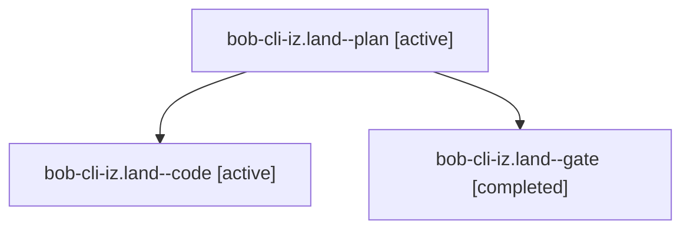

# Session: bob-cli-iz.land

[Agent Hoods](../README.md) / [bbugyi200](../users/bbugyi200/README.md) / [athena](../users/bbugyi200/machines/athena/README.md) / [bob-cli-iz](../users/bbugyi200/machines/athena/hoods/bob-cli-iz/README.md) / bob-cli-iz.land

Owner: `bbugyi200.athena` · Hood: `bob-cli-iz` · Members: 3 · Bead: [bob-cli-iz](https://github.com/bobs-org/bob-cli--beads/blob/main/pages/bob-cli-iz/README.md)

## Lineage

The diagram is an optional enhancement; the ordered table below contains the same lineage in accessible text.

| Role | Agent | State | Model / provider | Timing | Commits | Prompt | Chat |
|---|---|---|---|---|---:|---|---|
| plan | bob-cli-iz.land--plan | active | opus / claude | 2026-11-10T01:27:58.461873+00:00 | [1](../agents/bbugyi200.athena.bob-cli-iz.land--plan/README.md#commits) | [Prompt](../agents/bbugyi200.athena.bob-cli-iz.land--plan/prompt.md) | [Chat](../agents/bbugyi200.athena.bob-cli-iz.land--plan/chat.md) |
| code | bob-cli-iz.land--code | active | grok-4.6 / grok | 2026-11-10T02:10:08.312334+00:00 | 0 | — | — |
| gate | bob-cli-iz.land--gate | completed | opus / claude | 2026-11-10T02:09:06.852569+00:00 → 2026-11-10T02:09:38.082606+00:00 | 0 | — | [Chat](../agents/bbugyi200.athena.bob-cli-iz.land--gate/chat.md) |

## Commits

| Role | Repo | Commit | Subject | Committed |
|---|---|---|---|---|
| plan | bob-cli | [`d3f022a`](https://github.com/bobs-org/bob-cli/commit/d3f022a45cfa247305ec729b32168698dc42bb51) | feat(gcal)!: hold replaced Events sections | 2026-11-09 21:08:39 EST |

## Neighbors

| Agent | Relation | State |
|---|---|---|
| [bob-cli-iz.1](../agents/bbugyi200.athena.bob-cli-iz.1/README.md) | bob-cli-iz hood | completed |
| [bob-cli-iz.2](../agents/bbugyi200.athena.bob-cli-iz.2/README.md) | bob-cli-iz hood | completed |
| [bob-cli-iz.3](../agents/bbugyi200.athena.bob-cli-iz.3/README.md) | bob-cli-iz hood | completed |
| [bob-cli-iz.4](../agents/bbugyi200.athena.bob-cli-iz.4/README.md) | bob-cli-iz hood | completed |
| [bob-cli-iz.5](../agents/bbugyi200.athena.bob-cli-iz.5/README.md) | bob-cli-iz hood | completed |
