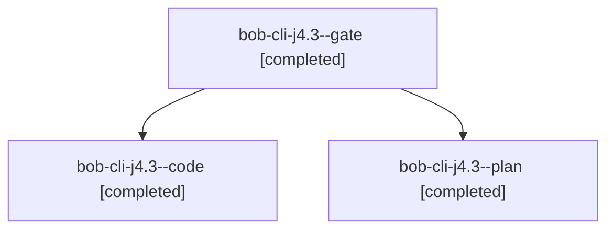

# Session: bob-cli-j4.3

[Agent Hoods](../README.md) / [bbugyi200](../users/bbugyi200/README.md) / [athena](../users/bbugyi200/machines/athena/README.md) / [bob-cli-j4](../users/bbugyi200/machines/athena/hoods/bob-cli-j4/README.md) / bob-cli-j4.3

Owner: `bbugyi200.athena` · Hood: `bob-cli-j4` · Members: 3 · Bead: [bob-cli-j4.3](https://github.com/bobs-org/bob-cli--beads/blob/main/pages/bob-cli-j4/bob-cli-j4.3.md)

## Lineage

The diagram is an optional enhancement; the ordered table below contains the same lineage in accessible text.

| Role | Agent | State | Model / provider | Timing | Commits | Prompt | Chat |
|---|---|---|---|---|---:|---|---|
| gate | bob-cli-j4.3--gate | completed | opus / claude | 2026-11-09T16:21:46.176265+00:00 → 2026-11-09T16:22:39.278633+00:00 | 0 | — | [Chat](../agents/bbugyi200.athena.bob-cli-j4.3--gate/chat.md) |
| code | bob-cli-j4.3--code | completed | muse-spark-1.3-contributor / muse | 2026-11-09T16:23:17.875899+00:00 → 2026-11-09T16:25:53.083009+00:00 | 0 | — | [Chat](../agents/bbugyi200.athena.bob-cli-j4.3--code/chat.md) |
| plan | bob-cli-j4.3--plan | completed | opus / claude | 2026-11-09T16:14:50.923389+00:00 → 2026-11-09T16:25:53.083009+00:00 | 0 | [Prompt](../agents/bbugyi200.athena.bob-cli-j4.3--plan/prompt.md) | [Chat](../agents/bbugyi200.athena.bob-cli-j4.3--plan/chat.md) |

## Neighbors

| Agent | Relation | State |
|---|---|---|
| [bob-cli-j4.1](bbugyi200.athena.bob-cli-j4.1.md) (session · 3) | bob-cli-j4 hood | completed 3 |
| [bob-cli-j4.2](bbugyi200.athena.bob-cli-j4.2.md) (session · 3) | bob-cli-j4 hood | completed 3 |
| [bob-cli-j4.4](bbugyi200.athena.bob-cli-j4.4.md) (session · 3) | bob-cli-j4 hood | completed 3 |
| [bob-cli-j4.5](bbugyi200.athena.bob-cli-j4.5.md) (session · 3) | bob-cli-j4 hood | completed 3 |
| [bob-cli-j4.land](../agents/bbugyi200.athena.bob-cli-j4.land/README.md) | bob-cli-j4 hood | waiting |
