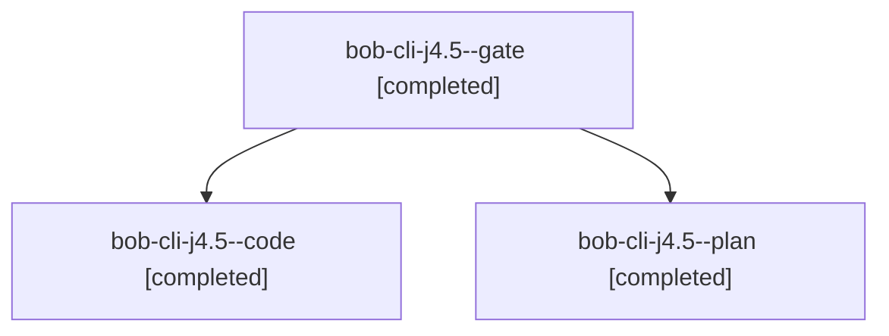

# Session: bob-cli-j4.5

[Agent Hoods](../README.md) / [bbugyi200](../users/bbugyi200/README.md) / [athena](../users/bbugyi200/machines/athena/README.md) / [bob-cli-j4](../users/bbugyi200/machines/athena/hoods/bob-cli-j4/README.md) / bob-cli-j4.5

Owner: `bbugyi200.athena` · Hood: `bob-cli-j4` · Members: 3 · Bead: [bob-cli-j4.5](https://github.com/bobs-org/bob-cli--beads/blob/main/pages/bob-cli-j4/bob-cli-j4.5.md)

## Lineage

The diagram is an optional enhancement; the ordered table below contains the same lineage in accessible text.

| Role | Agent | State | Model / provider | Timing | Commits | Prompt | Chat |
|---|---|---|---|---|---:|---|---|
| gate | bob-cli-j4.5--gate | completed | opus / claude | 2026-11-09T16:48:14.867611+00:00 → 2026-11-09T16:48:51.023979+00:00 | 0 | — | [Chat](../agents/bbugyi200.athena.bob-cli-j4.5--gate/chat.md) |
| code | bob-cli-j4.5--code | completed | gpt-6-luna / codex | 2026-11-09T16:49:42.147848+00:00 → 2026-11-09T16:52:53.687625+00:00 | 0 | — | [Chat](../agents/bbugyi200.athena.bob-cli-j4.5--code/chat.md) |
| plan | bob-cli-j4.5--plan | completed | opus / claude | 2026-11-09T16:41:59.669163+00:00 → 2026-11-09T16:52:53.687625+00:00 | 0 | [Prompt](../agents/bbugyi200.athena.bob-cli-j4.5--plan/prompt.md) | [Chat](../agents/bbugyi200.athena.bob-cli-j4.5--plan/chat.md) |

## Neighbors

| Agent | Relation | State |
|---|---|---|
| [bob-cli-j4.1](bbugyi200.athena.bob-cli-j4.1.md) (session · 3) | bob-cli-j4 hood | completed 3 |
| [bob-cli-j4.2](bbugyi200.athena.bob-cli-j4.2.md) (session · 3) | bob-cli-j4 hood | completed 3 |
| [bob-cli-j4.3](bbugyi200.athena.bob-cli-j4.3.md) (session · 3) | bob-cli-j4 hood | completed 3 |
| [bob-cli-j4.4](bbugyi200.athena.bob-cli-j4.4.md) (session · 3) | bob-cli-j4 hood | completed 3 |
| [bob-cli-j4.land](../agents/bbugyi200.athena.bob-cli-j4.land/README.md) | bob-cli-j4 hood | completed |
