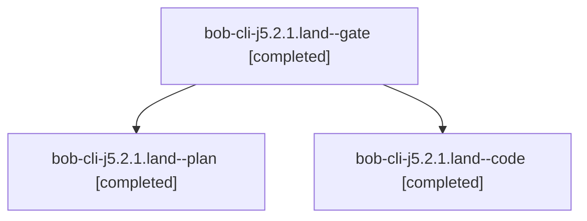

# Session: bob-cli-j5.2.1.land

[Agent Hoods](../README.md) / [bbugyi200](../users/bbugyi200/README.md) / [athena](../users/bbugyi200/machines/athena/README.md) / [bob-cli-j5](../users/bbugyi200/machines/athena/hoods/bob-cli-j5/README.md) / bob-cli-j5.2.1.land

Owner: `bbugyi200.athena` · Hood: `bob-cli-j5` · Members: 3 · Bead: [bob-cli-j5.2.1](https://github.com/bobs-org/bob-cli--beads/blob/main/pages/bob-cli-j5/bob-cli-j5.2.1.md)

## Lineage



The diagram is an optional enhancement; the ordered table below contains the same lineage in accessible text.

| Role | Agent | State | Model / provider | Timing | Commits | Prompt | Chat |
|---|---|---|---|---|---:|---|---|
| <a id="member-gate"></a>gate | bob-cli-j5.2.1.land--gate | completed | gpt-6-astra / codex | 2026-11-09T20:26:44.024021+00:00 → 2026-11-09T20:27:24.144311+00:00 | 0 | — | [Chat](../agents/bbugyi200.athena.bob-cli-j5.2.1.land--gate/chat.md) |
| <a id="member-plan"></a>plan | bob-cli-j5.2.1.land--plan | completed | gpt-6-astra / codex | 2026-11-09T20:12:10.417170+00:00 → 2026-11-09T21:07:10.291469+00:00 | 0 | [Prompt](../agents/bbugyi200.athena.bob-cli-j5.2.1.land--plan/prompt.md) | [Chat](../agents/bbugyi200.athena.bob-cli-j5.2.1.land--plan/chat.md) |
| <a id="member-code"></a>code | bob-cli-j5.2.1.land--code | completed | gpt-6-luna / codex | 2026-11-09T20:28:33.541420+00:00 → 2026-11-09T21:07:10.291469+00:00 | [1](../agents/bbugyi200.athena.bob-cli-j5.2.1.land--code/README.md#commits) | — | [Chat](../agents/bbugyi200.athena.bob-cli-j5.2.1.land--code/chat.md) |

## Commits

| Role | Repo | Commit | Subject | Committed |
|---|---|---|---|---|
| code | bob-cli | [`2455d9d`](https://github.com/bobs-org/bob-cli/commit/2455d9dbcaaa67936cf9b1eaaa8e842cd409422b) | fix(archive): repair guarded landing validation | 2026-11-09 16:06:02 EST |

## Variables

| Role | Variable | Value |
|---|---|---|
| plan | `artifacts` | \[{bead: bob-cli-j5.2.1, kind: file, label: Guarded archive landing four-case fixture reproduction, path: /home/bryan/.sase/artifacts/agents/gh\_bobs-org\_\_bob-cli/20261109122055/archive\_landing\_repro-a… |

#### artifacts

**Role:** `plan`

```yaml
- bead: bob-cli-j5.2.1
  kind: file
  label: Guarded archive landing four-case fixture reproduction
  path: /home/bryan/.sase/artifacts/agents/gh_bobs-org__bob-cli/20261109122055/archive_landing_repro-a9c84c4cfcd4.py
  ref: file:explicit:32c5dd2c69f2b0a7b394a3d8
  source_path: /tmp/archive_landing_repro.py
- bead: bob-cli-j5.2.1
  kind: file
  label: Guarded archive landing fixture results on e802071f
  path: /home/bryan/.sase/artifacts/agents/gh_bobs-org__bob-cli/20261109122055/archive_landing_repro-9fd5b2a3c1cf.out
  ref: file:explicit:822ae2f99cc5cbfc67be94e9
  source_path: /tmp/archive_landing_repro.out
```

Values are truncated for display; see each member's agent meta.json for the full values.

## Neighbors

| Agent | Relation | State |
|---|---|---|
| [bob-cli-j5.2](bbugyi200.athena.bob-cli-j5.2.md) (session · 3) | ancestor | active 1, completed 2 |
| [bob-cli-j5.2.1.1](bbugyi200.athena.bob-cli-j5.2.1.1.md) (session · 3) | bob-cli-j5.2.1 hood | completed 3 |
| [bob-cli-j5.2.1.2](../agents/bbugyi200.athena.bob-cli-j5.2.1.2/README.md) | bob-cli-j5.2.1 hood | completed |
| [bob-cli-j5.2.1.3](../agents/bbugyi200.athena.bob-cli-j5.2.1.3/README.md) | bob-cli-j5.2.1 hood | completed |
| [bob-cli-j5.1](../agents/bbugyi200.athena.bob-cli-j5.1/README.md) | bob-cli-j5 hood | completed |
| [bob-cli-j5.3](../agents/bbugyi200.athena.bob-cli-j5.3/README.md) | bob-cli-j5 hood | completed |
| [bob-cli-j5.4](bbugyi200.athena.bob-cli-j5.4.md) (session · 3) | bob-cli-j5 hood | active 1, completed 2 |
| [bob-cli-j5.4.1.1](../agents/bbugyi200.athena.bob-cli-j5.4.1.1/README.md) | bob-cli-j5 hood | completed |
| [bob-cli-j5.4.1.2](bbugyi200.athena.bob-cli-j5.4.1.2.md) (session · 3) | bob-cli-j5 hood | completed 3 |
| [bob-cli-j5.4.1.3](../agents/bbugyi200.athena.bob-cli-j5.4.1.3/README.md) | bob-cli-j5 hood | completed |
| [bob-cli-j5.4.1.4](../agents/bbugyi200.athena.bob-cli-j5.4.1.4/README.md) | bob-cli-j5 hood | completed |
| [bob-cli-j5.4.1.5](../agents/bbugyi200.athena.bob-cli-j5.4.1.5/README.md) | bob-cli-j5 hood | completed |
| [bob-cli-j5.4.1.land](bbugyi200.athena.bob-cli-j5.4.1.land.md) (session · 3) | bob-cli-j5 hood | completed 3 |
| [bob-cli-j5.5](../agents/bbugyi200.athena.bob-cli-j5.5/README.md) | bob-cli-j5 hood | completed |
| [bob-cli-j5.6](../agents/bbugyi200.athena.bob-cli-j5.6/README.md) | bob-cli-j5 hood | completed |
| [bob-cli-j5.7](bbugyi200.athena.bob-cli-j5.7.md) (session · 3) | bob-cli-j5 hood | completed 3 |
| [bob-cli-j5.8](../agents/bbugyi200.athena.bob-cli-j5.8/README.md) | bob-cli-j5 hood | completed |
| [bob-cli-j5.land](../agents/bbugyi200.athena.bob-cli-j5.land/README.md) | bob-cli-j5 hood | waiting |
