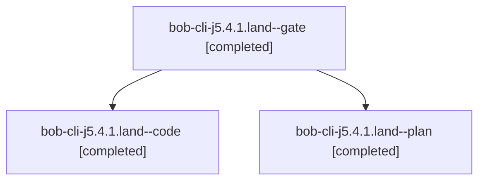

# Session: bob-cli-j5.4.1.land

[Agent Hoods](../README.md) / [bbugyi200](../users/bbugyi200/README.md) / [athena](../users/bbugyi200/machines/athena/README.md) / [bob-cli-j5](../users/bbugyi200/machines/athena/hoods/bob-cli-j5/README.md) / bob-cli-j5.4.1.land

Owner: `bbugyi200.athena` · Hood: `bob-cli-j5` · Members: 3 · Bead: [bob-cli-j5.4.1](https://github.com/bobs-org/bob-cli--beads/blob/main/pages/bob-cli-j5/bob-cli-j5.4.1.md)

## Lineage

The diagram is an optional enhancement; the ordered table below contains the same lineage in accessible text.

| Role | Agent | State | Model / provider | Timing | Commits | Prompt | Chat |
|---|---|---|---|---|---:|---|---|
| gate | bob-cli-j5.4.1.land--gate | completed | opus / claude | 2026-11-10T01:29:32.105471+00:00 → 2026-11-10T01:30:07.066033+00:00 | 0 | — | [Chat](../agents/bbugyi200.athena.bob-cli-j5.4.1.land--gate/chat.md) |
| code | bob-cli-j5.4.1.land--code | completed | gpt-6-luna / codex | 2026-11-10T01:30:44.752861+00:00 → 2026-11-10T03:25:18.490085+00:00 | [1](../agents/bbugyi200.athena.bob-cli-j5.4.1.land--code/README.md#commits) | — | [Chat](../agents/bbugyi200.athena.bob-cli-j5.4.1.land--code/chat.md) |
| plan | bob-cli-j5.4.1.land--plan | completed | opus / claude | 2026-11-10T00:55:11.075030+00:00 → 2026-11-10T03:25:18.490085+00:00 | [1](../agents/bbugyi200.athena.bob-cli-j5.4.1.land--plan/README.md#commits) | [Prompt](../agents/bbugyi200.athena.bob-cli-j5.4.1.land--plan/prompt.md) | [Chat](../agents/bbugyi200.athena.bob-cli-j5.4.1.land--plan/chat.md) |

## Commits

| Role | Repo | Commit | Subject | Committed |
|---|---|---|---|---|
| plan | bob-cli | [`eba2bd5`](https://github.com/bobs-org/bob-cli/commit/eba2bd59a6fa6fdf8e827adbda1d42c03d97519b) | test(archive): cover stats attribution and Git commit across archive renames | 2026-11-09 20:28:56 EST |
| code | bob-cli | [`d65be1c`](https://github.com/bobs-org/bob-cli/commit/d65be1ce02b66f9a08c6a31049990aa74cccca65) | perf(archive): cache pair facts for read-only consumers | 2026-11-09 22:24:11 EST |

## Neighbors

| Agent | Relation | State |
|---|---|---|
| [bob-cli-j5.4](bbugyi200.athena.bob-cli-j5.4.md) (session · 3) | ancestor | active 1, completed 2 |
| [bob-cli-j5.4.1.1](../agents/bbugyi200.athena.bob-cli-j5.4.1.1/README.md) | bob-cli-j5.4.1 hood | completed |
| [bob-cli-j5.4.1.2](bbugyi200.athena.bob-cli-j5.4.1.2.md) (session · 3) | bob-cli-j5.4.1 hood | completed 3 |
| [bob-cli-j5.4.1.3](../agents/bbugyi200.athena.bob-cli-j5.4.1.3/README.md) | bob-cli-j5.4.1 hood | completed |
| [bob-cli-j5.4.1.4](../agents/bbugyi200.athena.bob-cli-j5.4.1.4/README.md) | bob-cli-j5.4.1 hood | completed |
| [bob-cli-j5.4.1.5](../agents/bbugyi200.athena.bob-cli-j5.4.1.5/README.md) | bob-cli-j5.4.1 hood | completed |
| [bob-cli-j5.1](../agents/bbugyi200.athena.bob-cli-j5.1/README.md) | bob-cli-j5 hood | completed |
| [bob-cli-j5.2](bbugyi200.athena.bob-cli-j5.2.md) (session · 3) | bob-cli-j5 hood | active 1, completed 2 |
| [bob-cli-j5.2.1.1](bbugyi200.athena.bob-cli-j5.2.1.1.md) (session · 3) | bob-cli-j5 hood | completed 3 |
| [bob-cli-j5.2.1.2](../agents/bbugyi200.athena.bob-cli-j5.2.1.2/README.md) | bob-cli-j5 hood | completed |
| [bob-cli-j5.2.1.3](../agents/bbugyi200.athena.bob-cli-j5.2.1.3/README.md) | bob-cli-j5 hood | completed |
| [bob-cli-j5.2.1.land](bbugyi200.athena.bob-cli-j5.2.1.land.md) (session · 3) | bob-cli-j5 hood | completed 3 |
| [bob-cli-j5.3](../agents/bbugyi200.athena.bob-cli-j5.3/README.md) | bob-cli-j5 hood | completed |
| [bob-cli-j5.5](../agents/bbugyi200.athena.bob-cli-j5.5/README.md) | bob-cli-j5 hood | completed |
| [bob-cli-j5.6](../agents/bbugyi200.athena.bob-cli-j5.6/README.md) | bob-cli-j5 hood | completed |
| [bob-cli-j5.7](bbugyi200.athena.bob-cli-j5.7.md) (session · 3) | bob-cli-j5 hood | completed 3 |
| [bob-cli-j5.8](../agents/bbugyi200.athena.bob-cli-j5.8/README.md) | bob-cli-j5 hood | completed |
| [bob-cli-j5.land](bbugyi200.athena.bob-cli-j5.land.md) (session · 3) | bob-cli-j5 hood | completed 3 |
