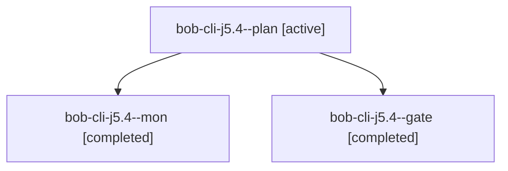

# Session: bob-cli-j5.4

[Agent Hoods](../README.md) / [bbugyi200](../users/bbugyi200/README.md) / [athena](../users/bbugyi200/machines/athena/README.md) / [bob-cli-j5](../users/bbugyi200/machines/athena/hoods/bob-cli-j5/README.md) / bob-cli-j5.4

Owner: `bbugyi200.athena` · Hood: `bob-cli-j5` · Members: 3 · Bead: [bob-cli-j5.4](https://github.com/bobs-org/bob-cli--beads/blob/main/pages/bob-cli-j5/bob-cli-j5.4.md)

## Lineage

The diagram is an optional enhancement; the ordered table below contains the same lineage in accessible text.

| Role | Agent | State | Model / provider | Timing | Commits | Prompt | Chat |
|---|---|---|---|---|---:|---|---|
| plan | bob-cli-j5.4--plan | active | gpt-6-astra / codex | 2026-11-09T21:35:04.682111+00:00 → 2026-11-09T21:44:34.904719+00:00 | 0 | [Prompt](../agents/bbugyi200.athena.bob-cli-j5.4--plan/prompt.md) | [Chat](../agents/bbugyi200.athena.bob-cli-j5.4--plan/chat.md) |
| mon | bob-cli-j5.4--mon | completed | gpt-6-astra / codex | 2026-11-09T21:44:27.888479+00:00 → 2026-11-09T21:47:13.876650+00:00 | 0 | — | [Chat](../agents/bbugyi200.athena.bob-cli-j5.4--mon/chat.md) |
| gate | bob-cli-j5.4--gate | completed | gpt-6-astra / codex | 2026-11-09T21:43:43.847766+00:00 → 2026-11-09T21:44:29.658623+00:00 | 0 | — | [Chat](../agents/bbugyi200.athena.bob-cli-j5.4--gate/chat.md) |

## Neighbors

| Agent | Relation | State |
|---|---|---|
| [bob-cli-j5.4.1.1](../agents/bbugyi200.athena.bob-cli-j5.4.1.1/README.md) | descendant | completed |
| [bob-cli-j5.4.1.2](bbugyi200.athena.bob-cli-j5.4.1.2.md) (session · 3) | descendant | completed 3 |
| [bob-cli-j5.4.1.3](../agents/bbugyi200.athena.bob-cli-j5.4.1.3/README.md) | descendant | completed |
| [bob-cli-j5.4.1.4](../agents/bbugyi200.athena.bob-cli-j5.4.1.4/README.md) | descendant | completed |
| [bob-cli-j5.4.1.5](../agents/bbugyi200.athena.bob-cli-j5.4.1.5/README.md) | descendant | completed |
| [bob-cli-j5.4.1.land](bbugyi200.athena.bob-cli-j5.4.1.land.md) (session · 3) | descendant | completed 3 |
| [bob-cli-j5.1](../agents/bbugyi200.athena.bob-cli-j5.1/README.md) | bob-cli-j5 hood | completed |
| [bob-cli-j5.2](bbugyi200.athena.bob-cli-j5.2.md) (session · 3) | bob-cli-j5 hood | active 1, completed 2 |
| [bob-cli-j5.2.1.1](bbugyi200.athena.bob-cli-j5.2.1.1.md) (session · 3) | bob-cli-j5 hood | completed 3 |
| [bob-cli-j5.2.1.2](../agents/bbugyi200.athena.bob-cli-j5.2.1.2/README.md) | bob-cli-j5 hood | completed |
| [bob-cli-j5.2.1.3](../agents/bbugyi200.athena.bob-cli-j5.2.1.3/README.md) | bob-cli-j5 hood | completed |
| [bob-cli-j5.2.1.land](bbugyi200.athena.bob-cli-j5.2.1.land.md) (session · 3) | bob-cli-j5 hood | completed 3 |
| [bob-cli-j5.3](../agents/bbugyi200.athena.bob-cli-j5.3/README.md) | bob-cli-j5 hood | completed |
| [bob-cli-j5.5](../agents/bbugyi200.athena.bob-cli-j5.5/README.md) | bob-cli-j5 hood | waiting |
| [bob-cli-j5.6](../agents/bbugyi200.athena.bob-cli-j5.6/README.md) | bob-cli-j5 hood | completed |
| [bob-cli-j5.7](../agents/bbugyi200.athena.bob-cli-j5.7/README.md) | bob-cli-j5 hood | waiting |
| [bob-cli-j5.8](../agents/bbugyi200.athena.bob-cli-j5.8/README.md) | bob-cli-j5 hood | waiting |
| [bob-cli-j5.land](../agents/bbugyi200.athena.bob-cli-j5.land/README.md) | bob-cli-j5 hood | waiting |
