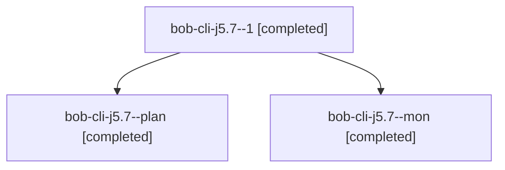

# Session: bob-cli-j5.7

[Agent Hoods](../README.md) / [bbugyi200](../users/bbugyi200/README.md) / [athena](../users/bbugyi200/machines/athena/README.md) / [bob-cli-j5](../users/bbugyi200/machines/athena/hoods/bob-cli-j5/README.md) / bob-cli-j5.7

Owner: `bbugyi200.athena` · Hood: `bob-cli-j5` · Members: 3 · Bead: [bob-cli-j5.7](https://github.com/bobs-org/bob-cli--beads/blob/main/pages/bob-cli-j5/bob-cli-j5.7.md)

## Lineage

The diagram is an optional enhancement; the ordered table below contains the same lineage in accessible text.

| Role | Agent | State | Model / provider | Timing | Commits | Prompt | Chat |
|---|---|---|---|---|---:|---|---|
| 1 | bob-cli-j5.7--1 | completed | grok-4.6 / grok | 2026-11-10T05:48:21.289105+00:00 → 2026-11-10T06:01:57.665354+00:00 | [1](../agents/bbugyi200.athena.bob-cli-j5.7--1/README.md#commits) | [Prompt](../agents/bbugyi200.athena.bob-cli-j5.7--1/prompt.md) | [Chat](../agents/bbugyi200.athena.bob-cli-j5.7--1/chat.md) |
| plan | bob-cli-j5.7--plan | completed | grok-4.6 / grok | 2026-11-10T05:07:00.117398+00:00 → 2026-11-10T05:42:37.647703+00:00 | 0 | [Prompt](../agents/bbugyi200.athena.bob-cli-j5.7--plan/prompt.md) | [Chat](../agents/bbugyi200.athena.bob-cli-j5.7--plan/chat.md) |
| mon | bob-cli-j5.7--mon | completed | grok-4.6 / grok | 2026-11-10T05:41:19.572844+00:00 → 2026-11-10T05:47:26.355023+00:00 | 0 | — | [Chat](../agents/bbugyi200.athena.bob-cli-j5.7--mon/chat.md) |

## Commits

| Role | Repo | Commit | Subject | Committed |
|---|---|---|---|---|
| 1 | — | `6a7afcd` | feat(archive): treat only top-level done/ as the archive | 2026-11-10 01:01:21 EST |

## Neighbors

| Agent | Relation | State |
|---|---|---|
| [bob-cli-j5.1](../agents/bbugyi200.athena.bob-cli-j5.1/README.md) | bob-cli-j5 hood | completed |
| [bob-cli-j5.2](bbugyi200.athena.bob-cli-j5.2.md) (session · 3) | bob-cli-j5 hood | completed 2, dismissed 1 |
| [bob-cli-j5.2.1.1](bbugyi200.athena.bob-cli-j5.2.1.1.md) (session · 3) | bob-cli-j5 hood | completed 3 |
| [bob-cli-j5.2.1.2](../agents/bbugyi200.athena.bob-cli-j5.2.1.2/README.md) | bob-cli-j5 hood | completed |
| [bob-cli-j5.2.1.3](../agents/bbugyi200.athena.bob-cli-j5.2.1.3/README.md) | bob-cli-j5 hood | completed |
| [bob-cli-j5.2.1.land](bbugyi200.athena.bob-cli-j5.2.1.land.md) (session · 3) | bob-cli-j5 hood | completed 3 |
| [bob-cli-j5.3](../agents/bbugyi200.athena.bob-cli-j5.3/README.md) | bob-cli-j5 hood | completed |
| [bob-cli-j5.4](bbugyi200.athena.bob-cli-j5.4.md) (session · 3) | bob-cli-j5 hood | completed 2, dismissed 1 |
| [bob-cli-j5.4.1.1](../agents/bbugyi200.athena.bob-cli-j5.4.1.1/README.md) | bob-cli-j5 hood | completed |
| [bob-cli-j5.4.1.2](bbugyi200.athena.bob-cli-j5.4.1.2.md) (session · 3) | bob-cli-j5 hood | completed 3 |
| [bob-cli-j5.4.1.3](../agents/bbugyi200.athena.bob-cli-j5.4.1.3/README.md) | bob-cli-j5 hood | completed |
| [bob-cli-j5.4.1.4](../agents/bbugyi200.athena.bob-cli-j5.4.1.4/README.md) | bob-cli-j5 hood | completed |
| [bob-cli-j5.4.1.5](../agents/bbugyi200.athena.bob-cli-j5.4.1.5/README.md) | bob-cli-j5 hood | completed |
| [bob-cli-j5.4.1.land](bbugyi200.athena.bob-cli-j5.4.1.land.md) (session · 3) | bob-cli-j5 hood | completed 3 |
| [bob-cli-j5.5](../agents/bbugyi200.athena.bob-cli-j5.5/README.md) | bob-cli-j5 hood | completed |
| [bob-cli-j5.6](../agents/bbugyi200.athena.bob-cli-j5.6/README.md) | bob-cli-j5 hood | completed |
| [bob-cli-j5.8](../agents/bbugyi200.athena.bob-cli-j5.8/README.md) | bob-cli-j5 hood | completed |
| [bob-cli-j5.land](bbugyi200.athena.bob-cli-j5.land.md) (session · 3) | bob-cli-j5 hood | completed 3 |
