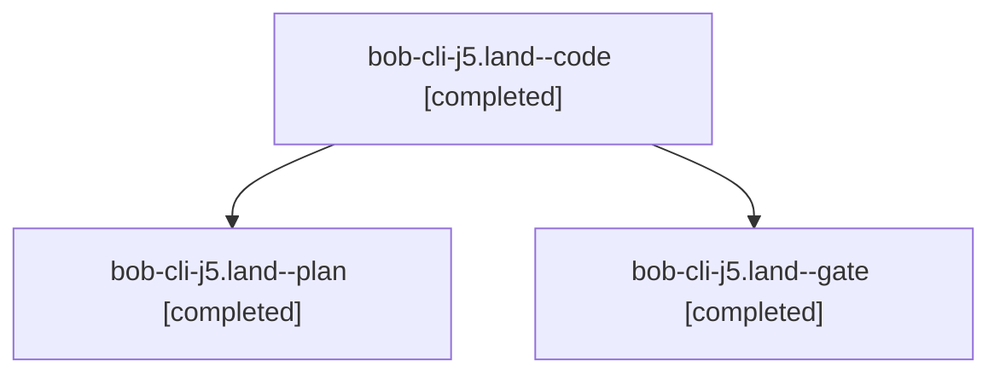

# Session: bob-cli-j5.land

[Agent Hoods](../README.md) / [bbugyi200](../users/bbugyi200/README.md) / [athena](../users/bbugyi200/machines/athena/README.md) / [bob-cli-j5](../users/bbugyi200/machines/athena/hoods/bob-cli-j5/README.md) / bob-cli-j5.land

Owner: `bbugyi200.athena` · Hood: `bob-cli-j5` · Members: 3 · Bead: [bob-cli-j5](https://github.com/bobs-org/bob-cli--beads/blob/main/pages/bob-cli-j5/README.md)

## Lineage

The diagram is an optional enhancement; the ordered table below contains the same lineage in accessible text.

| Role | Agent | State | Model / provider | Timing | Commits | Prompt | Chat |
|---|---|---|---|---|---:|---|---|
| code | bob-cli-j5.land--code | completed | gpt-6-luna / codex | 2026-11-10T06:57:11.722286+00:00 → 2026-11-10T07:35:17.700325+00:00 | [1](../agents/bbugyi200.athena.bob-cli-j5.land--code/README.md#commits) | — | [Chat](../agents/bbugyi200.athena.bob-cli-j5.land--code/chat.md) |
| plan | bob-cli-j5.land--plan | completed | opus / claude | 2026-11-10T06:19:52.146633+00:00 → 2026-11-10T07:35:17.700325+00:00 | 0 | [Prompt](../agents/bbugyi200.athena.bob-cli-j5.land--plan/prompt.md) | [Chat](../agents/bbugyi200.athena.bob-cli-j5.land--plan/chat.md) |
| gate | bob-cli-j5.land--gate | completed | opus / claude | 2026-11-10T06:56:10.599327+00:00 → 2026-11-10T06:56:36.246531+00:00 | 0 | — | [Chat](../agents/bbugyi200.athena.bob-cli-j5.land--gate/chat.md) |

## Commits

| Role | Repo | Commit | Subject | Committed |
|---|---|---|---|---|
| code | bob-cli | [`63ce765`](https://github.com/bobs-org/bob-cli/commit/63ce7653ad655251d2d44c2e48140dc135ca1565) | feat(archive)!: finish configurable keep-window behavior | 2026-11-10 02:34:09 EST |

## Neighbors

| Agent | Relation | State |
|---|---|---|
| [bob-cli-j5.1](../agents/bbugyi200.athena.bob-cli-j5.1/README.md) | bob-cli-j5 hood | completed |
| [bob-cli-j5.2](bbugyi200.athena.bob-cli-j5.2.md) (session · 3) | bob-cli-j5 hood | active 1, completed 2 |
| [bob-cli-j5.2.1.1](bbugyi200.athena.bob-cli-j5.2.1.1.md) (session · 3) | bob-cli-j5 hood | completed 3 |
| [bob-cli-j5.2.1.2](../agents/bbugyi200.athena.bob-cli-j5.2.1.2/README.md) | bob-cli-j5 hood | completed |
| [bob-cli-j5.2.1.3](../agents/bbugyi200.athena.bob-cli-j5.2.1.3/README.md) | bob-cli-j5 hood | completed |
| [bob-cli-j5.2.1.land](bbugyi200.athena.bob-cli-j5.2.1.land.md) (session · 3) | bob-cli-j5 hood | completed 3 |
| [bob-cli-j5.3](../agents/bbugyi200.athena.bob-cli-j5.3/README.md) | bob-cli-j5 hood | completed |
| [bob-cli-j5.4](bbugyi200.athena.bob-cli-j5.4.md) (session · 3) | bob-cli-j5 hood | active 1, completed 2 |
| [bob-cli-j5.4.1.1](../agents/bbugyi200.athena.bob-cli-j5.4.1.1/README.md) | bob-cli-j5 hood | completed |
| [bob-cli-j5.4.1.2](bbugyi200.athena.bob-cli-j5.4.1.2.md) (session · 3) | bob-cli-j5 hood | completed 3 |
| [bob-cli-j5.4.1.3](../agents/bbugyi200.athena.bob-cli-j5.4.1.3/README.md) | bob-cli-j5 hood | completed |
| [bob-cli-j5.4.1.4](../agents/bbugyi200.athena.bob-cli-j5.4.1.4/README.md) | bob-cli-j5 hood | completed |
| [bob-cli-j5.4.1.5](../agents/bbugyi200.athena.bob-cli-j5.4.1.5/README.md) | bob-cli-j5 hood | completed |
| [bob-cli-j5.4.1.land](bbugyi200.athena.bob-cli-j5.4.1.land.md) (session · 3) | bob-cli-j5 hood | completed 3 |
| [bob-cli-j5.5](../agents/bbugyi200.athena.bob-cli-j5.5/README.md) | bob-cli-j5 hood | completed |
| [bob-cli-j5.6](../agents/bbugyi200.athena.bob-cli-j5.6/README.md) | bob-cli-j5 hood | completed |
| [bob-cli-j5.7](bbugyi200.athena.bob-cli-j5.7.md) (session · 3) | bob-cli-j5 hood | completed 3 |
| [bob-cli-j5.8](../agents/bbugyi200.athena.bob-cli-j5.8/README.md) | bob-cli-j5 hood | completed |
