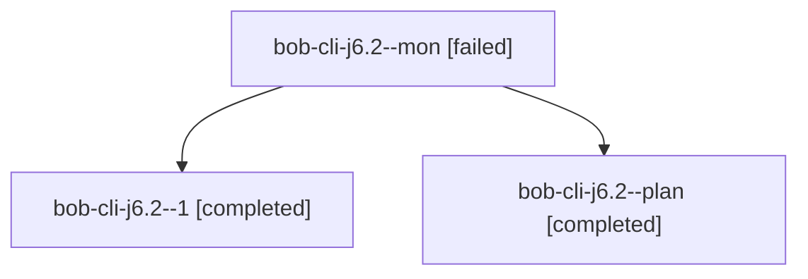

# Session: bob-cli-j6.2

[Agent Hoods](../README.md) / [bbugyi200](../users/bbugyi200/README.md) / [athena](../users/bbugyi200/machines/athena/README.md) / [bob-cli-j6](../users/bbugyi200/machines/athena/hoods/bob-cli-j6/README.md) / bob-cli-j6.2

Owner: `bbugyi200.athena` · Hood: `bob-cli-j6` · Members: 3 · Bead: [bob-cli-j6.2](https://github.com/bobs-org/bob-cli--beads/blob/main/pages/bob-cli-j6/bob-cli-j6.2.md)

## Lineage

The diagram is an optional enhancement; the ordered table below contains the same lineage in accessible text.

| Role | Agent | State | Model / provider | Timing | Commits | Prompt | Chat |
|---|---|---|---|---|---:|---|---|
| mon | bob-cli-j6.2--mon | failed | gpt-6-luna / codex | 2026-11-09T17:12:58.568203+00:00 → 2026-11-09T17:19:05.462427+00:00 | 0 | — | [Chat](../agents/bbugyi200.athena.bob-cli-j6.2--mon/chat.md) |
| 1 | bob-cli-j6.2--1 | completed | gpt-6-luna / codex | 2026-11-09T17:19:35.111626+00:00 → 2026-11-09T18:21:58.437375+00:00 | [1](../agents/bbugyi200.athena.bob-cli-j6.2--1/README.md#commits) | [Prompt](../agents/bbugyi200.athena.bob-cli-j6.2--1/prompt.md) | [Chat](../agents/bbugyi200.athena.bob-cli-j6.2--1/chat.md) |
| plan | bob-cli-j6.2--plan | completed | gpt-6-luna / codex | 2026-11-09T16:35:08.530135+00:00 → 2026-11-09T17:13:44.987502+00:00 | 0 | [Prompt](../agents/bbugyi200.athena.bob-cli-j6.2--plan/prompt.md) | [Chat](../agents/bbugyi200.athena.bob-cli-j6.2--plan/chat.md) |

## Commits

| Role | Repo | Commit | Subject | Committed |
|---|---|---|---|---|
| 1 | bob-cli | [`3c1b645`](https://github.com/bobs-org/bob-cli/commit/3c1b6451d49ea71b24c21cb33643c42977d191e5) | docs(glossary): describe capture modifier aliases | 2026-11-09 12:48:11 EST |

## Neighbors

| Agent | Relation | State |
|---|---|---|
| [bob-cli-j6.1](../agents/bbugyi200.athena.bob-cli-j6.1/README.md) | bob-cli-j6 hood | completed |
| [bob-cli-j6.land](bbugyi200.athena.bob-cli-j6.land.md) (session · 6) | bob-cli-j6 hood | active 1, completed 4, failed 1 |
