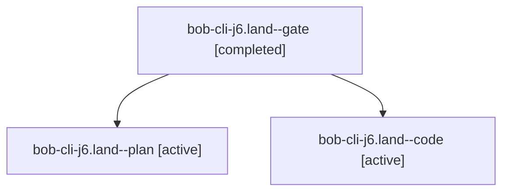

# Session: bob-cli-j6.land

[Agent Hoods](../README.md) / [bbugyi200](../users/bbugyi200/README.md) / [athena](../users/bbugyi200/machines/athena/README.md) / [bob-cli-j6](../users/bbugyi200/machines/athena/hoods/bob-cli-j6/README.md) / bob-cli-j6.land

Owner: `bbugyi200.athena` · Hood: `bob-cli-j6` · Members: 3 · Bead: [bob-cli-j6](https://github.com/bobs-org/bob-cli--beads/blob/main/pages/bob-cli-j6/README.md)

## Lineage

The diagram is an optional enhancement; the ordered table below contains the same lineage in accessible text.

| Role | Agent | State | Model / provider | Timing | Commits | Prompt | Chat |
|---|---|---|---|---|---:|---|---|
| gate | bob-cli-j6.land--gate | completed | gpt-6-astra / codex | 2026-11-09T18:34:16.970009+00:00 → 2026-11-09T18:34:49.314294+00:00 | 0 | — | [Chat](../agents/bbugyi200.athena.bob-cli-j6.land--gate/chat.md) |
| plan | bob-cli-j6.land--plan | active | gpt-6-astra / codex | 2026-11-09T18:24:25.120213+00:00 | 0 | [Prompt](../agents/bbugyi200.athena.bob-cli-j6.land--plan/prompt.md) | [Chat](../agents/bbugyi200.athena.bob-cli-j6.land--plan/chat.md) |
| code | bob-cli-j6.land--code | active | gpt-6-luna / codex | 2026-11-09T18:35:19.978405+00:00 | 0 | — | — |

## Neighbors

| Agent | Relation | State |
|---|---|---|
| [bob-cli-j6.1](../agents/bbugyi200.athena.bob-cli-j6.1/README.md) | bob-cli-j6 hood | completed |
| [bob-cli-j6.2](bbugyi200.athena.bob-cli-j6.2.md) (session · 3) | bob-cli-j6 hood | completed 2, failed 1 |
