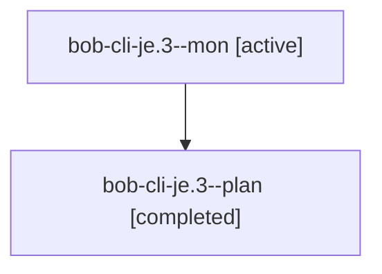

# Session: bob-cli-je.3

[Agent Hoods](../README.md) / [bbugyi200](../users/bbugyi200/README.md) / [athena](../users/bbugyi200/machines/athena/README.md) / [bob-cli-je](../users/bbugyi200/machines/athena/hoods/bob-cli-je/README.md) / bob-cli-je.3

Owner: `bbugyi200.athena` · Hood: `bob-cli-je` · Members: 2 · Bead: [bob-cli-je.3](https://github.com/bobs-org/bob-cli--beads/blob/main/pages/bob-cli-je/bob-cli-je.3.md)

## Lineage

The diagram is an optional enhancement; the ordered table below contains the same lineage in accessible text.

| Role | Agent | State | Model / provider | Timing | Commits | Prompt | Chat |
|---|---|---|---|---|---:|---|---|
| mon | bob-cli-je.3--mon | active | grok-4.6 / grok | 2026-11-10T00:00:16.734204+00:00 | 0 | — | — |
| plan | bob-cli-je.3--plan | completed | grok-4.6 / grok | 2026-11-09T23:45:43.425383+00:00 → 2026-11-10T00:01:17.245336+00:00 | 0 | [Prompt](../agents/bbugyi200.athena.bob-cli-je.3--plan/prompt.md) | [Chat](../agents/bbugyi200.athena.bob-cli-je.3--plan/chat.md) |

## Neighbors

| Agent | Relation | State |
|---|---|---|
| [bob-cli-je.1](../agents/bbugyi200.athena.bob-cli-je.1/README.md) | bob-cli-je hood | completed |
| [bob-cli-je.2](../agents/bbugyi200.athena.bob-cli-je.2/README.md) | bob-cli-je hood | completed |
| [bob-cli-je.land](../agents/bbugyi200.athena.bob-cli-je.land/README.md) | bob-cli-je hood | waiting |
