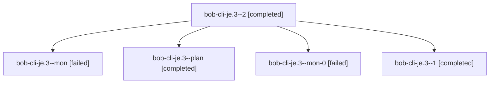

# Session: bob-cli-je.3

[Agent Hoods](../README.md) / [bbugyi200](../users/bbugyi200/README.md) / [athena](../users/bbugyi200/machines/athena/README.md) / [bob-cli-je](../users/bbugyi200/machines/athena/hoods/bob-cli-je/README.md) / bob-cli-je.3

Owner: `bbugyi200.athena` · Hood: `bob-cli-je` · Members: 5 · Bead: [bob-cli-je.3](https://github.com/bobs-org/bob-cli--beads/blob/main/pages/bob-cli-je/bob-cli-je.3.md)

## Lineage

The diagram is an optional enhancement; the ordered table below contains the same lineage in accessible text.

| Role | Agent | State | Model / provider | Timing | Commits | Prompt | Chat |
|---|---|---|---|---|---:|---|---|
| 2 | bob-cli-je.3--2 | completed | muse-spark-1.3-contributor / muse | 2026-11-10T00:15:07.292704+00:00 → 2026-11-10T00:21:49.111711+00:00 | 0 | [Prompt](../agents/bbugyi200.athena.bob-cli-je.3--2/prompt.md) | [Chat](../agents/bbugyi200.athena.bob-cli-je.3--2/chat.md) |
| mon | bob-cli-je.3--mon | failed | grok-4.6 / grok | 2026-11-10T00:00:16.734204+00:00 → 2026-11-10T00:03:06.299160+00:00 | 0 | — | [Chat](../agents/bbugyi200.athena.bob-cli-je.3--mon/chat.md) |
| plan | bob-cli-je.3--plan | completed | grok-4.6 / grok | 2026-11-09T23:45:43.425383+00:00 → 2026-11-10T00:01:17.245336+00:00 | 0 | [Prompt](../agents/bbugyi200.athena.bob-cli-je.3--plan/prompt.md) | [Chat](../agents/bbugyi200.athena.bob-cli-je.3--plan/chat.md) |
| mon-0 | bob-cli-je.3--mon-0 | failed | grok-4.6 / grok | 2026-11-10T00:06:27.218722+00:00 → 2026-11-10T00:14:02.089897+00:00 | 0 | — | [Chat](../agents/bbugyi200.athena.bob-cli-je.3--mon-0/chat.md) |
| 1 | bob-cli-je.3--1 | completed | grok-4.6 / grok | 2026-11-10T00:03:48.590997+00:00 → 2026-11-10T00:07:50.158537+00:00 | 0 | [Prompt](../agents/bbugyi200.athena.bob-cli-je.3--1/prompt.md) | [Chat](../agents/bbugyi200.athena.bob-cli-je.3--1/chat.md) |

## Neighbors

| Agent | Relation | State |
|---|---|---|
| [bob-cli-je.1](../agents/bbugyi200.athena.bob-cli-je.1/README.md) | bob-cli-je hood | completed |
| [bob-cli-je.2](../agents/bbugyi200.athena.bob-cli-je.2/README.md) | bob-cli-je hood | completed |
| [bob-cli-je.land](bbugyi200.athena.bob-cli-je.land.md) (session · 3) | bob-cli-je hood | completed 3 |
