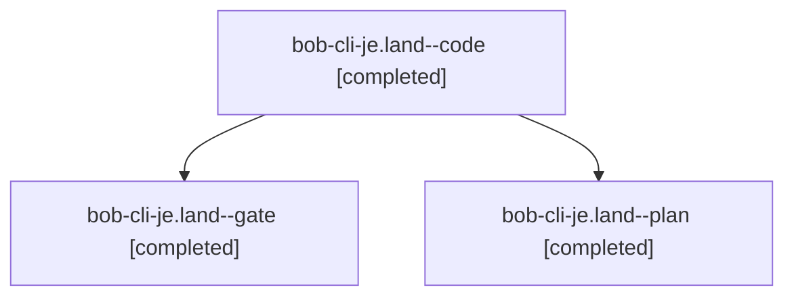

# Session: bob-cli-je.land

[Agent Hoods](../README.md) / [bbugyi200](../users/bbugyi200/README.md) / [athena](../users/bbugyi200/machines/athena/README.md) / [bob-cli-je](../users/bbugyi200/machines/athena/hoods/bob-cli-je/README.md) / bob-cli-je.land

Owner: `bbugyi200.athena` · Hood: `bob-cli-je` · Members: 3 · Bead: [bob-cli-je](https://github.com/bobs-org/bob-cli--beads/blob/main/pages/bob-cli-je/README.md)

## Lineage



The diagram is an optional enhancement; the ordered table below contains the same lineage in accessible text.

| Role | Agent | State | Model / provider | Timing | Commits | Prompt | Chat |
|---|---|---|---|---|---:|---|---|
| <a id="member-code"></a>code | bob-cli-je.land--code | completed | muse-spark-1.3-contributor / muse | 2026-11-10T00:38:53.521714+00:00 → 2026-11-10T01:20:18.368862+00:00 | [1](../agents/bbugyi200.athena.bob-cli-je.land--code/README.md#commits) | — | [Chat](../agents/bbugyi200.athena.bob-cli-je.land--code/chat.md) |
| <a id="member-gate"></a>gate | bob-cli-je.land--gate | completed | gpt-6-astra / codex | 2026-11-10T00:37:44.346814+00:00 → 2026-11-10T00:38:17.399346+00:00 | 0 | — | [Chat](../agents/bbugyi200.athena.bob-cli-je.land--gate/chat.md) |
| <a id="member-plan"></a>plan | bob-cli-je.land--plan | completed | gpt-6-astra / codex | 2026-11-10T00:22:41.172609+00:00 → 2026-11-10T01:20:18.368862+00:00 | 0 | [Prompt](../agents/bbugyi200.athena.bob-cli-je.land--plan/prompt.md) | [Chat](../agents/bbugyi200.athena.bob-cli-je.land--plan/chat.md) |

## Commits

| Role | Repo | Commit | Subject | Committed |
|---|---|---|---|---|
| code | bob-cli | [`6d063ff`](https://github.com/bobs-org/bob-cli/commit/6d063ff58f38b17d734528d54092dbc80b031b51) | fix(task-merge): preserve code text in merge copies and harden fence handling | 2026-11-09 20:18:50 EST |

## Variables

| Role | Variable | Value |
|---|---|---|
| plan | `artifacts` | \[{bead: bob-cli-je, kind: file, label: bob-cli-je landing: isolated plugin performance control, path: /home/bryan/.sase/artifacts/agents/gh\_bobs-org\_\_bob-cli/20261109180214/bob-je-plugin-perf-73db945… |

#### artifacts

**Role:** `plan`

```yaml
- bead: bob-cli-je
  kind: file
  label: bob-cli-je landing: isolated plugin performance control
  path: /home/bryan/.sase/artifacts/agents/gh_bobs-org__bob-cli/20261109180214/bob-je-plugin-perf-73db945af3b4.log
  ref: file:explicit:072da7bba40ac9881322bb16
  source_path: /tmp/bob-je-plugin-perf.log
- bead: bob-cli-je
  kind: file
  label: bob-cli-je landing: exact extracted sanitizer helper reproduction
  path: /home/bryan/.sase/artifacts/agents/gh_bobs-org__bob-cli/20261109180214/bob-je-helper-repro-37b579b5d583.rs
  ref: file:explicit:daae807d6d6751409db0db84
  source_path: /tmp/bob-je-helper-repro.rs
- bead: bob-cli-je
  kind: file
  label: bob-cli-je landing: inline-code and fence helper failures
  path: /home/bryan/.sase/artifacts/agents/gh_bobs-org__bob-cli/20261109180214/bob-je-helper-repro-2965764e5405.log
  ref: file:explicit:8f948c7f6873781d14e00111
  source_path: /tmp/bob-je-helper-repro.log
```

Values are truncated for display; see each member's agent meta.json for the full values.

## Neighbors

| Agent | Relation | State |
|---|---|---|
| [bob-cli-je.1](../agents/bbugyi200.athena.bob-cli-je.1/README.md) | bob-cli-je hood | completed |
| [bob-cli-je.2](../agents/bbugyi200.athena.bob-cli-je.2/README.md) | bob-cli-je hood | completed |
| [bob-cli-je.3](bbugyi200.athena.bob-cli-je.3.md) (session · 5) | bob-cli-je hood | completed 3, failed 2 |
