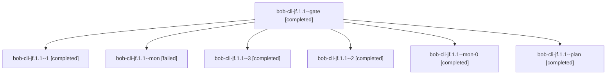

# Session: bob-cli-jf.1.1

[Agent Hoods](../README.md) / [bbugyi200](../users/bbugyi200/README.md) / [athena](../users/bbugyi200/machines/athena/README.md) / [bob-cli-jf](../users/bbugyi200/machines/athena/hoods/bob-cli-jf/README.md) / bob-cli-jf.1.1

Owner: `bbugyi200.athena` · Hood: `bob-cli-jf` · Members: 7 · Bead: [bob-cli-jf.1.1](https://github.com/bobs-org/bob-cli--beads/blob/main/pages/bob-cli-jf/bob-cli-jf.1.1.md)

## Lineage



The diagram is an optional enhancement; the ordered table below contains the same lineage in accessible text.

| Role | Agent | State | Model / provider | Timing | Commits | Prompt | Chat |
|---|---|---|---|---|---:|---|---|
| <a id="member-gate"></a>gate | bob-cli-jf.1.1--gate | completed | gpt-6-astra / codex | 2026-11-10T12:09:19.361023+00:00 → 2026-11-10T12:10:59.405269+00:00 | 0 | — | [Chat](../agents/bbugyi200.athena.bob-cli-jf.1.1--gate/chat.md) |
| <a id="member-1"></a>1 | bob-cli-jf.1.1--1 | completed | gpt-6-astra / codex | 2026-11-10T12:12:42.595661+00:00 → 2026-11-10T12:18:47.316092+00:00 | 0 | [Prompt](../agents/bbugyi200.athena.bob-cli-jf.1.1--1/prompt.md) | [Chat](../agents/bbugyi200.athena.bob-cli-jf.1.1--1/chat.md) |
| <a id="member-mon"></a>mon | bob-cli-jf.1.1--mon | failed | gpt-6-astra / codex | 2026-11-10T12:18:18.210562+00:00 → 2026-11-10T12:34:21.627505+00:00 | 0 | — | [Chat](../agents/bbugyi200.athena.bob-cli-jf.1.1--mon/chat.md) |
| <a id="member-3"></a>3 | bob-cli-jf.1.1--3 | completed | gpt-6-astra / codex | 2026-11-10T12:55:37.011762+00:00 → 2026-11-10T13:01:08.684379+00:00 | 0 | [Prompt](../agents/bbugyi200.athena.bob-cli-jf.1.1--3/prompt.md) | [Chat](../agents/bbugyi200.athena.bob-cli-jf.1.1--3/chat.md) |
| <a id="member-2"></a>2 | bob-cli-jf.1.1--2 | completed | gpt-6-astra / codex | 2026-11-10T12:35:22.050584+00:00 → 2026-11-10T12:41:26.942331+00:00 | 0 | [Prompt](../agents/bbugyi200.athena.bob-cli-jf.1.1--2/prompt.md) | [Chat](../agents/bbugyi200.athena.bob-cli-jf.1.1--2/chat.md) |
| <a id="member-mon-0"></a>mon-0 | bob-cli-jf.1.1--mon-0 | completed | gpt-6-astra / codex | 2026-11-10T12:40:54.253009+00:00 → 2026-11-10T12:55:30.444022+00:00 | 0 | — | [Chat](../agents/bbugyi200.athena.bob-cli-jf.1.1--mon-0/chat.md) |
| <a id="member-plan"></a>plan | bob-cli-jf.1.1--plan | completed | gpt-6-astra / codex | 2026-11-10T11:55:25.389677+00:00 → 2026-11-10T12:07:22.780951+00:00 | 0 | [Prompt](../agents/bbugyi200.athena.bob-cli-jf.1.1--plan/prompt.md) | [Chat](../agents/bbugyi200.athena.bob-cli-jf.1.1--plan/chat.md) |

## Variables

| Role | Variable | Value |
|---|---|---|
| 2 | `artifacts` | \[{bead: bob-cli-jf.1.1, kind: file, label: Restoration docs and CI failure assessment, path: /home/bryan/.sase/artifacts/agents/gh\_bobs-org\_\_bob-cli/20261110073321/failure-assessment-2a769367c212.jso… |
| 3 | `artifacts` | \[{bead: bob-cli-jf.1.1, kind: file, label: bob-cli-jf.1.1 restored descendant green CI and closure evidence, path: /home/bryan/.sase/artifacts/agents/gh\_bobs-org\_\_bob-cli/20261110075351/restoration-c… |

#### artifacts

**Role:** `2`

```yaml
- bead: bob-cli-jf.1.1
  kind: file
  label: Restoration docs and CI failure assessment
  path: /home/bryan/.sase/artifacts/agents/gh_bobs-org__bob-cli/20261110073321/failure-assessment-2a769367c212.json
  ref: file:explicit:9c06ef579a77645b1ef8134e
  source_path: /tmp/bob-cli-jf-restore-verify/failure-assessment.json
```

#### artifacts

**Role:** `3`

```yaml
- bead: bob-cli-jf.1.1
  kind: file
  label: bob-cli-jf.1.1 restored descendant green CI and closure evidence
  path: /home/bryan/.sase/artifacts/agents/gh_bobs-org__bob-cli/20261110075351/restoration-completion-784bc911de64.json
  ref: file:explicit:56505b5871a0c00d9ec89aa2
  source_path: /tmp/bob-cli-jf-restore-verify/restoration-completion.json
```

Values are truncated for display; see each member's agent meta.json for the full values.

## Neighbors

| Agent | Relation | State |
|---|---|---|
| [bob-cli-jf](bbugyi200.athena.bob-cli-jf.md) (session · 3) | ancestor | completed 3 |
| [bob-cli-jf.1.2](../agents/bbugyi200.athena.bob-cli-jf.1.2/README.md) | bob-cli-jf.1 hood | completed |
| [bob-cli-jf.1.land](../agents/bbugyi200.athena.bob-cli-jf.1.land/README.md) | bob-cli-jf.1 hood | completed |
