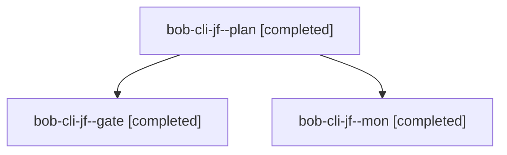

# Session: bob-cli-jf

[Agent Hoods](../README.md) / [bbugyi200](../users/bbugyi200/README.md) / [athena](../users/bbugyi200/machines/athena/README.md) / [bob-cli-jf](../users/bbugyi200/machines/athena/hoods/bob-cli-jf/README.md) / bob-cli-jf

Owner: `bbugyi200.athena` · Hood: `bob-cli-jf` · Members: 3 · Bead: [bob-cli-jf](https://github.com/bobs-org/bob-cli--beads/blob/main/pages/bob-cli-jf/README.md)

## Lineage

The diagram is an optional enhancement; the ordered table below contains the same lineage in accessible text.

| Role | Agent | State | Model / provider | Timing | Commits | Prompt | Chat |
|---|---|---|---|---|---:|---|---|
| plan | bob-cli-jf--plan | completed | opus / claude | 2026-11-10T11:36:13.322780+00:00 → 2026-11-10T11:46:42.958861+00:00 | 0 | [Prompt](../agents/bbugyi200.athena.bob-cli-jf--plan/prompt.md) | [Chat](../agents/bbugyi200.athena.bob-cli-jf--plan/chat.md) |
| gate | bob-cli-jf--gate | completed | opus / claude | 2026-11-10T11:47:26.502238+00:00 → 2026-11-10T11:47:58.462792+00:00 | 0 | — | [Chat](../agents/bbugyi200.athena.bob-cli-jf--gate/chat.md) |
| mon | bob-cli-jf--mon | completed | opus / claude | 2026-11-10T11:47:53.774830+00:00 → 2026-11-10T11:50:10.701729+00:00 | 0 | — | [Chat](../agents/bbugyi200.athena.bob-cli-jf--mon/chat.md) |

## Neighbors

| Agent | Relation | State |
|---|---|---|
| [bob-cli-jf.1.1](bbugyi200.athena.bob-cli-jf.1.1.md) (session · 7) | descendant | completed 6, failed 1 |
| [bob-cli-jf.1.2](../agents/bbugyi200.athena.bob-cli-jf.1.2/README.md) | descendant | completed |
| [bob-cli-jf.1.land](../agents/bbugyi200.athena.bob-cli-jf.1.land/README.md) | descendant | completed |
