# Session: bob-cli-jt.2

[Agent Hoods](../README.md) / [bbugyi200](../users/bbugyi200/README.md) / [athena](../users/bbugyi200/machines/athena/README.md) / [bob-cli-jt](../users/bbugyi200/machines/athena/hoods/bob-cli-jt/README.md) / bob-cli-jt.2

Owner: `bbugyi200.athena` · Hood: `bob-cli-jt` · Members: 13 · Bead: [bob-cli-jt.2](https://github.com/bobs-org/bob-cli--beads/blob/main/pages/bob-cli-jt/bob-cli-jt.2.md)

## Lineage

```mermaid
flowchart TD
  n0["bob-cli-jt.2--mon [failed]"]
  n1["bob-cli-jt.2--1 [completed]"]
  n0 --> n1
  n2["bob-cli-jt.2--mon-0 [failed]"]
  n0 --> n2
  n3["bob-cli-jt.2--mon-3 [failed]"]
  n0 --> n3
  n4["bob-cli-jt.2--mon-4 [failed]"]
  n0 --> n4
  n5["bob-cli-jt.2--4 [completed]"]
  n0 --> n5
  n6["bob-cli-jt.2--mon-2 [failed]"]
  n0 --> n6
  n7["bob-cli-jt.2--5 [completed]"]
  n0 --> n7
  n8["bob-cli-jt.2--3 [completed]"]
  n0 --> n8
  n9["bob-cli-jt.2--mon-1 [completed]"]
  n0 --> n9
  n10["bob-cli-jt.2--6 [completed]"]
  n0 --> n10
  n11["bob-cli-jt.2--plan [completed]"]
  n0 --> n11
  n12["bob-cli-jt.2--2 [completed]"]
  n0 --> n12
```

The diagram is an optional enhancement; the ordered table below contains the same lineage in accessible text.

| Role | Agent | State | Model / provider | Timing | Commits | Prompt | Chat |
|---|---|---|---|---|---:|---|---|
| mon | bob-cli-jt.2--mon | failed | gpt-6-luna / codex | 2026-11-10T21:29:29.257466+00:00 → 2026-11-10T21:51:12.213693+00:00 | 0 | — | [Chat](../agents/bbugyi200.athena.bob-cli-jt.2--mon/chat.md) |
| 1 | bob-cli-jt.2--1 | completed | gpt-6-luna / codex | 2026-11-10T21:52:08.122776+00:00 → 2026-11-10T22:02:59.732622+00:00 | 0 | [Prompt](../agents/bbugyi200.athena.bob-cli-jt.2--1/prompt.md) | [Chat](../agents/bbugyi200.athena.bob-cli-jt.2--1/chat.md) |
| mon-0 | bob-cli-jt.2--mon-0 | failed | gpt-6-luna / codex | 2026-11-10T22:01:24.409832+00:00 → 2026-11-10T22:23:55.056329+00:00 | 0 | — | [Chat](../agents/bbugyi200.athena.bob-cli-jt.2--mon-0/chat.md) |
| mon-3 | bob-cli-jt.2--mon-3 | failed | gpt-6-luna / codex | 2026-11-10T23:07:57.843578+00:00 → 2026-11-10T23:30:12.154856+00:00 | 0 | — | [Chat](../agents/bbugyi200.athena.bob-cli-jt.2--mon-3/chat.md) |
| mon-4 | bob-cli-jt.2--mon-4 | failed | gpt-6-luna / codex | 2026-11-10T23:37:57.974456+00:00 → 2026-11-10T23:57:56.149366+00:00 | 0 | — | [Chat](../agents/bbugyi200.athena.bob-cli-jt.2--mon-4/chat.md) |
| 4 | bob-cli-jt.2--4 | completed | gpt-6-luna / codex | 2026-11-10T22:58:22.256073+00:00 → 2026-11-10T23:08:42.026478+00:00 | 0 | [Prompt](../agents/bbugyi200.athena.bob-cli-jt.2--4/prompt.md) | [Chat](../agents/bbugyi200.athena.bob-cli-jt.2--4/chat.md) |
| mon-2 | bob-cli-jt.2--mon-2 | failed | gpt-6-luna / codex | 2026-11-10T22:40:44.910230+00:00 → 2026-11-10T22:57:28.928644+00:00 | 0 | — | [Chat](../agents/bbugyi200.athena.bob-cli-jt.2--mon-2/chat.md) |
| 5 | bob-cli-jt.2--5 | completed | gpt-6-luna / codex | 2026-11-10T23:31:08.716180+00:00 → 2026-11-10T23:38:42.370941+00:00 | 0 | [Prompt](../agents/bbugyi200.athena.bob-cli-jt.2--5/prompt.md) | [Chat](../agents/bbugyi200.athena.bob-cli-jt.2--5/chat.md) |
| 3 | bob-cli-jt.2--3 | completed | gpt-6-luna / codex | 2026-11-10T22:38:48.892252+00:00 → 2026-11-10T22:41:25.437753+00:00 | 0 | [Prompt](../agents/bbugyi200.athena.bob-cli-jt.2--3/prompt.md) | [Chat](../agents/bbugyi200.athena.bob-cli-jt.2--3/chat.md) |
| mon-1 | bob-cli-jt.2--mon-1 | completed | gpt-6-luna / codex | 2026-11-10T22:32:40.281815+00:00 → 2026-11-10T22:37:56.597919+00:00 | 0 | — | [Chat](../agents/bbugyi200.athena.bob-cli-jt.2--mon-1/chat.md) |
| 6 | bob-cli-jt.2--6 | completed | gpt-6-luna / codex | 2026-11-10T23:58:48.080529+00:00 → 2026-11-11T00:04:15.817333+00:00 | 0 | [Prompt](../agents/bbugyi200.athena.bob-cli-jt.2--6/prompt.md) | [Chat](../agents/bbugyi200.athena.bob-cli-jt.2--6/chat.md) |
| plan | bob-cli-jt.2--plan | completed | gpt-6-luna / codex | 2026-11-10T20:47:50.022029+00:00 → 2026-11-10T21:31:08.422923+00:00 | 0 | [Prompt](../agents/bbugyi200.athena.bob-cli-jt.2--plan/prompt.md) | [Chat](../agents/bbugyi200.athena.bob-cli-jt.2--plan/chat.md) |
| 2 | bob-cli-jt.2--2 | completed | gpt-6-luna / codex | 2026-11-10T22:24:51.993321+00:00 → 2026-11-10T22:34:16.733281+00:00 | 0 | [Prompt](../agents/bbugyi200.athena.bob-cli-jt.2--2/prompt.md) | [Chat](../agents/bbugyi200.athena.bob-cli-jt.2--2/chat.md) |

## Neighbors

| Agent | Relation | State |
|---|---|---|
| [bob-cli-jt.1](../agents/bbugyi200.athena.bob-cli-jt.1/README.md) | bob-cli-jt hood | completed |
| [bob-cli-jt.land](bbugyi200.athena.bob-cli-jt.land.md) (session · 3) | bob-cli-jt hood | active 2, completed 1 |
