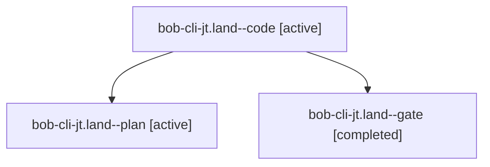

# Session: bob-cli-jt.land

[Agent Hoods](../README.md) / [bbugyi200](../users/bbugyi200/README.md) / [athena](../users/bbugyi200/machines/athena/README.md) / [bob-cli-jt](../users/bbugyi200/machines/athena/hoods/bob-cli-jt/README.md) / bob-cli-jt.land

Owner: `bbugyi200.athena` · Hood: `bob-cli-jt` · Members: 3 · Bead: [bob-cli-jt](https://github.com/bobs-org/bob-cli--beads/blob/main/pages/bob-cli-jt/README.md)

## Lineage



The diagram is an optional enhancement; the ordered table below contains the same lineage in accessible text.

| Role | Agent | State | Model / provider | Timing | Commits | Prompt | Chat |
|---|---|---|---|---|---:|---|---|
| <a id="member-code"></a>code | bob-cli-jt.land--code | active | grok-4.6 / grok | 2026-11-11T00:19:32.639014+00:00 | 0 | — | — |
| <a id="member-plan"></a>plan | bob-cli-jt.land--plan | active | gpt-6-astra / codex | 2026-11-11T00:04:37.857514+00:00 | 0 | [Prompt](../agents/bbugyi200.athena.bob-cli-jt.land--plan/prompt.md) | [Chat](../agents/bbugyi200.athena.bob-cli-jt.land--plan/chat.md) |
| <a id="member-gate"></a>gate | bob-cli-jt.land--gate | completed | gpt-6-astra / codex | 2026-11-11T00:18:37.629076+00:00 → 2026-11-11T00:19:02.546075+00:00 | 0 | — | [Chat](../agents/bbugyi200.athena.bob-cli-jt.land--gate/chat.md) |

## Variables

| Role | Variable | Value |
|---|---|---|
| plan | `artifacts` | \[{bead: bob-cli-jt, kind: file, label: bob-cli-jt landing verification and follow-up evidence, path: /home/bryan/.sase/artifacts/agents/gh\_bobs-org\_\_bob-cli/20261110150646/jt-land-evidence-a6138dc138… |

#### artifacts

**Role:** `plan`

```yaml
- bead: bob-cli-jt
  kind: file
  label: bob-cli-jt landing verification and follow-up evidence
  path: /home/bryan/.sase/artifacts/agents/gh_bobs-org__bob-cli/20261110150646/jt-land-evidence-a6138dc138b9.txt
  ref: file:explicit:5d919abc2555b8f911456244
  source_path: /tmp/jt-land-evidence.txt
- bead: bob-cli-jt
  kind: file
  label: bob-cli-jt completed just check results
  path: /home/bryan/.sase/artifacts/agents/gh_bobs-org__bob-cli/20261110150646/jt-check-evidence-438fa5375ac5.txt
  ref: file:explicit:a7ca20870803705cc70efee4
  source_path: /tmp/jt-check-evidence.txt
```

Values are truncated for display; see each member's agent meta.json for the full values.

## Neighbors

| Agent | Relation | State |
|---|---|---|
| [bob-cli-jt.1](../agents/bbugyi200.athena.bob-cli-jt.1/README.md) | bob-cli-jt hood | completed |
| [bob-cli-jt.2](bbugyi200.athena.bob-cli-jt.2.md) (session · 13) | bob-cli-jt hood | completed 8, failed 5 |
